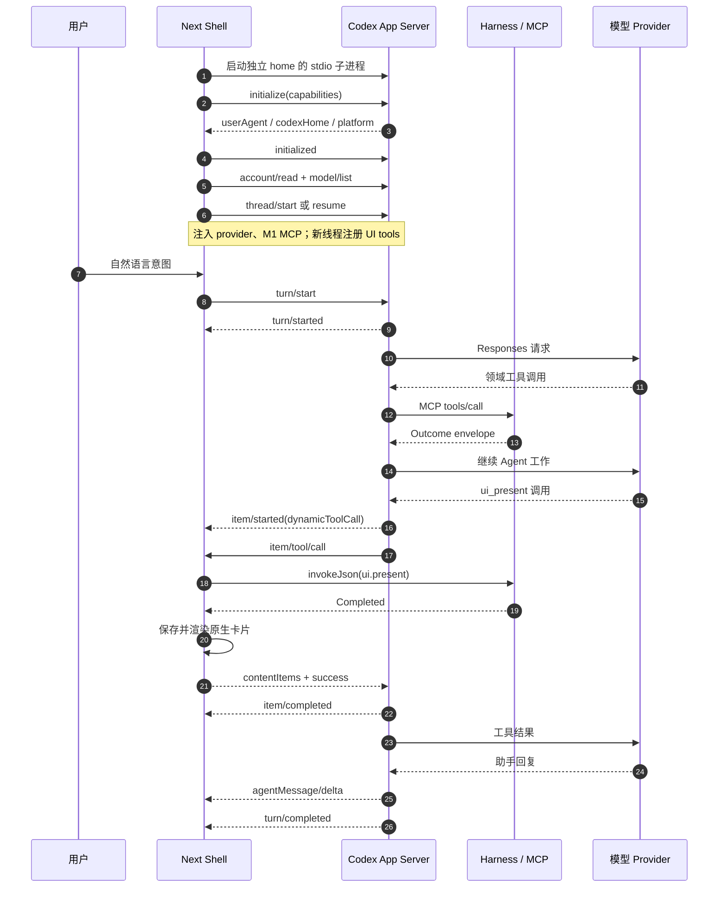
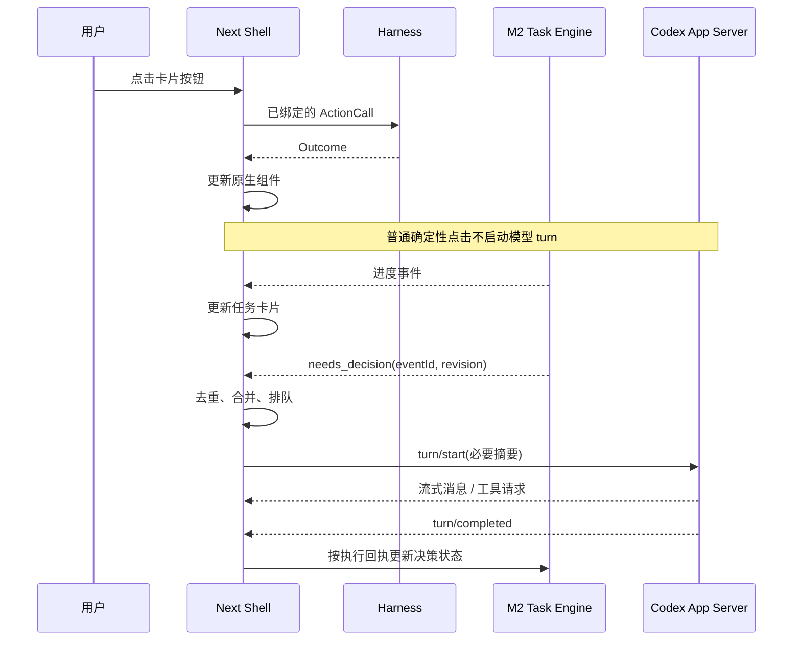

# Codex App Server 调研：NipaPlay Next M3

> 调研日期：2026-10-10  
> 实测版本：`codex-cli 0.144.1`  
> 实测平台：macOS 26.7、arm64  
> 范围：协议、工具接入、认证、桌面嵌入及 M3 映射。所有实验文件均位于 `/tmp`，调研过程没有创建或修改仓库文件。

## 1. 结论与证据范围

**M3 可以使用 Codex App Server 作为桌面端 Agent 运行时。** 本机已验证：启动子进程、初始化、创建线程、流式回复、动态工具往返、按线程注入 MCP 和模型 provider、重启恢复线程，以及中断等待工具结果的 turn。Agent Loop 由 App Server 执行，NipaPlay 负责协议客户端、Harness 调用、原生组件渲染、审批和任务调度。【实测 T1—T4】

建议 M3 采用：

- **stdio 子进程连接**，固定运行时版本。
- **独立 `CODEX_HOME`**，与用户安装的 Codex 分开管理状态。
- **领域 Action 继续走 M1 MCP**；`ui.present`、`ui.layout.patch` 优先走 dynamicTools。
- **原生按钮直接执行 Harness `ActionCall`**。
- **任务引擎只在需要判断时启动 turn**。
- **宿主保存卡片、布局及执行回执**，不要只依赖 Codex 的历史重建 UI。

以上是架构建议，依据为已验证的协议能力及 [DESIGN.md](../DESIGN.md) 的 Harness、Effect 和 `NeedsDecision` 契约。

两个必须进入 M3 设计的事实：

1. **`sandbox: "read-only"` 不等于“只能读取工作区”。** 本机运行时在此模式下成功读取了工作区外的临时文件。凭据保护不能只靠 `cwd` 和这个开关。【实测 T7】
2. **dynamicTools 是实验 API。** 未声明 `capabilities.experimentalApi: true` 时，`thread/start.dynamicTools` 被拒绝。【实测 T2；生成 Schema S1；文档 D1】

### 1.1 来源标记

| 标记 | 来源 |
|---|---|
| T1 | 本机 CLI 帮助、stdio/WebSocket/Unix socket 初始化及 proxy 实验 |
| T2 | 本地模拟 Responses 服务驱动的 dynamicTools 完整往返 |
| T3 | 按线程注入 provider、MCP、`outputSchema` 和 AGENTS 指令实验 |
| T4 | 子进程关闭、重启、`thread/resume`、恢复工具及 interrupt 实验 |
| T5 | 项目信任及 `.codex/config.toml` 加载实验 |
| T6 | 假 API key 的登录状态、注销；命令审批及 MCP 工具审批实验 |
| T7 | read-only 模式读取工作区外文件实验 |
| S1 | 0.144.1 生成的 JSON Schema，分别包含默认版和 `--experimental` 版 |
| S2 | 0.144.1 生成的实验版 TypeScript 协议类型 |
| D1 | [0.144.1 App Server README](https://github.com/openai/codex/blob/rust-v0.144.1/codex-rs/app-server/README.md) |
| D2 | [官方 App Server 文档](https://developers.openai.com/codex/app-server/) |
| D3 | [高级配置](https://learn.chatgpt.com/docs/config-file/config-advanced)、[环境变量](https://learn.chatgpt.com/docs/config-file/environment-variables) |
| D4 | [0.144.1 官方发行包](https://github.com/openai/codex/releases/tag/rust-v0.144.1) |
| D5 | [LICENSE](https://github.com/openai/codex/blob/rust-v0.144.1/LICENSE)、[NOTICE](https://github.com/openai/codex/blob/rust-v0.144.1/NOTICE) |
| D6 | [0.144.1 provider 实现](https://github.com/openai/codex/blob/rust-v0.144.1/codex-rs/model-provider-info/src/lib.rs) |
| D7 | [0.144.1 凭据存储实现](https://github.com/openai/codex/blob/rust-v0.144.1/codex-rs/login/src/auth/storage.rs) |

**实验边界：**模型往返使用本地模拟 Responses SSE 服务，没有向真实模型发送请求；API key 实验使用假值，没有验证真实账号权限。ChatGPT OAuth、DeepSeek 服务、Windows/Linux 执行、移动端执行和签名安装没有实测，对这些内容只引用文档或明确保留结论。

官方文档会更新。字段和方法以本机 **0.144.1 生成协议**为准，版本行为优先参考 D1，不直接套用当前网页新增的命令选项。

## 2. 背景基线

[DESIGN.md](../DESIGN.md) 定义：ActionSpec 是领域契约的唯一事实来源，GUI 和 Agent 通过同一个 Harness 执行能力；`NeedsDecision` 的选项携带可直接执行的 `ActionCall`；副作用由宿主强制检查，`AGENTS.md` 不构成安全边界。【来源：仓库设计文档】

[M1_TASKBOOK.md](../M1_TASKBOOK.md) 末尾验收记录已证明外部 Codex 能通过本机 MCP 查询观看记录、续播和暂停。其发现包括：项目配置需要持久化信任，回环 MCP 访问需要考虑代理。本次没有重复操作真实播放器。【来源：仓库 M1 验收记录】

M3 新增的是 **NipaPlay 自己的协议客户端和原生首页**。M1 的 Harness 与 MCP 能力接口可以继续使用。【架构建议，依据：仓库设计文档；T3】

## 3. 协议

### 3.1 传输方式

App Server 使用双向 JSON-RPC 2.0 风格消息，线上消息省略 `"jsonrpc": "2.0"`。它与 M1 MCP 是两个不同协议连接。【文档 D1、D2；实测 T1】

| 传输 | 启动方式 | 帧格式与验证结果 | 来源 |
|---|---|---|---|
| stdio | `codex app-server`、`--stdio` 或 `--listen stdio://` | UTF-8 JSONL，每行一个消息；初始化成功 | T1；D1 |
| TCP WebSocket | `--listen ws://127.0.0.1:PORT` | HTTP Upgrade 后，每个文本帧一个消息；初始化成功 | T1；D1 |
| Unix socket | `--listen unix://PATH` | **WebSocket over Unix socket**，需要 HTTP Upgrade；初始化成功 | T1；D1 |
| 默认 Unix socket | `--listen unix://` | 默认路径为 `$CODEX_HOME/app-server-control/app-server-control.sock` | D1 |
| 无本地接口 | `--listen off` | 不暴露本地 transport | CLI 帮助；D1 |

`codex app-server proxy --sock PATH` 透传原始字节，**不会把 JSONL 转换成 WebSocket**。客户端仍须发送 Upgrade 和 WebSocket 帧；按此方式实验成功。【实测 T1；文档 D1】

WebSocket 在 0.144.1 README 中明确标为 experimental/unsupported。CLI 提供 capability-token 和 signed-bearer-token 鉴权选项。【CLI 帮助；文档 D1】

**M3 建议：stdio。**它适合宿主拥有的子进程，避免端口、socket 路径和额外 WebSocket 实现。daemon 与 proxy 不需要进入最小实现。【架构建议，依据：T1】

### 3.2 initialize 与 capabilities

每条连接先发 `initialize`，收到响应后发 `initialized` 通知。【文档 D1、D2】

```json
{
  "id": 1,
  "method": "initialize",
  "params": {
    "clientInfo": {
      "name": "nipaplay_next",
      "title": "NipaPlay Next",
      "version": "0.1.0"
    },
    "capabilities": {
      "experimentalApi": true,
      "requestAttestation": false
    }
  }
}
```

```json
{"method":"initialized","params":{}}
```

`clientInfo` 是必填字段；JSON Schema 中 `capabilities` 可省略。capabilities 包含：

| 字段 | 含义 | 来源 |
|---|---|---|
| `experimentalApi` | 允许实验方法和字段；默认 false | S1；T2 |
| `requestAttestation` | 允许服务端请求宿主提供 attestation；默认 false | S1；D1 |
| `mcpServerOpenaiFormElicitation` | 允许下游 MCP 的 OpenAI 扩展表单 | S1；D1 |
| `optOutNotificationMethods` | 按完整方法名抑制通知；不支持通配符 | S1；D1 |

初始化响应包含 `userAgent`、`codexHome`、`platformFamily` 和 `platformOs`。本机返回 `unix`、`macos`，并返回隔离后的 Codex home。【生成 Schema：`InitializeResponse`；实测 T1】

未初始化请求返回 `-32600 / Not initialized`；重复初始化返回 `-32600 / Already initialized`。【实测 T1】

**M3 建议：**使用 dynamicTools 时启用 `experimentalApi`；没有 attestation 提供能力时保持 `requestAttestation: false`。握手应按响应推进，不能靠固定延时。【架构建议，依据：T1、T2；D1】

### 3.3 thread、turn 与 item

- **Thread** 是对话，包含多个 turn。
- **Turn** 是一次输入及运行时随后完成的 Agent 工作，可以包含多次模型请求和工具调用。
- **Item** 是消息、工具调用、命令执行等输入或输出单元。【文档 D1、D2】

| 方法 | 作用 | 来源 |
|---|---|---|
| `thread/start` | 创建并加载线程，订阅其事件 | S2；T2 |
| `thread/resume` | 加载已有线程，供后续 turn 继续使用 | S2；T4 |
| `thread/fork` | 从已有历史创建新线程 | S2；D1 |
| `thread/read` | 读取历史；本身不恢复运行线程 | S2；D1 |
| `thread/list` | 分页列出持久化线程 | S2；D1 |
| `thread/archive` / `thread/unarchive` | 归档、取消归档 | S2；D1 |
| `thread/unsubscribe` | 取消当前客户端对线程的订阅 | S2；D1 |
| `turn/start` | 开始一次 Agent 工作 | S2；T2 |
| `turn/steer` | 给活动 turn 追加输入 | S2；D1 |
| `turn/interrupt` | 中断指定 turn | S2；T4 |

`turn/start` 的基本输入：

```json
{
  "id": 20,
  "method": "turn/start",
  "params": {
    "threadId": "<threadId>",
    "input": [
      {"type":"text","text":"继续播放我最近看的作品"}
    ]
  }
}
```

返回的 turn 可以是 `inProgress` 且 `items: []`、`itemsView: "notLoaded"`；这不表示没有执行内容。内容通过事件或历史读取获得。【实测 T2；生成 Schema：`Turn`】

Turn 状态为 `inProgress`、`completed`、`interrupted`、`failed`。Thread 状态独立，包括 `notLoaded`、`idle`、`active`、`systemError`。【生成 Schema：`TurnStatus`、`ThreadStatus`】

0.144.1 的 `ThreadItem` 联合类型包括：

```text
userMessage、hookPrompt、agentMessage、plan、reasoning
commandExecution、fileChange、mcpToolCall、dynamicToolCall
collabAgentToolCall、subAgentActivity
webSearch、imageView、imageGeneration、sleep
enteredReviewMode、exitedReviewMode、contextCompaction
```

【生成 Schema：`ThreadItem`】

协议没有 Flutter Widget 或 Nipa 原生卡片 item 类型。`ui.present` 的组件协议和渲染由 NipaPlay 定义。【生成 Schema：`ThreadItem`、`DynamicToolCallOutputContentItem`】

### 3.4 流式事件

本地模拟模型实验观察到：

```text
turn/started
item/started                         userMessage
item/completed                       userMessage
item/started                         dynamicToolCall
item/tool/call                       服务端请求
item/completed                       dynamicToolCall
item/started                         agentMessage
item/agentMessage/delta
item/completed                       agentMessage
turn/completed
```

同时观察到 `thread/status/changed`、`thread/tokenUsage/updated` 等通知。【实测 T2】

协议还提供以下事件：【生成 Schema：`ServerNotification`；文档 D1】

| 事件 | UI 用途 |
|---|---|
| `item/agentMessage/delta` | 追加助手文字 |
| `item/reasoning/summaryPartAdded`、`summaryTextDelta` | 推理摘要 |
| `item/reasoning/textDelta` | 可用时的推理内容 |
| `turn/plan/updated`、`item/plan/delta` | 计划展示 |
| `item/commandExecution/outputDelta` | 命令输出 |
| `item/commandExecution/terminalInteraction` | 终端交互状态 |
| `item/fileChange/patchUpdated` | 文件变更详情 |
| `item/mcpToolCall/progress` | MCP 工具进度 |
| `thread/tokenUsage/updated` | Token 用量 |
| `error`、`warning`、`configWarning` | 失败与配置提示 |
| `serverRequest/resolved` | 清理已处理或撤销的请求 |

`item/fileChange/outputDelta` 虽然仍在生成协议中，但 0.144.1 README 说明它已弃用且不再发出，不能将它作为文件变更展示的唯一来源。【文档 D1】

### 3.5 服务端请求：审批、权限、用户输入

客户端必须同时处理响应、通知和**服务端发起的请求**。请求带 `id`，客户端回复同一个 `id`，不能仅将其显示成普通消息。【生成 Schema：`ServerRequest`；实测 T2、T6】

| 方法 | 主要内容与响应 | 来源 |
|---|---|---|
| `item/commandExecution/requestApproval` | 命令、cwd、原因、可用决策；回复 `{decision: ...}` | S2；T6 |
| `item/fileChange/requestApproval` | 文件修改审批；回复 `{decision: ...}` | S2 |
| `item/permissions/requestApproval` | 请求文件系统/网络权限；回复授予的 `permissions` 和 `scope` | S2 |
| `item/tool/requestUserInput` | 结构化问题；回复按问题 ID 映射的答案 | S2 |
| `mcpServer/elicitation/request` | MCP 表单、扩展表单或 URL 请求；回复 `action`、`content`、`_meta` | S2；T6 |

命令审批决策包含：

```text
accept
acceptForSession
acceptWithExecpolicyAmendment
applyNetworkPolicyAmendment
decline
cancel
```

具体审批可以通过 `availableDecisions` 限定客户端应展示的选项。文件审批包含 `accept`、`acceptForSession`、`decline`、`cancel`。【生成 Schema：`CommandExecutionApprovalDecision`、`FileChangeApprovalDecision`】

实验中拒绝命令审批后，命令 item 状态成为 `declined`，随后模型仍可继续回复，turn 最终为 `completed`。**拒绝一项审批不等于中断整个 turn。**【实测 T6】

权限响应的 `scope` 为 `"turn"` 或 `"session"`；只应返回请求权限的授予子集。【生成 Schema：`PermissionsRequestApprovalResponse`、`PermissionGrantScope`；文档 D1】

用户输入请求包含：

```text
threadId、turnId、itemId、questions、autoResolutionMs
```

问题含 `id`、`header`、`question`、`isOther`、`isSecret`、`options`。响应形状：

```json
{
  "id": "<服务端请求id>",
  "result": {
    "answers": {
      "question_1": {"answers":["用户选择"]}
    }
  }
}
```

该用户输入类型被生成类型注释标记为 experimental。【生成 Schema：`ToolRequestUserInputParams`、`ToolRequestUserInputResponse`、`ToolRequestUserInputAnswer`】

MCP 工具审批实测走 `mcpServer/elicitation/request`，其 `_meta` 含：

```json
{"codex_approval_kind":"mcp_tool_call"}
```

它不能只按“用户填写表单”处理。【实测 T6；文档 D1】

此外，服务端请求还包括动态工具调用、外部 ChatGPT token 刷新、attestation、外部时间，以及旧版审批方法。M3 应明确协商能力并处理意外请求，避免请求悬挂。【生成 Schema：`ServerRequest`；架构建议】

### 3.6 持久化与 thread/resume

本次普通线程在独立 Codex home 中写入：

```text
$CODEX_HOME/sessions/2026/10/10/
  rollout-2026-10-10T...-<threadId>.jsonl
```

关闭 stdin 后进程退出；新进程使用同一 home，通过 `thread/resume {threadId}` 成功恢复对话。【实测 T4】

默认 Codex home 为 `~/.codex`；sessions、配置、认证和日志等状态由 `CODEX_HOME` 管理。归档线程使用 archived sessions 目录。【文档 D1、D3】

`thread/resume` 支持按 ID、path 或传入 history 恢复；path/history 有不稳定用途标记。M3 应保存并使用 `threadId`，不要解析 rollout 文件名作为业务接口。【生成 Schema：`ThreadResumeParams`；架构建议】

`ephemeral: true` 的语义是不将线程物化到磁盘，不适合需要恢复的普通对话。【生成 Schema：`Thread`；文档 D1】

**动态工具定义会被持久化并恢复。**实测 rollout 的 `session_meta.payload.dynamic_tools` 保存了定义；恢复时没有重新传工具，新 turn 仍触发该工具。【实测 T4；文档 D1】

但默认 `historyMode: "legacy"` 下，本次 `thread/read(includeTurns: true)` 和 resume 历史只返回用户与助手消息，没有返回已执行的 `dynamicToolCall` item。不能据此断言所有历史模式都丢失工具 item，但足以说明默认历史不是完整的 Next UI 存档。【实测 T4】

**M3 建议：**单独持久化原生卡片、布局版本、按钮绑定、Harness 回执和关联 ID；Codex 管对话历史，宿主管产品状态。【架构建议，依据：T4】

### 3.7 interrupt 与取消

```json
{
  "id": 30,
  "method": "turn/interrupt",
  "params": {
    "threadId": "<threadId>",
    "turnId": "<turnId>"
  }
}
```

方法响应为 `{}`。实测在等待动态工具结果时中断成功，随后收到 `turn/completed`，状态为 `"interrupted"`。【生成 Schema：`TurnInterruptParams`；实测 T4】

取消须区分：

| 操作 | 含义 | 来源 |
|---|---|---|
| `turn/interrupt` | 停止 Agent 当前 turn | T4 |
| 审批中的 decline/cancel | 对当前请求作出拒绝或取消决策 | S2；T6 |
| `account/login/cancel` | 取消登录流程 | S2；D1 |
| 关闭子进程 | 结束运行时连接和进程 | T1、T4 |

**`turn/interrupt` 不是 Harness 回滚，也不是 M2 任务取消接口。**协议没有提供自动撤销 NipaPlay 已执行 Action 的契约。已开始的下载、播放或扫描应由对应领域 Action 和任务引擎处理取消。【生成 Schema：`TurnInterruptParams`；架构建议，依据：仓库 Action 契约】

### 3.8 outputSchema

`turn/start.outputSchema` 是约束**当前 turn 最终助手消息**的 JSON Schema，不是工具输出 schema，也不是原生 UI 组件定义。【生成 Schema：`TurnStartParams`；文档 D1】

实测传入后，上游 Responses 请求包含：

```json
{
  "text": {
    "format": {
      "type": "json_schema",
      "strict": true,
      "name": "codex_output_schema",
      "schema": {
        "type": "object",
        "properties": {"ok":{"type":"boolean"}},
        "required": ["ok"],
        "additionalProperties": false
      }
    }
  }
}
```

恢复后新 turn 未传 `outputSchema`，请求中不再有此格式，符合它只对当前 turn 生效的说明。【实测 T3、T4；文档 D1】

本次证明了格式配置的转发，没有验证真实模型或第三方 provider 的约束能力。【实验边界】

M3 的 `ui.present` 应通过工具调用执行，避免把最终回复 JSON 当作全部 UI 副作用的唯一入口。【架构建议】

### 3.9 按线程设置 model、provider、cwd、sandbox

**可以。**`thread/start` 和 `thread/resume` 均有 `model`、`modelProvider`、`cwd`、`sandbox`、`approvalPolicy`、`config` 等覆盖字段。【生成 Schema：`ThreadStartParams`、`ThreadResumeParams`；实测 T3、T4】

注意层级差异：

| 层级 | 支持的相关覆盖 | 来源 |
|---|---|---|
| start/resume | `model`、`modelProvider`、`cwd`、`sandbox`、`config` | S2 |
| turn/start | `model`、`cwd`、`sandboxPolicy`、`approvalPolicy` 等 | S2 |
| turn/start | **没有 `modelProvider` 字段** | S2 |
| thread/settings/update | 可更新下一 turn 的部分设置；是实验方法，没有 provider 字段 | S2；D1 |

`sandbox` 简写支持 `read-only`、`workspace-write`、`danger-full-access`。turn 的 `sandboxPolicy` 使用详细对象；不能混用两种形状。【生成 Schema：`SandboxMode`、`SandboxPolicy`】

恢复时显式传入 provider/config 等覆盖可能改变默认模型解析。首次实验只传 provider/config，恢复结果使用普通配置默认模型；显式重传模型后符合预期。D1 同样说明这些覆盖会关闭持久化模型的 fallback。【实测 T4；文档 D1】

**M3 建议：**恢复时明确处理用户选定的模型和 provider，并检查响应中的有效配置，不假设所有旧设置都会自动保持。【架构建议】

## 4. 工具接入

### 4.1 dynamicTools 的确切 schema

0.144.1 生成类型如下；`JsonValue` 表示任意 JSON 值：【生成 Schema S1、S2】

```ts
type DynamicToolSpec =
  | {
      type: "function";
      name: string;
      description: string;
      inputSchema: JsonValue;
      deferLoading?: boolean;
    }
  | {
      type: "namespace";
      name: string;
      description: string;
      tools: Array<{
        type: "function";
        name: string;
        description: string;
        inputSchema: JsonValue;
        deferLoading?: boolean;
      }>;
    };
```

`thread/start.dynamicTools` 是 `DynamicToolSpec[]`。顶层 function 的 `type`、`name`、`description`、`inputSchema` 必填；namespace 的 `type`、`name`、`description`、`tools` 必填。【生成 Schema：`ThreadStartParams` 内的 `DynamicToolSpec` 定义】

这里没有 `outputSchema`、MCP annotations 或 Effect 字段；也没有可以直接返回 Flutter 组件的字段。【生成 Schema：`DynamicToolSpec`、`DynamicToolCallResponse`】

D1 规定 function 名只允许字母、数字、下划线、连字符，长度 1—128；namespace 名长度 1—64，并受保留名限制。`deferLoading` 默认 false，真正延迟加载的工具须属于 namespace。【文档 D1】

因此，Harness Action ID `ui.present` 不应直接作为 function name；可以映射成 `ui_present`，或使用 `nipa_ui` namespace 内的 `present`。M3 最小实现可采用扁平函数，减少 provider 对 namespace 支持的依赖。【架构建议，依据：D1、S2】

本次实测注册：

```json
{
  "type": "function",
  "name": "probe_present",
  "description": "Show a native card",
  "inputSchema": {
    "type": "object",
    "properties": {
      "label": {"type":"string"}
    },
    "required": ["label"],
    "additionalProperties": false
  }
}
```

未启用实验能力时返回：

```text
-32600: thread/start.dynamicTools requires experimentalApi capability
```

【实测 T2】

### 4.2 item/tool/call 往返

调用参数类型：【生成 Schema：`DynamicToolCallParams`】

```ts
type DynamicToolCallParams = {
  threadId: string;
  turnId: string;
  callId: string;
  namespace: string | null;
  tool: string;
  arguments: JsonValue;
};
```

实测请求：

```json
{
  "id": 0,
  "method": "item/tool/call",
  "params": {
    "threadId": "<threadId>",
    "turnId": "<turnId>",
    "callId": "call_1",
    "namespace": null,
    "tool": "probe_present",
    "arguments": {"label":"hello"}
  }
}
```

响应类型：【生成 Schema：`DynamicToolCallResponse`】

```ts
type DynamicToolCallResponse = {
  contentItems: Array<
    | {type: "inputText"; text: string}
    | {type: "inputImage"; imageUrl: string}
  >;
  success: boolean;
};
```

宿主回复：

```json
{
  "id": 0,
  "result": {
    "contentItems": [
      {
        "type": "inputText",
        "text": "{\"status\":\"completed\",\"result\":{\"cardId\":\"1\"}}"
      }
    ],
    "success": true
  }
}
```

随后观察到 `dynamicToolCall` 的 `item/completed`，包含 `status: "completed"`、`contentItems`、`success: true`；运行时把结果转成上游 `function_call_output`，继续模型请求并完成 turn。【实测 T2】

图片必须使用 inline data URL；远程 HTTP(S) 图片 URL 会被拒绝。【文档 D1】

**协议请求 `id` 用于回复；`callId` 用于关联工具执行。**两者不能混用。客户端自己的请求 ID 与服务端请求 ID 也应分方向管理；实验中服务端使用了 `id: 0`。【实测 T2；架构建议】

宿主仍要按照 ActionSpec 校验 `arguments` 和输出。dynamicTools 的 `success` 与文本内容不能代替 Harness 的 Outcome 契约。【架构建议，依据：S2；仓库设计文档】

### 4.3 不写 config.toml 注入 MCP

**可以通过 `thread/start.config` 注入。**本次使用扁平配置路径，未创建对应 MCP 配置文件：【实测 T3】

```json
{
  "method": "thread/start",
  "id": 10,
  "params": {
    "cwd": "/absolute/nipa-workspace",
    "sandbox": "read-only",
    "config": {
      "mcp_servers.nipaplay": {
        "url": "http://127.0.0.1:47811/mcp",
        "http_headers": {
          "Authorization": "Bearer <endpoint-token>"
        },
        "default_tools_approval_mode": "auto"
      }
    }
  }
}
```

实验捕获了下游 MCP 的 `initialize`、`notifications/initialized`、`tools/list`，并在模型请求中看到了该 MCP namespace。上述 Authorization 值是 M1 接口配置示意；本地模拟端点没有测试鉴权。【实测 T3；来源：M1 配置契约】

`mcpServerStatus/list` 应传 `threadId` 查询线程注入的服务器；省略它查询的是全局配置，实验中省略时为空。【实测 T3；生成 Schema：`ListMcpServerStatusParams`；文档 D1】

`config/mcpServer/reload` 用于从磁盘重载 MCP 配置，并在已加载线程的下一次活动 turn 应用刷新，不是独立的“注入服务器”参数接口。【文档 D1】

**M3 建议：**启动及恢复时由宿主注入当前端点 URL 和认证配置。这样无需为了内嵌运行时修改用户全局配置；仍需保护配置值在日志和本地状态中的暴露。【架构建议】

### 4.4 AGENTS.md 与项目信任

两者同样适用于 App Server，但不是同一个加载条件。

实测：

1. 未信任项目中，read-only 线程忽略 `.codex/config.toml` 的模型配置。
2. 同一线程响应的 `instructionSources` 包含 `AGENTS.md`；模型请求包含其标记。
3. 以 `workspace-write` 启动该 cwd 后，运行时在隔离 home 的用户配置中写入 `trust_level = "trusted"`。
4. 再创建 read-only 线程，项目模型配置生效。【实测 T3、T5】

D1 明确说明：带 cwd 且解析为 workspace-write 或完全访问的 `thread/start` 会将项目标记为 trusted。【文档 D1】

这意味着“创建可写线程”可能产生持久信任副作用，独立 home 有实际必要。标准模式应保持只读，并通过宿主配置注入必要 MCP；不应为加载项目配置而临时提升 sandbox。【架构建议，依据：T5】

`AGENTS.md` 是指令来源，不是防止模型读取凭据、执行副作用的权限边界。【来源：仓库 DESIGN.md；T7】

## 5. 认证与模型

### 5.1 认证方法

| 方法或通知 | 用途 | 来源 |
|---|---|---|
| `account/read` | 查询账户；可指定 `refreshToken` | S2；T6 |
| `account/login/start` | 开始 API key、ChatGPT 或设备码登录 | S2；D1 |
| `account/login/cancel` | 按 loginId 取消登录 | S2；D1 |
| `account/logout` | 注销，返回 `{}` | S2；T6 |
| `account/login/completed` | 登录成功或失败通知 | S2；D1 |
| `account/updated` | 认证模式、套餐变化 | S2；D1 |
| `account/rateLimits/read` / `updated` | ChatGPT 用量限制 | S2；D1 |
| `account/chatgptAuthTokens/refresh` | 请求宿主刷新外部 token | S2；D1 |

认证不是 `thread/start` 内的逐线程登录字段，而是运行时账户状态。模型 provider 可以按线程覆盖，不能据此推导出线程具有独立 ChatGPT 登录身份。【生成 Schema：`LoginAccountParams`、`ThreadStartParams`；架构解释】

### 5.2 ChatGPT 登录

浏览器流程：

```json
{
  "id": 40,
  "method": "account/login/start",
  "params": {"type":"chatgpt"}
}
```

返回 `loginId` 和 `authUrl`。宿主打开系统浏览器，运行时处理本地 OAuth callback；最终以 `account/login/completed` 和 `account/updated` 确认结果。运行时管理 token 持久化与刷新。【生成 Schema：`LoginAccountParams`、`LoginAccountResponse`；文档 D1、D2；未实测真实登录】

设备码流程使用：

```json
{"type":"chatgptDeviceCode"}
```

返回 `loginId`、`verificationUrl`、`userCode`。【生成 Schema：`LoginAccountResponse`；未实测】

`chatgptAuthTokens` 是实验模式，参数含 `accessToken`、`chatgptAccountId`、可选 `chatgptPlanType`；宿主必须处理刷新请求。不适合尚未拥有 ChatGPT 认证生命周期的最小 M3。【生成 Schema；文档 D1；架构建议】

当前官方 App Server 文档明确区分本地/开源应用与商业/托管服务，并说明 App Server authentication 不允许用于商业或托管服务。运行时代码许可证不等于 ChatGPT 认证使用授权；若产品形态改变，需要重新核对该规则。【文档 D2 的 Auth endpoints】

### 5.3 OpenAI API key

```json
{
  "id": 41,
  "method": "account/login/start",
  "params": {
    "type": "apiKey",
    "apiKey": "<用户提供的OpenAI API key>"
  }
}
```

实测假 key 被写入测试认证状态，`account/read` 返回 `account.type: "apiKey"`；注销后为 null。此实验只验证状态往返，不证明 key 有效或模型可用。【实测 T6】

凭据可存文件或系统 keyring，取决于 `cli_auth_credentials_store`。文件位置为 `$CODEX_HOME/auth.json`。【文档 D3、D7】

### 5.4 第三方 provider 与切换

本次通过线程 config 定义本地 provider：

```json
{
  "model": "probe-model",
  "modelProvider": "probe",
  "config": {
    "model_providers.probe": {
      "name": "Local test",
      "base_url": "http://127.0.0.1:<port>/v1",
      "wire_api": "responses",
      "requires_openai_auth": false,
      "supports_websockets": false
    }
  }
}
```

运行时实际向其 `/v1/responses` 发送请求，完成工具及文字 SSE 往返。【实测 T3】

0.144.1 的 `WireApi` 实现使用 `"responses"`；该版本没有可用的 `"chat"` 枚举分支。不能把只兼容 Chat Completions 的服务直接视为兼容。【文档/源码 D6】

对于 DeepSeek 或其他第三方，以下仅是**条件配置建议**：

```toml
[model_providers.third_party]
name = "Third-party Responses"
base_url = "<供应商或网关提供的兼容base URL>"
wire_api = "responses"
env_key = "NIPAPLAY_PROVIDER_API_KEY"
requires_openai_auth = false
supports_websockets = false
```

该配置机制有官方依据；**本次没有核实 DeepSeek 的具体 Responses URL、兼容范围或工具流式行为，不能宣布 DeepSeek 已可用。**【文档 D3、D6；未验证事项】

第三方 key 可以由 provider 的 `env_key` 指定。`account/login/start(type: "apiKey")` 是 OpenAI API key 登录方法，不是通用的任意 provider 凭据注册方法。【文档 D3、D6；生成 Schema】

建议：

- 切换模型可使用 `turn/start.model`。
- 切换 provider 使用 start/resume 的 `modelProvider` 和 provider 配置。
- 更换子进程环境变量中的 key 后重启运行时。
- 保持账户登录与模型路由两套状态分别展示。【架构建议，依据：S2、T3、T4】

跨真实 provider 恢复已有工具历史的兼容性尚未实测，应作为独立验收项。【未验证事项】

### 5.5 模型列表

```json
{
  "id": 50,
  "method": "model/list",
  "params": {
    "limit": 20,
    "includeHidden": false
  }
}
```

返回 `data` 和 `nextCursor`；下一页使用 cursor。模型条目包含 ID、显示名称、推理 effort、输入模态、默认项及服务档位等信息。【生成 Schema：`ModelListParams`、`ModelListResponse`、`Model`；实测 T3】

`model/list` 参数没有 `threadId` 或 `modelProvider`。`modelProvider/capabilities/read` 也没有 provider 选择参数，其返回 namespaceTools、imageGeneration、webSearch 能力。【生成 Schema】

隔离且未登录的运行时也返回了模型目录。因此，**目录中出现不证明当前账户具有调用权限**；M3 不应把目录缓存当作授权检查。【实测 T3】

M3 应分页消费模型目录，并允许配置第三方模型 ID；不要把 M1 验收中的模型名称写死。【架构建议】

## 6. 桌面嵌入、分发与平台

### 6.1 Flutter 子进程生命周期

已验证 stdio 子进程在 stdin EOF 后退出，关闭重启后可以恢复线程。生成的客户端方法集合没有通用 `shutdown` 方法。【实测 T1、T4；生成 Schema：`ClientRequest`】

建议宿主实现以下状态机：

```text
stopped → starting → initializing → ready
ready → stopping → stopped
任意运行状态 → failed → 按策略重新启动
```

这是宿主设计，不是 Codex 协议状态。【架构建议】

具体职责：

1. 以绝对可执行文件路径启动 `app-server`，明确 cwd、home 和环境。
2. stdout 经 UTF-8 解码后按行解析；stderr 独立消费。
3. 同时维护客户端请求和服务端请求，不因执行 Harness 而阻塞协议读流。
4. 以 initialize 响应建立连接就绪状态。
5. 退出时按产品策略 interrupt 活动 turn，再关闭 stdin、等待退出；超时才终止进程。
6. 异常退出使待处理请求失败；重启后重新握手、恢复线程并核对状态。
7. 域任务取消由 M2 处理；不要自动重放未确认的 write/destructive 调用。【架构建议，依据：T1、T2、T4、T6】

macOS 签名版的 Flutter App Sandbox 和 entitlements 会影响文件与网络访问，不能由命令行实验推导出签名发行版必然可运行。【[Flutter macOS 构建文档](https://docs.flutter.dev/platform-integration/macos/building#entitlements-and-the-app-sandbox)；未实测签名版】

### 6.2 二进制分发与许可证

0.144.1 官方 release 提供完整 Codex、独立 app-server，以及 package 形式的桌面发行资产。macOS、Windows、Linux 均有 x86_64 和 arm64 资产。【文档 D4】

本机 npm 入口是 Node 包装脚本，实际执行原生二进制。安装目录的 `codex-package.json` 描述了：

```text
entrypoint: bin/codex
resourcesDir: codex-resources
pathDir: codex-path
```

因此，“执行本机 npm 命令”和“发行时嵌入原生运行时”应分开设计；完整 package 布局值得保留，不能默认任意单个 exe 都满足全部功能依赖。【本机安装文件实测；架构建议】

Codex 仓库使用 Apache-2.0；NOTICE 包含 OpenAI Codex 及派生代码声明。分发时应携带许可证、保留适用声明，修改版按许可证标明变更。【文档 D5】

建议固定版本、平台和校验值，保留升级回滚路径；不要默认使用 PATH 中任意版本的用户 Codex。独立 app-server 发行资产的存在已经核实，但本次实际执行的是 `codex app-server`，没有测试独立发行包的安装依赖。【架构建议；实验边界】

### 6.3 平台可用性

| 平台 | 核实的事实 | M3 判定 |
|---|---|---|
| macOS | 官方有 arm64/x86_64 包；本机完成协议实验 | 桌面 M3 首个平台；签名版需验证 |
| Windows | 官方有 arm64/x86_64 MSVC 包和 Windows sandbox 辅助资产 | 可纳入桌面方案；未实测 |
| Linux | 官方有 arm64/x86_64 musl 包 | 可纳入桌面方案；未实测 |
| iOS | 没有对应 release 资产；Dart 的 iOS `Process::Start` 实现返回 `EPERM` | Flutter 子进程方案不可采用 |
| Android | 没有 Android 专用 release 资产；不能把它概括成“禁止所有子进程” | 不进入本次桌面方案；需要独立移植验证 |
| tvOS | 没有对应 release 资产；Apple 应用分发约束适用 | 没有可直接采用的内嵌方案 |

桌面发行资产来源：D4。

iOS 子进程限制来源：[Dart process_macos.cc](https://github.com/dart-lang/sdk/blob/main/runtime/bin/process_macos.cc)。

Android 官方说明：面向 Android 10 的普通应用不能直接对可写应用 home 内的文件执行 `execve()`；这会阻止“下载/解压 CLI 到应用数据目录再启动”的简单实现，但不证明所有 APK 内嵌原生进程方案都不可能。【[Android 10 行为变化](https://developer.android.com/about/versions/10/behavior-changes-10#execute-permission)】

本机 npm launcher 甚至把 Node 的 android 平台映射到 Linux musl 目标；这只能证明存在选择分支，不能证明普通 Android Flutter APK 已受支持。【本机 launcher 实测】

Apple 规则要求应用 bundle 自包含，并限制下载安装或执行改变功能的代码。它与没有移动平台运行时包一起构成移动方案的实际约束；本次没有单独执行 tvOS 子进程实验。【[App Review Guidelines 2.5.2](https://developer.apple.com/app-store/review/guidelines/#software-requirements)】

**建议：**M3 聚焦桌面。移动端/电视端将来可研究连接桌面或家庭节点，但这是后续架构方向，未在本次验证。【架构建议】

### 6.4 与用户 Codex 共存

`CODEX_HOME` 管理配置、认证、日志、sessions、skills 等状态；还需留意 `CODEX_SQLITE_HOME` 和 `sqlite_home` 对数据库路径的单独覆盖。【文档 D3】

建议目录：

```text
<AppSupport>/next/
  codex-home/
  workspace/
  endpoint.json
  ui-state/
```

这是建议布局，不是现有文件声明。

| 方式 | 影响 | 来源 |
|---|---|---|
| 独立 home | 独立配置、登录状态、历史、信任、skills；需要单独登录 | D3；T4、T5 |
| 共享 home | 可共享已有状态，但 Nipa 的注销、配置写入、信任等会作用于同一存储 | D3；T5、T6 |

0.144.1 的 keyring 存储 key 也由规范化 `CODEX_HOME` 路径的哈希派生，独立 home 不只是文件目录隔离。【文档/源码 D7】

**M3 默认建议隔离。**启动环境还应排除用户已有的 SQLite 路径覆盖、无关认证变量和自动扩展配置，明确哪些环境变量需要继承。共享模式若以后提供，应作为明确选项。【架构建议，依据：D3、D7】

隔离 home 不等于阻止 Agent 读取该目录；这仍需要实际文件读取权限边界。【实测 T7；架构解释】

## 7. NipaPlay 映射建议

### 7.1 ui.present 与 ui.layout.patch

建议领域 Action 保留 M1 MCP，Next UI Action 优先使用 dynamicTools。两种方式均调用同一个 Harness，不创建另一套业务实现。

| 比较项 | dynamicTools | MCP |
|---|---|---|
| 宿主连接 | 直接通过现有双向连接调用客户端 | 运行时访问本地 MCP 端点 |
| 输入契约 | 有 `inputSchema` | 有 `inputSchema` |
| 输出契约 | 协议只提供 contentItems/success，宿主自行校验 | M1 已提供 outputSchema、structuredContent、Outcome |
| Effect/审批元数据 | 无对应字段；必须由宿主检查 | M1 已按 Effect 生成配置和 annotations |
| 原生 UI 定位 | 请求自带 threadId、turnId、callId | M1 Action 输入没有这些原生关联字段 |
| 外部 Codex 复用 | 工具属于创建线程的客户端 | 可以复用 M1 接口 |
| 稳定性 | 明确实验 API | M1 路径已有验收 |
| 生命周期 | UI 宿主连接断开即失去处理方 | 依赖端点及 UI 宿主存活 |

【事实来源：S2；T2、T3、T6；仓库 DESIGN.md】

建议工具映射：

```text
ui_present       → Harness ui.present
ui_layout_patch  → Harness ui.layout.patch
```

卡片内容只描述白名单组件和数据引用，不接受任意 Dart、HTML 或可执行代码。工具成功响应返回短回执，例如 cardId、layoutRevision；完整卡片状态保存于宿主。【架构建议】

动态工具没有专用审批 metadata，因此必须从注册的 ActionSpec 查 Effect。不能相信模型参数中的副作用声明。【架构建议，依据：S2；仓库契约】

### 7.2 确定性按钮不经过模型

沿用现有 `DecisionOption.call`：

```text
按钮点击
  → 查找宿主保存的 ActionCall
  → Harness 输入与权限校验
  → 执行 Action
  → 原生组件更新 Outcome
```

不需要 `turn/start`，也不需要先把点击改写成自然语言。【架构建议，依据：DESIGN.md 的 NeedsDecision 契约】

若点击后再次出现 `NeedsDecision`，宿主可继续展示选项；仅在确实需要新的语义判断时唤醒 Agent。按钮执行结果在下一次自然对话或必要唤醒时汇总给模型，无需为每次暂停、选集或跳转生成一次回复。【架构建议】

### 7.3 M2 稀疏唤醒

App Server 的 `turn/start` 能为已有线程启动一次 Agent 工作；无需实现另一个模型循环。【实测 T2；生成 Schema】

建议 M2 将以下事件分开：

| 事件 | 处理 |
|---|---|
| 下载进度、扫描计数、普通状态变化 | 更新原生 UI |
| 能按已保存策略执行的后续步骤 | Task Engine/Harness 执行 |
| NeedsDecision、缺少策略、需要解释的异常 | 排队唤醒 Agent |
| 重复错误或相关任务事件 | 去重、合并后唤醒 |

【架构建议】

唤醒输入可携带短摘要：

```json
{
  "type": "text",
  "text": "任务事件：taskId=t42，eventId=e17，revision=8。状态 needs_decision。原因：找到两个候选文件。请结合已有偏好判断；信息不足时展示选项。"
}
```

这是产品输入示意，不是 App Server 内置任务事件协议。

调度器应：

- 保存事件 ID、任务 revision 和“已提交/已处理”状态。
- 同一线程有活动 turn 时排队；是否使用 steer 由语义决定。
- 只发送发生变化的必要摘要，不反复送进度日志。
- 限制重试次数和唤醒频率。
- 用 tokenUsage 观察成本。
- 将长耗时操作交给任务引擎，工具尽快返回 taskId。【架构建议】

稀疏唤醒减少调用次数，但不保证后续模型请求只计算新增摘要。实验中的第二次请求包含之前上下文和工具结果。【实测 T2；架构解释】

### 7.4 对话 UI 的最小事件消费

建议按 `(threadId, turnId, itemId)` 管理 item：

| 类别 | 最小事件 |
|---|---|
| 对话/工作状态 | `thread/started`、`thread/status/changed`、`turn/started`、`turn/completed` |
| 消息与工具生命周期 | `item/started`、`item/completed` |
| 回复文字 | `item/agentMessage/delta` |
| 交互请求 | dynamicTools、审批、权限、用户输入、MCP elicitation |
| 请求清理 | `serverRequest/resolved` |
| 诊断 | `error`、`warning`、`configWarning` |
| 用量 | `thread/tokenUsage/updated` |
| 认证 | `account/updated`、`account/login/completed` |

【架构建议，依据：S2；T2、T6】

文字在 delta 到达时追加，item 完成时用完整 item 校正。turn 完成是工作结束信号，不能把“出现最终文本”当作结束。未知 item/通知应兼容处理；取消的审批在 resolved 或 turn 终止时清理。【架构建议】

原生卡片在成功执行 `ui.present` 时渲染，布局在成功执行 `ui.layout.patch` 时更新；聊天文本只是解释。【架构建议】

### 7.5 审批与 Harness Effect 统一

建议共用一个审批组件和请求队列，但保留不同来源的响应适配器：

```text
Approval
  source
  requestId / invocationId
  threadId / turnId
  action 或 command
  effect 或权限说明
  可用决策
  有效期与作用域
```

这是建议的宿主模型。

| 来源 | 判断依据 | 回应 |
|---|---|---|
| Harness Action | 本地 ActionSpec Effect、用户意图授权、参数及作用域 | 执行或返回 NeedsDecision/Failed |
| 动态 UI 工具 | 映射到 Action 后使用同一 Harness 策略 | `DynamicToolCallResponse` |
| MCP 工具审批 | elicitation 及已知 Action 契约 | elicitation response |
| 通用命令/文件修改 | 运行时权限请求、命令/修改详情 | approval decision |
| 额外权限 | 请求权限与授予子集 | permissions response |

【架构建议，依据：T6；S2；仓库 DESIGN.md】

普通 read/write 按现有授权执行；destructive 根据已有用户意图判断，信息不足时询问。不能把所有 shell 命令简单归类为 Harness 的 write；沙箱提升也不能自动继承“播放操作已授权”。【架构建议，依据：仓库 Effect 与权限设计】

避免双重审批：用户已经通过对应 Codex 提示批准的具体调用，可由宿主带可验证的授权上下文执行；这不应变成整个线程的 blanket destructive 授权。【架构建议】

## 8. M3 最小可行子集与时序

### 8.1 协议子集

| 层 | M3 必需 | 来源 |
|---|---|---|
| 连接 | stdio、initialize、initialized | T1 |
| 认证 | account/read、login/start、login/cancel、logout，相关通知 | S2；T6 |
| 模型 | model/list 与分页 | S2；T3 |
| 线程 | thread/start、resume、list、read | S2；T4 |
| 执行 | turn/start、turn/interrupt | T2、T4 |
| UI 工具 | dynamicTools、item/tool/call 响应 | T2 |
| 流式 UI | 7.4 节事件 | S2 |
| 审批 | 命令、文件、权限、用户输入、MCP elicitation | S2；T6 |
| 领域能力 | thread config 注入 M1 MCP | T3 |
| 宿主状态 | UI 持久化、调用回执、M2 唤醒队列 | 架构建议 |

首版不依赖 daemon、proxy、远程控制、realtime、外部 ChatGPT token、原始 Responses 事件或分页历史实验模式。`turn/steer`、fork、归档和结构化最终回复可以后续加入。【架构建议】

### 8.2 启动与 Agent 调用



该图是建议集成时序；动态工具与 MCP 的基本往返已分别验证。【T2、T3】

### 8.3 按钮与稀疏唤醒



【架构建议】

### 8.4 最小验收

建议 M3 验收覆盖：

1. 新安装后能够完成登录、创建对话和流式回复。
2. M1 查询、播放能力通过注入的 MCP 可用。
3. `ui.present` 生成原生组件；`ui.layout.patch` 修改布局。
4. 按钮直接调用 Harness，不增加模型 turn。
5. 重启能恢复对话、卡片、布局及任务状态。
6. 停止按钮中断 turn，待审批请求不残留。
7. destructive Action 及运行时权限请求遵循各自授权边界。
8. M2 普通进度不唤醒，决策事件只触发必要 turn。
9. Agent 不能读取 endpoint token、provider 凭据等敏感状态。
10. 各桌面平台的正式安装包分别验证启动、sandbox 与退出。【验收建议】

## 9. 风险清单

| 风险 | 已核实依据 | 建议处理 |
|---|---|---|
| 实验协议变化 | dynamicTools 有 capability 门控；CLI 标注实验 | 固定版本，升级时重新生成协议并做兼容验证 |
| read-only 范围过宽 | 工作区外文件读取成功，T7 | 验证实际文件读取边界；凭据不要依赖 cwd 隔离 |
| 沙箱与宿主网络边界不同 | read-only/networkAccess=false 时，运行时仍成功访问模拟 provider 和 MCP，T3 | 分别控制通用工具权限与宿主连接权限 |
| 自动持久化项目信任 | workspace-write start 写入信任，T5 | 独立 home；标准模式不为加载配置提升权限 |
| UI 历史恢复不完整 | legacy 历史未返回动态工具 item，T4 | 宿主保存 UI 与调用回执 |
| 重启或重试重复副作用 | interrupt 没有 Action 回滚契约 | 记录调用状态，未确认操作先核对再重试 |
| provider 兼容性 | 只验证本地 Responses 模拟；未验证 DeepSeek | 验证 SSE、工具、后续请求、schema 与错误恢复 |
| 模型目录与权限不一致 | 未登录仍可获得目录，T3 | 把真实调用错误作为权限判断的一部分 |
| 审批路径遗漏 | 命令和 MCP 使用不同方法，T6 | 共用审批 UI，按协议类型分别回应 |
| 子进程/正式包差异 | 本机 npm launcher 与 package 结构已观察 | 测正式签名包及辅助资源，管理进程退出 |
| 共享配置或凭据污染 | 信任、注销均可写状态，T5、T6 | 默认独立 home，检查路径覆盖变量 |
| WebSocket 误用 | 0.144.1 标记 experimental/unsupported，D1 | M3 使用 stdio |
| 移动平台误判 | 无专用资产；iOS Process 限制；Android 限制不同 | 桌面先行，移动端独立研究 |
| Token 浪费 | 一个 turn 可以包含多次模型请求，T2 | 稀疏唤醒、短回执、长任务退出 Agent 循环 |
| 认证使用范围改变 | 官方区分本地开源与商业/托管认证，D2 | 产品形态变化时重新核对认证方案 |

## 附录 A：实验命令与产物

### A.1 版本和子命令

```bash
command -v codex
codex --version

codex app-server --help
codex app-server generate-json-schema --help
codex app-server generate-ts --help
codex app-server daemon --help
codex app-server proxy --help
```

版本输出：

```text
codex-cli 0.144.1
```

本次只查看 daemon 帮助并尝试隔离 home 中的 `daemon version`，没有 bootstrap、启动或修改用户 daemon。没有运行默认 daemon 时，version 返回 socket 不存在错误。【实测 T1】

### A.2 生成协议

```bash
mkdir -p /tmp/nipa-appserver-01441

codex app-server generate-json-schema \
  --out /tmp/nipa-appserver-01441/schema

codex app-server generate-json-schema \
  --experimental \
  --out /tmp/nipa-appserver-01441/schema-exp

codex app-server generate-ts \
  --experimental \
  --out /tmp/nipa-appserver-01441/ts
```

重点阅读：

```text
v1/InitializeParams.json
v2/ThreadStartParams.json
v2/ThreadResumeParams.json
v2/TurnStartParams.json
DynamicToolCallParams.json
DynamicToolCallResponse.json

InitializeCapabilities.ts
ClientRequest.ts
ServerRequest.ts
ServerNotification.ts
v2/ThreadItem.ts
v2/DynamicToolSpec.ts
v2/DynamicToolCallParams.ts
v2/DynamicToolCallResponse.ts
v2/LoginAccountParams.ts
v2/ModelListParams.ts
v2/SandboxPolicy.ts
```

实验版 v2 Schema bundle SHA-256：

```text
0cc583f0772e9084ab63dc41366cba80c06cd309f17195cf6d89158563dbec9f
```

### A.3 本地协议探针

探针脚本及记录保存在 `/tmp/nipa-appserver-01441/`，未加入仓库：

```bash
python3 /tmp/nipa-appserver-01441/probe.py \
  > /tmp/nipa-appserver-01441/probe.out

python3 /tmp/nipa-appserver-01441/probe-extra.py \
  > /tmp/nipa-appserver-01441/extra.out

python3 /tmp/nipa-appserver-01441/probe-transports.py \
  > /tmp/nipa-appserver-01441/transports.out

python3 /tmp/nipa-appserver-01441/probe-approval.py \
  > /tmp/nipa-appserver-01441/approval.out

python3 /tmp/nipa-appserver-01441/probe-mcp-approval.py \
  > /tmp/nipa-appserver-01441/mcp-approval.out

python3 /tmp/nipa-appserver-01441/probe-readonly.py \
  > /tmp/nipa-appserver-01441/readonly.out
```

| 脚本 | 实验内容 |
|---|---|
| `probe.py` | 本地 HTTP Responses/MCP 服务；动态工具；schema 转发；线程恢复；interrupt |
| `probe-extra.py` | 未信任/可写/已信任项目配置；假 API key 状态与注销 |
| `probe-transports.py` | 初始化错误、TCP/Unix WebSocket、原始 proxy |
| `probe-approval.py` | 模拟模型请求命令提升；客户端拒绝执行 |
| `probe-mcp-approval.py` | MCP prompt 模式；elicitation 拒绝 |
| `probe-readonly.py` | 读取 cwd 之外的无敏感临时标记文件 |

探针子进程设置：

```text
cwd = /tmp
CODEX_HOME = /tmp/nipa-appserver-01441/<实验home>
NO_PROXY = 127.0.0.1,localhost
```

模型实验移除了子进程中的 `OPENAI_API_KEY`、`CODEX_API_KEY`，使用不要求 OpenAI 认证的本地 provider。模拟 Responses 服务先发 function_call，再根据工具结果发文字 SSE；因此验证的是运行时协议和循环行为，而不是真实模型的推理质量。

主要记录：

```text
probe.out、events.json、upstream.json、mcp.json
extra.out、extra-events.json
transports.out
approval.out、approval-events.json
mcp-approval.out、mcp-approval-events.json
readonly.out
各实验 home 下的 stderr 日志与 sessions
```

这些文件是临时实验产物，可能被系统清理；本报告已经记录关键输入、响应和结论，不把临时文件作为长期依赖。

### A.4 官方资料核对

官方手册缓存仅写入 `/tmp`：

```bash
node ~/.codex/skills/.system/openai-docs/scripts/fetch-codex-manual.mjs \
  --cache-dir /tmp/nipaplay-codex-manual
```

版本固定资料：

```bash
curl -fsSL \
  https://raw.githubusercontent.com/openai/codex/rust-v0.144.1/codex-rs/app-server/README.md \
  -o /tmp/nipa-appserver-01441/app-server-README.md

curl -fsSL \
  https://api.github.com/repos/openai/codex/releases/tags/rust-v0.144.1 \
  -o /tmp/nipa-appserver-01441/release.json

curl -fsSL \
  https://raw.githubusercontent.com/openai/codex/rust-v0.144.1/LICENSE \
  -o /tmp/nipa-appserver-01441/LICENSE

curl -fsSL \
  https://raw.githubusercontent.com/openai/codex/rust-v0.144.1/NOTICE \
  -o /tmp/nipa-appserver-01441/NOTICE

curl -fsSL \
  https://raw.githubusercontent.com/openai/codex/rust-v0.144.1/codex-rs/model-provider-info/src/lib.rs \
  -o /tmp/nipa-appserver-01441/provider-info.rs

curl -fsSL \
  https://raw.githubusercontent.com/openai/codex/rust-v0.144.1/codex-rs/login/src/auth/storage.rs \
  -o /tmp/nipa-appserver-01441/auth-storage.rs
```

官方 Docs MCP 另外读取了 App Server 文档，并检索第三方 Responses/provider 资料。检索没有建立 DeepSeek 的具体兼容性结论，因此报告保留为未验证事项。