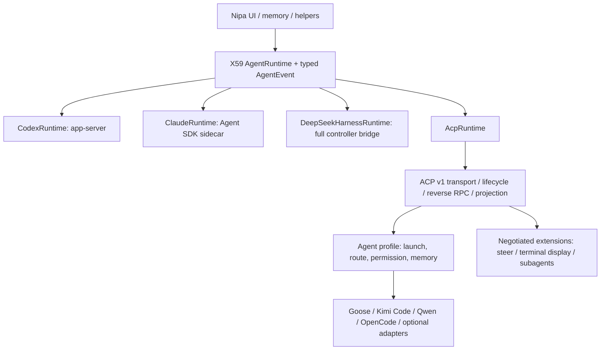

# X62：ACP 能否成为 NipaPlay 的通用 agent 接口

调研截点：**2026-10-15 UTC**。工作分支 `next/x62-acp`，基线 `96fba609398e18d5daccc6e923d267dd23f25d14`。本次只写本报告和 `docs/next/evidence/x62/`，没有修改产品代码，没有构建或启动 NipaPlay，没有发起消耗用户额度的模型对话，没有读取用户 `~/.claude`、`~/.codex` 中的凭据。

**证据标记**：`[规范]` 为 ACP 项目的一手规范；`[源码]` 为提供方/维护者的公开实现；`[实测]` 为本次隔离实验；`[仓库]` 为当前 NipaPlay 与 X59；`[建议]` 为设计判断；`[未验证]` 表示证据边界。源码能力与真实模型端到端能力不等同。第三方文档、源码、SDK、包和实验原始文件全部留在 `/tmp/nipa-next/x62/`，仓库只保存原创分析、来源元数据和校验记录。

证据入口：[来源与 SHA-256](../evidence/x62/sources.json)、[版本/分发/依赖/上游校验值](../evidence/x62/runtimes.json)、[实验结论与临时原件哈希](../evidence/x62/experiments.json)。资料访问日期均为 2026-10-15 UTC；有明确发布日期的地方另行注明。文末的来源编号均指一手材料。

## 1. 决策结论

**值得实现 ACP 客户端，但“适配一次即可使用共同能力”成立，“适配一次便得到所有 agent 的全部能力”不成立。** `[规范/源码/建议]`

1. **稳定基线是 ACP v1**，握手整数 `protocolVersion: 1`。最新稳定 schema 为 **`schema-v1.25.0`（2026-10-09）**；同日有仓库发布 `v1.11.0`。v2 的 **`schema-v2.0.0-alpha.8`** 仍是草案，不能把其提示生命周期当成所有 agent 当前已支持的接口。[P1][P2]
2. 通用层能覆盖创建、发送、取消、文字/工具更新、权限应答、配置选项，以及**有声明时**的恢复、列表和文件/终端反向调用。列表、历史、逐 token 输出、引导、子代理、自动执行模式和自定义端点仍有实现差异。[P3–P10]
3. **默认 Codex 继续 `app-server`**；Claude 主接法仍优先官方 Agent SDK；DeepSeek Harness 的完整交互体验仍需要 X59 的原生控制桥。三者可另提供 ACP 兼容路线，但不以其通用子集取代已有能力。[A1–A3][N1]
4. **ACP 首批候选：Goose、Kimi Code CLI、Qwen Code、OpenCode。** Kimi 的推荐对象必须是 **TypeScript 继任版 `@moonshot-ai/kimi-code@2.2.0`**，Python `kimi-cli@1.52.0` 已归档并停用。ACP 官网注册表仍列旧 Kimi，是本次发现的实际过期条目。[A4][A9–A11]
5. **Codex 和 Claude 转换器已经有引导与子代理支持**，不能再笼统写成“ACP 不支持，所以转换器也没有”。但是引导使用扩展，子代理使用仍在演进的 RFD/客户端专属形态，尚非统一稳定基线；Codex 2.2.2 与 Claude 0.91.0 的子代理事件形状也不完全相同。[A1][A2][P11]
6. **模型端点配置仍需要每个 runtime 的启动配置配方。** 标准配置选项可选模型，但可配置 provider 与客户端 system prompt 仍处于提案阶段。已有 Codex/Claude 实现了相关提案，不代表别家必须支持。[P12][P13]
7. 本次用本机假 Responses 服务跑通 **codex-acp 2.2.2 + Codex 0.160.1**；用假 Chat Completions 跑通 **Kimi Code CLI 2.2.0**。没有验证真实 DeepSeek V4.1 Flash / GLM 5.3 Flash 的工具质量、拒绝行为或全部 API 细节，不能把这两组实验写成真实模型验收。

## 2. ACP 的当前规范

### 2.1 维护者、版本和传输

`[规范]` ACP 是 **Agent Client Protocol**，用于客户端/编辑器控制 agent；不是模型推理协议，也不是 MCP 或同名的其他 Agent Communication Protocol。项目由 **Zed 与 JetBrains 共同治理**，lead maintainers 为 **Ben Brandt（Zed）和 Sergey Ignatov（JetBrains）**，通过公开 RFD 流程演进。规范仓库采用 Apache-2.0。[P1]

`[规范]` `initialize` 的版本号是**协议主版本整数**，不是 npm、Python、Rust SDK 或 schema 的 semver。v1 在相同主版本下不断增加可选能力。双方交换 `clientInfo` / `agentInfo`、能力和认证方式；缺省能力视为不支持。客户端不能因为新 SDK 中出现某字段，就假定旧 agent 支持。ACP 不需要照搬 Codex 的 `initialized` 通知。[P3]

| 传输 | 当前状态 | Nipa 含义 |
|---|---|---|
| stdio | 稳定通用路线；双向 JSON-RPC 2.0、UTF-8、每条消息以换行分隔；stdout 只放协议，stderr 放日志 | 首期使用子进程；支持反向请求、并发 request ID、UTF-8/JSON 分包、退出和超时 |
| Streamable HTTP / WebSocket | 官方规范仍标为讨论/草案；允许自定义传输 | 不能把某 agent 的 HTTP 地址当作跨 agent 通用连接方式 |
| agent 自有服务 | Goose `serve` 提供其 `/acp` 服务；Qwen 等也有自有 daemon/HTTP 控制面 | 单独的 transport/profile；认证、重连和持久会话生命周期须按实现验收 |

ACP 是传输无关的，但这不意味着 HTTP 或 WebSocket 的发现、认证和断线恢复已经标准化。首期不需要远程 ACP。[P4][A4]

### 2.2 能力逐项对应 Nipa

| Nipa 需求 | ACP v1 当前标准 | 限制与实现要求 |
|---|---|---|
| 新会话 | `session/new`，绝对 `cwd`、`mcpServers`；可协商附加目录 | 不应发送占位模型回合；ID 是 agent 所有的 opaque ID |
| 恢复并加载历史 | `session/load`，由 `loadSession` 声明；在响应前用 `session/update` 回放会话 | 有恢复不等于有完整历史；要区分 replay 与 live，避免重复触发 UI/任务副作用 |
| 只恢复、不回放 | `session/resume`，由 `sessionCapabilities.resume` 声明 | 已稳定；不是实验性方法，也不是与 `load` 相同的别名 |
| 列表 | `session/list`，能力 `sessionCapabilities.list`；可按 cwd 和 cursor 分页；`session_info_update` 更新标题等元数据 | 可选，不支持时不可调用；空会话未必已经被原生持久化/索引 |
| 关闭/删除 | `session/close` / `session/delete`，分别协商 | close 释放活跃资源，delete 删除历史，不能混用；fork 仍须按具体支持处理 |
| 发回合 | `session/prompt`，输入 `ContentBlock[]`；响应带 `stopReason` | v1 的 prompt 响应标识该提示处理结束；没有统一的 Codex turn ID/expectedTurnId |
| 实时文字 | `session/update` 的 `agent_message_chunk`，也有 user message 回放 | “chunk”不保证逐 token，有实现只在整条消息提交后发送 |
| 推理 | `agent_thought_chunk` | 类型本身没有保证是**推理摘要**；可能是原始 thinking。Nipa 不应自动映射为 reasoningSummary |
| 工具/命令 | `tool_call` / `tool_call_update`；ID、kind、状态、content、locations、可选 name、rawInput/rawOutput | 是工具执行的**报告**，不是要求客户端接管全部工具执行；输入/结果/exitCode 的结构仍可能不同 |
| 计划 | `plan`，条目包含内容、优先级和状态 | 表示展示用计划，不提供通用的 Nipa 任务调度器/计划编辑控制面 |
| 权限 | agent → client `session/request_permission`；允许一次/始终允许、拒绝一次/始终拒绝等选项 | 客户端返回 agent 提供的 `optionId`；它不能凭空解除 agent 的 sandbox、组织策略或模型拒绝 |
| 自动执行 | 模式/配置选择 + 自动回答所有已授权的 permission 请求 | **没有统一 `approvalPolicy: never` 枚举**；必须核实实际模式是 bypass/YOLO/full-access，而不是只自动批编辑或安全动作 |
| 取消 | `session/cancel` 通知；原 prompt 最终返回 `cancelled`。另有稳定的 JSON-RPC 请求取消机制 `$/cancel_request` | 客户端须把待决 permission 回为 `cancelled`；通知无独立成功响应。请求取消和会话取消不同；后台 shell/子代理是否停止仍取决于实现 |
| 文件 | 客户端可声明 `fs.readTextFile` / `fs.writeTextFile`，实现 `fs/read_text_file` / `fs/write_text_file` | 用于编辑器缓冲区/文件访问；agent 可能另用本地工具，不能视为统一文件访问沙箱 |
| 终端 | 客户端可声明 `terminal`，实现 create/output/wait_for_exit/kill/release | 生命周期及输出字节上限由客户端实现；标准 `terminal/output` 是取输出，不等于强制每个 agent 推送 stdout 增量 |
| MCP 能力注入 | `session/new/load/resume` 携带 MCP 声明；stdio 为基础，HTTP/SSE 等按能力协商 | 工具执行仍在 agent；stdio MCP 命令和 env 是实际执行授权；资源/提示是否消费另看 agent |
| 上下文/记忆 | 可发送 text、resource_link、支持时的 embedded resource；保留内容次序 | 稳定基线没有通用的 session-start system/developer context 注入方法，也没有保证压缩后记忆 barrier |
| 模型选择 | `session/set_config_option`、`configOptions`/更新；mode selector 仍可用 | 模型 ID、reasoning、模式选项由 agent 定义；旧实现可能仍用 `session/set_model` 等旧接口 |
| 压缩观察 | 2026-10-06 已稳定的 compaction 更新；v1 客户端须声明 `session.compaction` | 可观察不等于能控制，也不提供统一 `session/compact`；手动压缩常为 agent 宣告的 slash command |
| 用户提问 | 稳定的 elicitation 能力/反向调用，另有实现借权限请求承载问题 | 问题不能误当作工具许可自动选“允许”；不支持的交互应明确失败/交回任务策略，避免后台永久等待 |

以上来自会话、提示、工具、权限、终端、内容、配置及 RFD 更新文档；部分 overview 未穷尽后来稳定的方法，应以专题页与当前 schema 为准。[P3–P10][P14]

### 2.3 中途追加消息：稳定基线没有统一语义，实际扩展已经存在

`[规范]` v1 没有标准 `session/steer`，也没有协议级“传入这段内容，必须注入指定正在运行回合”的原子承诺。**不能在忙碌时盲发第二个 `session/prompt`**：它在不同实现中可能排队、替换/中断旧请求、重定向，或者拒绝。

`[源码/实测]` Codex 与 Claude 转换器通过顶层 `InitializeResponse._meta.steering.supported` 宣告 **`_session/steering`**。Codex 2.2.2 本机返回 `outcome: injected`。Claude 还有 prompt queueing 能力标记和 SDK priority 语义；Goose 使用 **`_goose/unstable/session/steer`**；Hermes 的并发文本输入可条件式 redirect，否则排队；Qwen 有客户端反向取中途消息的扩展。它们的回执和取消范围不能互换。[A1][A2][A4][A6][A9]

`[规范/未验证]` v2 草案把 `session/prompt` 改成接收提示后返回消息 ID，以更新流中的 session 状态描述后续工作，允许后台更新和更灵活的排队/引导。但这仍**不自动保证任一 agent 会在当前工具执行期间读入新消息**。v2 必须按版本及功能旗标单独实现，首期不启用。[P2]

### 2.4 子代理：有提案、有可用实现，但不能当成已统一

`[规范]` 当前 Subagent Sessions RFD 用 **`subagent_update`** 建立父子 session 关系，再按 child session ID 接收消息、思考和工具事件；子 session 有受限交互语义，不能默认当作可自由发送提示、恢复或接管的顶层会话。v1 用客户端 `subagents` 能力启用。它不是当前通用稳定基线。[P11]

`[源码]` 版本差异已经实际出现：

- **codex-acp 2.2.2** 的文档和实现采用较早形态 `subagent_spawned` / `subagent_state_update`，声明子能力空对象，**没有 targeted child cancel/close**。不协商时退回普通工具卡片。
- **claude-agent-acp 0.91.0** 对普通协商客户端提供修订版 `subagent_update` / `session_message`；JetBrains AIR 分支保留旧形态；其 v2 路线目前也不能直接推定同样支持子代理。
- Qwen 可在工具/流事件中附带 `parentToolCallId`、`subagentType` 等私有元数据；这不是独立可恢复 child session。Hermes/Goose 等内部委派可作为工具活动展示，但没有证据证明其当前稳定 ACP 路线都提供同一子树协议。

`[建议]` Nipa 先实现多顶层会话驱动的自有 helpers，再选择性观察原生子代理。子代理观察、定向取消、发送消息、冷恢复、接管分别声明 capability，不能因看见 Agent/delegate_task 工具就全部置为 true。

### 2.5 协商、扩展与客户端生态

`[规范]` 协商覆盖协议版本、认证、输入模态、embeddedContext、MCP transport、session lifecycle、客户端 fs/terminal/elicitation/compaction 等。`_meta` 可附加命名空间数据，自定义方法以下划线开头；未知字段/能力不能被赋予默认语义，未知方法返回 method-not-found。能力遗漏就不调用；扩展有自己的版本及数据契约。[P3][P9]

**特别注意两个尚未统一的控制面**：Configurable LLM Providers 提案定义 `providers/list/set/disable`，当前 Codex/Claude 已实现；Client-Provided System Prompt 提案于 **2026-10-12** 进入 Draft。不能把源码已有这些字段当作跨 agent 稳定标准。Claude 的 `_meta.systemPrompt` 与 Goose 的私有 system-prompt/set 已能解决各自问题，其他 agent 仍须走配置/说明文件/第一条提示。[P12][P13]

`[官方]` 已有使用者包括 **Zed 外部 agents**、**JetBrains AI Assistant**，以及 Neovim 的 CodeCompanion/avante、Emacs agent-shell；官网也列出 VS Code 第三方扩展、Obsidian 和其他非编辑器客户端。**VS Code 有第三方 ACP 客户端，不代表微软原生聊天层统一采用 ACP。** Zed/JetBrains 一手接入页已读取；社区列表证明有实现，不证明其全部扩展、权限或后台语义一致。[P15]

## 3. 逐个 agent：支持程度与维护状态

下面以**固定发布版本**为主；分支 tip 只用于核查维护状态和变化，不把未发布功能归入已发布版本。`runtimes.json` 同时记录 release、commit、pushed_at、archived 和包元数据。维护活跃是依据近期提交/发布的判断，不是维护承诺。

### 3.1 能力矩阵

表中“恢复”指可再次继续会话；`load` 另含历史回放。`✓` 为源码/官方资料确认；`实` 为本次实际跑通；`—` 为当前接口明确缺失或未宣告；`?` 为本次证据不足。所有未停用条目都有基本 prompt/cancel 路线，但**取消后台任务的完整性未逐一实测**。“思考”均不保证是摘要。

| Agent / 本次版本 | 接法、维护 | 新建 / 恢复 / 列表 | 文字、工具、输出、思考 | 同回合追加 | 计划 / 原生子代理 |
|---|---|---|---|---|---|
| **Codex + codex-acp 2.2.2**（10-10；内装 Codex 0.160.1） | ACP 组织维护的转换器，非 OpenAI 原生协议；10-15 仍有提交 | 实 / 实，含 cold load+resume / 实；空会话列表例外 | 实：text/tool/command output；reasoning 源码支持 | 实：`_session/steering`；非标准 | plan ✓；子代理早期 RFD，观察可用，不能直接接管 |
| **Claude Agent / claude-agent-acp 0.91.0**（10-15；SDK 0.3.300） | ACP/Zed 维护的官方 SDK 转换器，非 Anthropic 官方 ACP 实现；活跃 | ✓ / load+resume ✓ / ✓ | text/thinking/tool/file/terminal、任务进展；stdout 和后台细节有扩展 | 扩展 ✓；SDK priority/queueing，须看回执 | plan ✓；修订 RFD 子树 ✓；AIR 旧形态另分支 |
| **DeepSeek Harness 0.2.1-alpha.4**（10-15） | **原生** `dsh --profile acp`；官方 alpha，活跃 | ✓ / **resume ✓，load —** / ✓ | **提交后的** assistant/thought、通用 tool lifecycle；非逐 token，无专用 terminal 流 | —，每 session 只允许一个 in-flight prompt | plan —；内部子代理影响 settlement，但不暴露标准子树 |
| **Gemini CLI 0.64.0**（10-13） | 原生 `gemini --acp`；官方活跃 | ✓ / load ✓ / **— 未宣告列表** | text、thought、工具/编辑与执行结果；详细子工具投影依实现 | **不能视为引导**：新 prompt 会 abort 原 pending prompt | 独立 plan 更新 ?；内部子代理通过工具路径，标准子树 — |
| **Goose 1.54.0**（10-08） | 原生 `goose acp`；Block 项目现归 `aaif-goose/goose`，活跃 | ✓ / load ✓ / ✓；close/delete ✓，未宣告标准 resume | text/thought/tool 与终端/文件活动；Goose 扩展很丰富 | `_goose/unstable/session/steer` ✓；忙碌直接 prompt 被拒 | plan ?；内部委派可运行，通用子树/接管未证实 |
| **pi 1.2.0 + pi-acp 0.0.34**（pi 10-12；adapter 09-24） | 社区转换器，调用 `pi --mode rpc`；adapter 10-06 仍有提交，README 自称 MVP | ✓ / load ✓ / ✓ | text、工具执行/结果与 diff；**没有独立 thought 流**，无 fs/terminal 委托 | **adapter 自己排下一回合**；`/steering` 仅设置 pi 模式，不等于把本次消息变成 steer | 通用 plan/原生子树 —；扩展 slash commands 有损 |
| **Hermes Agent 0.22.2**（10-15） | 官方仓库内 ACP adapter，原生可启动 `hermes acp`；活跃 | ✓ / load+resume ✓ / ✓ | text/thinking、文件 diff、terminal/tool 进展；todo 转 ACP plan | 条件式 redirect，运行时不支持或非纯文本则排队；没有统一投递回执 | plan ✓；delegate_task 有工具可见性，独立 child 控制未证实 |
| **OpenHands CLI 1.16.0**（05-08；仓库仍有 10-12 提交） | CLI 原生 ACP，基于官方 SDK；发布相对慢 | ✓ / load ✓ / **—：实现返回空列表，且不宣告 list** | tool/结果、thought；逐 token 需 streaming 配置，Responses 路线被显式排除 | 稳定同回合引导未证实 | SDK 委派不等于 ACP 子树；plan/子树 ? |
| **Kimi CLI Python 1.52.0**（09-22） | **已归档/停用**；不是当前候选 | 历史源码有 new/load/resume/list；**发布包实测不能启动可用 ACP** | 不据历史源码承诺当前可用 | 不适用 | 不适用 |
| **Kimi Code CLI 2.2.0**（10-15 release commit） | **继任 TypeScript 原生实现**；活跃，MIT | 实 / load 实，resume 源码 ✓ / 实；close 实 | text 实；源码有 thinking、tool/plan、fs/terminal；本次没跑工具 | 无已宣告的统一 steer；adapter 对忙碌输入有独立 admission，建议 host 排队 | plan ✓；Agent/AgentSwarm 工具不等于标准 child-session 事件 |
| **Qwen Code 0.25.2**（10-15） | 原生 `qwen --acp`；官方活跃 | ✓ / load+resume ✓ / ✓ | text/thought、工具/命令、plan、子代理嵌套活动投影 | 私有中途消息 drain/send-now 控制；通用客户端不能直接假定可用 | plan ✓；私有 parentToolCallId/subagentType 元数据，非统一可接管子会话 |
| **OpenCode 1.19.0**（10-11） | 原生 `opencode acp`；官方活跃 | ✓ / load+resume ✓ / ✓，close/fork ✓ | 文字/工具活动与原生事件投影；详细输出依 event/tool 转换 | 没有在本固定版本确认通用 steer 承诺 | task/subagent 工具可见；新版 dev 的 child 扩展不能外推到本 release |
| **Mistral Vibe 2.26.1**（10-09） | 原生 `vibe-acp`；官方活跃 | ✓ / load ✓ / ✓；close/fork ✓ | 文字、thinking、工具/终端活动；Vibe 自有扩展 | 同回合引导未证实 | 内部 subagents 可运行，标准子树/plan ? |
| **Cline CLI 3.0.71**（npm 当前；仓库扩展版 4.1.24，10-13） | 原生 `cline --acp`；官方活跃，**CLI 与扩展版本不同** | ✓ / load ✓ / **— 未宣告 list** | text/reasoning/tool updates；具体命令输出按 SDK 转换 | 同回合引导未证实 | Plan/Act 是模式，不等于 ACP plan 事件；标准子树未证实 |
| **glm-acp-agent 1.15.0**（当前 npm） | Stefan de Vogelaere 的社区独立 agent，非智谱官方转换器 | README 声明 new/load/resume/list/fork/close | text/reasoning/tool、命令；取消与保存有明确文档 | 未声明同回合 steer | 有 todo 工具；标准子树未声明；未实测 |

主要依据 [A1–A14]。`?` 项不进入 Nipa 的首期兼容承诺；需要这些功能时先补固定版本实验。

#### 3.1.1 每个 agent 的自动执行与记忆接入边界

下表补充前表未展开的两项要求。**所有仍可用的条目至少可接收首条 prompt 的 text 记忆前缀**，这是 Nipa 可实现的共同降级方案 `[建议]`，不是 system 指令，也不保证压缩后保留。原生记忆机制能否在恢复、压缩、子代理分叉时满足 Nipa 的同步注入要求，除明确实测项外均未验收。具体模型/端点见第4.1节。

| Agent | 完全自动执行的接法与证据边界 | 超出普通 text 的上下文接法 |
|---|---|---|
| Codex ACP | `agent-full-access` 本次实测；approval/sandbox 仍是两个需核对的维度 | 原生说明/配置、provider与system-prompt提案实现；本次首请求记忆已验，压缩hook未验 |
| Claude ACP | `bypassPermissions`，须由实际SDK允许；acceptEdits/auto不能直接等同 | `_meta.systemPrompt`、原生说明/hook；特殊客户端分支不可冒充 |
| DSH ACP | 没有mode；对其one-shot permission自动回答allow；原生工具策略仍生效 | MCP与标准内容；持久记忆/压缩强注入需full profile控制桥 |
| Gemini CLI | ACP可调整approval mode，官方文档举auto-approve；实际策略限制仍需验收 | 文件代理/项目说明与embedded context；无统一host system-prompt承诺 |
| Goose | 原生autonomous/auto策略 + ACP许可应答；需核对生效模式 | 私有system-prompt扩展与原生说明；不能外推到其他agent |
| pi-acp | adapter没有统一bypass配置；pi/扩展自己的确认可映射为permission，自动模式需单独验收 | pi原生说明/skills；embedded context默认关闭，可显式启用；ACP MCP不透传 |
| Hermes | `dont_ask`只自动放行会话文件编辑且敏感路径仍例外；危险命令等仍经permission桥，需自动应答 | 原生memory/skills；没有证明通用客户端system-prompt setter及同步barrier |
| OpenHands | `always-approve`；不能用`llm-approve`代替 | SDK上下文/原生配置；ACP没有承诺SDK全部hook与压缩控制 |
| 旧Python Kimi | 已停用，不再承诺权限或记忆接入 | 不适用 |
| Kimi Code | 显式set_mode(yolo)并核对回显，本次已验；new默认manual | 原生说明、embedded context；首请求text记忆已验，system/压缩强保证未验 |
| Qwen Code | 选择YOLO并核对回显；不把AUTO的审核策略当成bypass | 原生说明与ACP内容；私有控制面需单独profile |
| OpenCode | 继承原生permission规则，并由host自动应答许可；没有验证一个统一ACP full-access模式 | 原生instructions/配置与ACP内容；记忆生命周期尚未实测 |
| Vibe | 原生auto-approve/YOLO策略存在；ACP模式与project trust是否全部无交互仍待验 | 原生配置/项目说明与embedded context；具体注入时机待验 |
| Cline CLI | `--auto-approve true`及ACP toggle；仍需验证具体工具策略 | ACP内容和CLI原生配置；不直接等同完整VS Code扩展的上下文能力 |
| glm-acp-agent | 维护者声明bypass_permissions；本次未跑权限实验 | 维护者的持久上下文/会话机制；host system层注入未验证 |

权限列是可实现路径与剩余条件；**只有模式回显、反向许可和实际工具都通过后，才可对用户标为“完全自动执行”**。上述源码确认项仍分别来自[A1–A14]，不会因Nipa自动选择allow就推断agent硬限制已解除。

### 3.2 Codex：转换器覆盖已很广，仍不应替换默认原生接法

`[源码]` 当前 `agentclientprotocol/codex-acp` 是 **TypeScript/Node 转换器，启动 Codex App Server**；不能沿用早期 Rust adapter 的安装/体积认知。它包含兼容的 `@openai/codex` 依赖，支持模型/推理/权限/sandbox 配置、会话管理、工具与计划、原生子代理扩展、compact 命令等。`CODEX_PATH` 可指定另一 Codex；这同时带来版本配对责任。[A1]

`[源码/实测]` 自定义 route 可用 `CODEX_CONFIG`、`MODEL_PROVIDER` 和独立 `CODEX_HOME` 配置 Responses provider；也实现了草案 provider 控制面。本次假 Responses 走通；**ACP 不会把 Chat Completions 自动变成 Codex 所需的 Responses**。DeepSeek/GLM 的具体模型 ID、地区入口和工具兼容性仍沿 X59 的 ModelRoute 选择、按确切接口验收。[N1]

`[实测]` 纯标准更新不足以保证命令输出展示：工具卡片的 content 引用了 terminal，而本次真正的输出/退出码位于 `tool_call_update._meta.terminal_output_delta` 和 `_meta.terminal_exit`。客户端虽然没宣告 terminal，也能收到这些**展示扩展元数据**；不能误认为自己已经创建了标准 terminal。Nipa 若选择此转换器需显式实现这些投影，或保留 rawOutput/“输出不可用”降级。

### 3.3 Claude：当前叫 claude-agent-acp，不把旧包名与官方性混淆

`[源码]` 官网和现维护项目指向 `claude-agent-acp`，基于 **官方 Claude Agent SDK**；旧资料中的 `claude-code-acp`/Zed 仓库路径应跳转核对，不能作为另一套当前官方实现。0.91.0 固定 SDK 为 **0.3.300**，比 X59 本机 2.1.289/SDK 0.3.289 新；X59 的旧版本行为不能直接替代本版本源码。[A2]

它支持 list/load/resume、流式文字与 thinking、工具、子代理、后台任务、`_session/steering`、provider 控制以及 `_meta.systemPrompt`。部分丰富能力只给协商后的 AIR 分支，Nipa 不应冒充 JetBrains 客户端来解锁它们；需要与上游确定通用扩展契约。

`[源码]` 可配置 Anthropic Messages 兼容 base URL/key，也有 provider/gateway 扩展。DeepSeek/GLM 需提供 **Messages 兼容入口**；任意 Chat/Responses 地址不能直接使用。权限需选择 `bypassPermissions` 且运行时允许该模式；`auto`/acceptEdits 不等价于完全自动执行。记忆可用原生说明/hook 或已支持的 systemPrompt 扩展，**压缩后注入的强保证仍应由原生 hook 负责**。wrapper Apache-2.0；其 SDK/Claude 可执行文件为 Anthropic 专有条款，见第 4 节。

### 3.4 DeepSeek Harness：X59 漏列了原生 ACP，但它是刻意裁剪的自动化接口

`[源码]` **0.2.1-alpha.4 的 `dsh-acp` README 和实现明确存在原生 ACP v1**；不是只能自行开发 SDK bridge。`dsh --profile acp` 挂载持久化，提供 new/list/resume/close、模型与 reasoning 配置、MCP、取消、one-shot permission；一个连接可管理多 session。[A3]

同一资料也明确排除了 **`session/load`、历史回放、modes、slash commands、plans、terminals、client filesystem、elicitation**。输出是 committed messages/thoughts/generic tool lifecycle，刻意排除 raw provider deltas 和 DSH presentation data。每 session 一个 prompt；prompt settlement 会等待其拥有的根/后代活动及更新排空。不能据此宣称有子代理事件或 UI 逐 token 流。

`[建议]` ACP 可先作为 DSH 的**后台自动任务接法**，适合 Nipa helpers 的有限结果回执。若主聊天必须有即时文字、历史、引导、终端细节、记忆/压缩边界，仍保留 X59 Session Controller/core bridge。这是基于接口选择的双 profile，不需要重写 DSH agent loop。

自定义 DeepSeek/GLM route 可通过官方 `dsh-llm-pi-ai` 的 `providers` 字典声明 `api`、`baseURL`、`apiKeyEnv`、model metadata；ACP 只选择已经配置好的 catalog。运行配置应绑定用户推荐的 **DeepSeek V4.1 Flash / GLM 5.3 Flash** 的实际 provider ID，不能把 ACP profile 默认的 `deepseek-v4-flash` 当作已经等于 V4.1 Flash。[A3]

### 3.5 Gemini、Goose 与 pi

**Gemini CLI** `[源码]` 是原生 ACP 的成熟使用者，支持 load、流式 thought/文字、权限和本地工具；初始化却未宣告 session list。0.64.0 的 `prompt()` 开头会 abort 前一个 pending prompt，故第二个 prompt **不是可信的 same-turn steer**。其端点/网关配置使用 **Google/Gemini 协议**；本机 Gemma 路由实验也不是通用 Chat Completions 执行模型支持。没有发现其当前标准发行可直接拿 DeepSeek/GLM Chat/Responses URL 替代执行模型的证据；除非另建 Gemini 协议转换器，暂不推荐此模型组合。[A5]

**Goose** `[源码]` 的 ACP 与其自有 UI/服务结合较深，扩展包括 steer、system prompt、provider catalog/config 等。标准能力包含 load/list/close/delete；默认不要调用未宣告的 resume。可通过自定义 OpenAI-compatible provider 配置 URL/model/key，符合 DeepSeek/GLM 的 route 方向；实际协议与模型工具能力须复核。权限用 Goose 的 fully autonomous/auto 语义并自动处理尚存的 permission，而非照搬 Codex 字符串。Goose 是最适合检验“ACP 主干 + 少量厂商扩展”的首批对象。[A4]

**pi** `[源码]` 本体现在位于 `earendil-works/pi`，包名 `@earendil-works/pi-coding-agent`；`badlogic/pi-mono` 已重定向。官方目录经社区 `svkozak/pi-acp` 接入，而非 pi 本体原生 ACP。adapter 0.0.34 的重要损失：没有独立 thought stream；忽略/只保存 ACP 传入 MCP 声明而不接到 pi；不代理 fs/terminal；不支持扩展提供的 slash commands。普通忙碌输入进入 adapter 自己的下一回合队列，`/steering` 只是设 pi 的模式。[A7]

pi 原生 RPC 已有 steering/follow-up/abort 等更丰富接口，并能以 `models.json` 连接 OpenAI/Anthropic/Google-compatible 端点。**需要引导与完整扩展生态时，直接 pi RPC 更合适；只要求基本聊天/工具/恢复时可用 pi-acp。** 本次仅隔离安装了二者；没有把 pi 1.2.0 与 adapter 0.0.34 的运行兼容性写成已验证。adapter 的用户 session-map 路径硬编码也是隔离与分发时需处理的事项。

### 3.6 Hermes 与 OpenHands

**Hermes Agent（Nous Research）** `[源码]` 在自己的仓库内维护 `acp_adapter`，`hermes acp` 使用 Hermes 的身份、模型路由、memory/skills 及 ACP 工具集（含 terminal/process、todo、delegate_task）。它能列出、load/resume/fork 会话，todo 会投影为 ACP plan；活跃回合收到纯文本时，只有运行时明确支持 redirect 才引导，否则排队。客户端应把投递结果标为条件式/待确认，不能从返回 `end_turn` 推断旧回合完成。[A6]

自定义 provider/base_url 在原生 runtime resolution 中传入 AIAgent，故可接兼容的 DeepSeek/GLM route；本次未真实调用。官方 GitHub 当前 **0.22.2**，但 **PyPI `hermes-agent` 仍为 0.19.0**，不能用一句 pip install 最新就承诺拿到当前 ACP 行为。推荐锁 GitHub tag，由Hermes的内置依赖管理器PM准备checkout，再在该环境运行 `python -c "import pm; pm.sync_venv(['acp'], explicit=True)"` 启用ACP extra。虽然元数据允许Python3.11至3.14，源码明确说明**当前正式支持3.14**，较低下界是给旧安装升级使用。浏览器另需Node/Chromium；基础Python ACP不因此强制依赖Node，官方完整安装器则会准备Node等组件。

**OpenHands** `[源码]` 本报告检查的是 **OpenHands-CLI 1.16.0 的 ACP**，不是把 SDK 的 HTTP Agent Server 误称为 ACP。它本身依赖 SDK，支持 new/load/cancel、权限模式与流事件。`list_sessions()` 当前明确是 no-op 空列表，initialize 也没宣告 list；Nipa 应用本地目录降级，不能显示“没有历史”冒充权威全量查询。[A8]

可走自定义 LLM provider/`base_url`，但 CLI **默认忽略 `LLM_API_KEY/MODEL/BASE_URL` 环境覆盖**，须 `--override-with-envs` 或其明确配置。`always-approve` 才是本次要求的权限方向，`llm-approve` 还会询问。逐 token 支持受 streaming 选项控制，local_agent 对 Responses API 路线禁用该 token streaming；不能将“SDK 可接 Responses”直接等同“ACP 可流式逐 token”。SDK 的压缩、委派、rich event API 仍更完整。

### 3.7 国内 CLI：区分 Kimi 两代、Qwen 与 GLM 社区 agent

**Kimi Python 旧版** `[官方/实测]` `MoonshotAI/kimi-cli` README 明确归档、迁移到 `MoonshotAI/kimi-code`。本次隔离安装 1.52.0 后，`--version` 可用，但 `acp --help` 和 `acp` 输出停用迁移提示，未形成可用协议握手。其遗留源码虽然有 ACP 和多 provider，但 ACP 创建还曾受 Kimi OAuth 门槛约束；**这些都不应成为当前接入方案**。PyPI 的 `kimi-code` 也只是旧 alias，**新的包在 npm**。[A10]

**Kimi Code CLI 2.2.0** `[源码/实测]` 使用新 TypeScript 引擎，`kimi acp` 原生 stdio ACP。支持 new/load/resume/list/fork/close/delete、image/embedded context、MCP、fs/terminal、plan、thinking、权限和 elicitation。认证 readiness 接受配置里的 API key 或显式 `api_key_env`，不是只能 OAuth。`providers/*` 尚未实现，但原生配置有 `openai`、`openai_responses`、`anthropic` 等，可自填端点和 key。[A10]

本次假 Chat Completions 已验证无需登录用户账户即可创建、列表、发送、取消、load/close，记忆 marker 到达请求。**ACP 新会话默认返回 `mode=default`（manual）**，即使配置写了默认 YOLO 也不能据此认定已经自动执行；本次又显式调用 `session/set_mode(yolo)` 并验证成功。需要据返回模式确定实际权限。新版本说明中仍有陈旧 SDK/spec 注释，优先以 package、wire、实际源码为准。Agent/AgentSwarm 是原生帮手工具，本次没验证标准子会话流或帮手接管。

**Qwen Code 0.25.2** `[源码]` 原生 ACP 支持较全的会话管理、模型配置、文字/思考/工具/plan，以及嵌套子代理工具活动。它有 daemon/bridge 专属中途消息机制：agent 可反向向 host drain 队列，send-now 等路径又有独立 admission；**实现一个普通 ACP 客户端不会自然拥有这些控制**。自定义 OpenAI-compatible base URL/model/API key 可连接两种推荐模型，权限使用其 YOLO 模式并核对实际回显。它的私有控制面较多，首期只接稳定子集，扩展逐项添加。[A9]

**glm-acp-agent 1.15.0** `[维护者资料/未验证]` 是社区独立 agent，README 明确面向 **Z.AI Coding Plan**，不是通用 Z.AI Open Platform API client。支持 GLM 5.3/5.3 Flash、流式 reasoning、工具、持久会话、bypass_permissions；`ACP_GLM_BASE_URL` 可覆盖地址。但其工具、计费和 provider 假设围绕 Coding Plan，**不能仅凭可改 URL 就承诺可接任意 DeepSeek/GLM 端点**。Nipa 要求用户自填地址/key，故不把它作为通用默认 runtime；可做自愿安装的专用候选。没有取得逐项源码/运行验收的功能不升级为“已验证”。[A13]

### 3.8 其他常见实现

**OpenCode 1.19.0** `[源码]` 原生 ACP 提供 create/load/resume/list/fork/close，复用其模型与权限配置，可用自定义 provider 的 OpenAI-compatible route。原生 HTTP/SDK 的 session/event/permission 控制更广。注意项目当前 dev 已重构到 `packages/cli/src/acp` 并新增 child-session capability，但**1.19.0 发布源码在 `packages/opencode/src/acp`**；本报告不把 dev 的 child 扩展算入 release。[A11]

**Mistral Vibe 2.26.1** `[源码]` 提供 `vibe-acp`，支持持久会话、load/list/fork/close、模型/权限选择、终端与工具事件，另有 trust/rewind/voice 等私有扩展。可配置兼容 provider；与 DeepSeek/GLM 的具体组合、引导及 native helper 可控性尚未跑通，暂为第二批候选。不能因为有自动模式便跳过它自己的 project trust 语义。[A12]

**Cline CLI 3.0.71** `[官方/源码]` `cline --acp` 支持文字/reasoning/tool、load、Plan/Act、provider/model picker 和自动批准 toggle；`--auto-approve true` 可在启动时设置。扩展仓库 release 4.1.24 的 `apps/cli/package.json` 确实标为3.0.71，与npm版本一致，但未做分发二进制与源码的同一性验证。官方本体有 OpenAI-compatible provider，但 ACP CLI 的认证/provider UI 与完整扩展的路由行为还需单独验收；本次未证明只设置一个 `OPENAI_BASE_URL` 就能运行此 CLI。不将其列为 DeepSeek/GLM 首批默认项。[A14]

官网还列有 Cursor、GitHub Copilot CLI、Kiro、Augment、Junie、Factory Droid、Qoder 等。**此处只确认列入一手 ACP 生态目录，不对其未逐项核查的功能、任意端点或许可证作推断**；本次已对上面三个其他常见开源 agent 进行更深入核查，不以厂商数量取代兼容性证据。[P15]

## 4. 自定义模型、安装体积与许可证

### 4.1 DeepSeek V4.1 Flash / GLM 5.3 Flash 的路由边界

`[建议]` 延续 X59：**agent 工具与模型设置独立**。两种模型作为推荐预设；用户地址、key、地区、协议、实际 model ID 保存在独立 `ModelRoute`，由 runtime 的启动配方绑定。不要从显示名推断 model slug，也不硬编码一个跨提供方通用入口。

| 路线 | 能否自定义端点 | 两种推荐模型的判断 |
|---|---|---|
| Codex 原生 / codex-acp | Responses provider，环境 key、base_url；adapter 另有 provider 提案实现 | 协议具备路径；本机 fake Responses 已验。真实 route 沿 X59 官方资料，具体模型组合未在 X62 重测 |
| Claude 原生 SDK / claude-agent-acp | Anthropic Messages-compatible gateway，或其支持的其他官方后端 | 两家须提供对应 Messages 接口；不是任意 OpenAI URL |
| DSH ACP / 原生桥 | 通过 `llm-pi-ai` 预配 Chat/Responses/Messages 等 route，再从 ACP catalog 选 | 可以设计两个预设；catalog、context/reasoning/tool metadata 和 key 引用需预配 |
| Goose、pi、Qwen、OpenCode、Hermes | 各自的 OpenAI-compatible/provider 配置 | 适合作为候选；ACP 没有替代这些配置。没有真实调用证据时只承诺“route 可表达” |
| Kimi Code CLI | `type=openai/openai_responses/anthropic`，base_url + `api_key_env` | 本机 fake Chat 已验；真实 DeepSeek/GLM 工具及 thinking 字段仍待验 |
| OpenHands / Vibe | 原生 provider/base URL 配置 | 可表达兼容 route；OpenHands env override 和 streaming 有额外条件，Vibe 组合未实测 |
| Gemini CLI | Google/Gemini-compatible endpoint | 没有直接通用 Chat/Responses 兼容证据，暂不推荐此组合 |
| Cline ACP CLI | provider picker / CLI 原生配置 | 本体支持兼容 provider，但 CLI 的无登录自填端点路径未完成验证 |
| glm-acp-agent | Coding Plan 为契约；base URL 可覆盖 | GLM Coding Plan 专用候选；不是通用 DeepSeek/开放平台接法 |

`[未验证]` 本报告不把 agent 的 model picker 宣告当成服务端真实支持证明，不把无额度假服务实验当成拒绝率或 BT 下载任务行为证明。权限自动批准也不会改变模型自身行为。

### 4.2 安装与体积

下表均为**锁定版本的接法说明，未在系统全局安装**。MB 为十进制。npm `unpackedSize` 是该包本身，wheel 是压缩文件，release asset 是上游标称下载大小，三者不能混加成完整安装体积。精确字节、URL、integrity、SHA-256/上游 digest 见 `runtimes.json`。只有明确注明本机测量的目录才包含已安装传递依赖。

| Agent | 安装/启动形状 | 运行环境 | 可核对的体积 |
|---|---|---|---|
| codex-acp 2.2.2 | `npx -y @agentclientprotocol/codex-acp@2.2.2` | npm 路线需 Node；自带 Codex 依赖；本机 Node 23.11.0 跑通 | adapter 1.75 MB；本次独立安装目录逻辑文件 **348.0 MB**，含 Codex 0.160.1/依赖，不含系统 Node/缓存 |
| claude-agent-acp 0.91.0 | `npx -y @agentclientprotocol/claude-agent-acp@0.91.0` | Node ≥22；SDK 0.3.300 携带原生 Claude 运行文件 | adapter 1.90 MB；SDK JS 包4.68 MB；darwin-arm64 原生 SDK 包 **249.56 MB 解包**，另有依赖 |
| DSH 0.2.1-alpha.4 | `npx -y @deepseek-ai/dsh@0.2.1-alpha.4 --profile acp` | 源码根要求Node 22.19以上的22.x或≥24，含本地系统组件/大量分包 | CLI 包仅 **76,390 B**，不是完整体积；完整依赖未测。npm latest 仍0.2.0-rc.2，必须显式锁 alpha4 |
| Gemini CLI 0.64.0 | `npx -y @google/gemini-cli@0.64.0 --acp` | Node ≥20；部分 PTY/keytar 为 optional native 包 | 主包 **98.60 MB 解包**，另有 optional 组件 |
| Goose 1.54.0 | 下载 CLI，`goose acp` | 原生 Rust CLI 不需外部 Node/Python；MCP 插件可能另需 | macOS arm64 CLI tar.gz **83.31 MB**；不要把桌面应用208.68 MB zip 当成 CLI 体积 |
| pi-acp 0.0.34 + pi1.2.0 | 安装 pi 后运行 `pi-acp`；支持项目本地 npm 安装 | adapter 声明 Node≥20；pi需≥22.19，实际取较高约束 | adapter0.33 MB + pi主包23.20 MB；本次无 scripts/optional 的安装目录 **117.1 MB**，运行未验 |
| Hermes 0.22.2 | 固定 GitHub tag，用内置依赖管理器PM准备checkout并加ACP extra；`hermes acp` | **官方当前支持Python3.14**；元数据≥3.11,<3.15为兼容旧安装升级。基础ACP不强制Node；完整安装器含Node，浏览器需Chromium | 当前完整checkout/依赖未测；PyPI0.19.0 wheel10.14 MB **不是0.22.2**；浏览器额外约400 MB（官方说明） |
| OpenHands1.16.0 | `uvx --python 3.12 --from openhands==1.16.0 openhands acp`，或原生发布文件 | Python包要求 **3.12.***；独立原生分发无需另装 Python | wheel0.219 MB 不含SDK依赖；macOS-arm64独立 executable **86.73 MB** |
| Kimi Code CLI2.2.0 | 项目本地 npm `@moonshot-ai/kimi-code@2.2.0` 后运行 `kimi acp`；另有官方单文件分发 | npm Node≥22.19；官方单文件路线不需外部 Node/Python | 主包 **54.26 MB 解包**；本次无 optional 安装目录 **56.16 MB**；单文件分发未下载测量 |
| Kimi Python旧版1.52.0 | **不推荐安装**，仅为迁移核查隔离安装 | Python≥3.12；本次3.12.14 | wheel5.61 MB；本次依赖目录207.4 MB；ACP入口已停用 |
| Qwen Code0.25.2 | `npx -y @qwen-code/qwen-code@0.25.2 --acp` | Node≥22，optional PTY/image/audio等组件 | 主包 **142.50 MB 解包**，完整依赖未测 |
| OpenCode1.19.0 | 原生 `opencode acp`，或 npm `opencode-ai@1.19.0` | 原生Bun编译分发无需外部Node/Bun；npm安装器需Node | macOS-arm64 CLI zip **45.56 MB**；npm平台包144.37 MB解包，入口包仅7,852 B |
| Mistral Vibe2.26.1 | `uvx --from mistral-vibe==2.26.1 vibe-acp`，或原生ACP包 | Python≥3.12；原生独立ACP包不需外部Python | macOS-arm64 wheel36.98 MB；独立ACP tar.gz **60.30 MB** |
| Cline CLI3.0.71 | npm `cline@3.0.71` 后 `cline --acp` | npm入口需Node，执行平台二进制；平台工具另计 | npm入口48,236 B；darwin-arm64平台包 **98.65 MB解包**；没有混用4.1.24扩展大小 |
| glm-acp-agent1.15.0 | `npx -y glm-acp-agent@1.15.0` | Node20.x≥20.19、22.x≥22.13或≥24；Vision MCP另需npx/相应服务 | 主包0.89 MB解包，tarball本次下载 **205,985 B**；传递依赖未安装 |

本机安装数字是文件逻辑字节合计，跳过符号链接、不去重硬链接，不含缓存/系统运行时/源码，也不是磁盘占用或跨平台体积承诺。正式内置前必须另测所选 OS/架构的完整分发、许可、签名与升级；本次没有进行该发布工作。

### 4.3 许可证

`[官方包/源码]` **ACP规范、codex-acp、claude-agent-acp、Codex、Gemini CLI、Goose、Qwen Code、Vibe、Cline、glm-acp-agent** 为 Apache-2.0；**DSH、pi/pi-acp、Hermes、OpenHands CLI、OpenCode、Kimi Code CLI** 为 MIT；**归档 Python Kimi CLI** 为 Apache-2.0。codex-acp 的 GitHub license detector 返回 NOASSERTION，但实际 LICENSE 与 package.json 均标 Apache-2.0，应读文件而非只用 API 标签。

**Claude 的 Apache-2.0 wrapper 不覆盖 Claude Agent SDK/Claude 运行文件。** SDK npm 标明 `SEE LICENSE IN LICENSE.md`，包中 LICENSE 指向 Anthropic 法律条款；它不是可据 wrapper 许可任意再分发的开源 agent。本次只读其官方 npm tarball 许可证，没有把原文复制入仓库。X59 对 SDK 产品集成、订阅登录和品牌的约束仍适用。[A2][N1]

上述许可只覆盖所述项目，不代表所有传递依赖、模型服务、MCP工具、商标和分发条款已完成审核。用户自填 key 路线不继承任何免费额度承诺。

## 5. 同一个 agent：ACP 与原生接口的得失

| Agent | 走 ACP 得到什么 | 相比原生接口减少/增加的工作 | 对 Nipa 的选择 |
|---|---|---|---|
| Codex：ACP vs app-server | 复用会话/工具/权限 UI；丰富 adapter 已替客户端处理许多映射 | 多一层Node进程和版本配对；原生thread/turn/item、expectedTurnId、hook/trust、rollout、collab/后台控制会被重塑或扩展化。即使有steering/subagents，也不是与当前ChatHost无损等价 | **默认原生**；ACP仅兼容测试/用户选择 |
| Claude：ACP vs stream-json/Agent SDK | SDK进程、历史、权限、工具/计划及部分队列/子代理映射已经打包，减少自写sidecar | 原生priority、UUID消费/interrupt receipt、queued cancellation、task/hook/compact细节需经adapter暴露；AIR专属扩展与修订RFD有版本成本。原生SDK可更直接处理记忆barrier和精确任务关系 | **主线原生SDK**；普通用户可选ACP简化版，但不是功能等价替换 |
| DSH：ACP vs full profile/controller | 官方持久自动化面，省去自行维护new/list/resume/cancel/permission桥，适合后台任务 | 明确失去load/history、transient frames、展示计划/终端、steer、原生compaction/injection控制 | **后台任务可ACP；完整主聊天保留原生桥** |
| pi：ACP vs RPC | 标准化text/tool/load/list投影；客户端无需理解全部pi事件 | adapter的队列遮住native steer/follow_up；thought、MCP透传、扩展命令与完整stats存在缺口，增加一层映射和用户session-map | 基础兼容可ACP；要达到Nipa完整需求则优先RPC |
| Goose/Qwen/Kimi/OpenCode：ACP vs自有接口 | 每家共用一个双向协议、生命周期、更新和权限框架 | 自有provider、memory/hook、steer、后台/子树、daemon语义仍需小型profile/extension；不能把每家私有控制塞进通用协议主干 | **先ACP**；只有明确产品需求才补扩展/原生控制 |
| OpenHands：ACP vs SDK/Agent Server | 本地stdio接入简单，可共用权限和工具投影 | 原生会话查询、typed events、delegation/streaming更广；当前ACP list是stub，Responses token stream有缺口 | 第二批ACP；确需其SDK特性再选原生 |
| Gemini/Vibe/Cline | 无需为已有ACP路线再写一套stdin事件parser | 自定义模型路由和agent特有控制仍未统一；ACP不能消除模型协议或认证差异 | 可选兼容，先验证用户实际route |

`[建议]` ACP 的收益主要是**共享协议与基本展示**，不是统一 agent 的全部行为。即使同一种 agent，原生与 ACP 的 session ID 也必须先核对映射才能共用恢复；不要靠相同标题匹配。不同 agent 之间没有通用原生 transcript 迁移；只能建立新会话，传有界交接摘要和记忆 revision。

## 6. 放在 X59 的哪一层

`[仓库]` 当前 `ChatHost` 直接识别 Codex：启动/握手在 [chat_host.dart](../../../lib/next/chat/chat_host.dart)，显示类型白名单与reasoning合并约523行，steer约821行，interrupt约883行；[native_helpers.dart](../../../lib/next/chat/native_helpers.dart) 用collab receiver thread恢复/接管原生帮手；[helpers.dart](../../../lib/next/chat/helpers.dart) 则建立Nipa独立帮手。X59第2、7节已要求中立会话、事件、历史和能力，不应把ACP消息直接灌给Codex UI白名单。[N1]

`[建议]` **AcpRuntime 是 AgentRuntime 的一个实现，ACP 是其内部协议层**，不替换 AgentRuntime，也不要求其他 runtime 先转成 ACP。分工如下：

- **协议主干**：stdio framing、双向RPC、取消/退出、会话方法、能力表、content/tool/plan/config投影、replay标识、fs/terminal/permission/elicitation反向调用。
- **AgentProfile**：固定可执行文件/版本、参数、独立状态目录、模型route配置、权限模式、说明/hook记忆接法、额外依赖。配置配方不可完全消除，但比重写整套RPC/事件parser小。
- **可选扩展模块**：只按能力与固定版本启用 `_session/steering`、Goose steer/system-prompt、终端展示元数据、Qwen中途消息、子代理RFD各版本；不伪造AIR身份。
- **中立投影**：X59的NormalizedSession/Turn/Item与AgentEvent。保留nativeRef、来源、完整度、replayed/live；ACP没有turnId时，由Nipa生成turn映射，不能声称等于agent内部turn。
- **会话目录**：Nipa记录自己创建/见过的session及runtime/profile。支持原生list时合并；否则只显示“此设备已知会话”，不假装全量。原生transcript仍由agent管理，Nipa仅保存有界展示投影与任务回执。

### 6.1 能力与降级契约

| 缺口 | Nipa 应有的行为 |
|---|---|
| 没有same-turn steer | busy时只进**Nipa自有下一回合队列**，界面显示“下回合发送”；不再次prompt探测。队列有message ID，可显式撤销 |
| 有条件式/私有steer | 返回 sameTurn/nextTurn/pending/rejected。除非回执证明，不显示“已读”；保留targetTurn校验，idle后不悄悄误发新turn |
| 没有list或空会话未落盘 | 用本地会话目录；Codex实验说明new成功不等于list立即可见；不发送收费占位消息 |
| 有resume但没有load/history | 能继续工作；历史只显示本机有界投影并标“历史不完整”；不把它重新灌给模型当第二份transcript |
| 只有committed output | 展示等待/工具进展，文字到达后一次呈现；不伪造流式token或虚拟心跳输出 |
| 工具只有最终结果 | 把stdout完整度标final/partial/unknown；exitCode可null。扩展提供值时才解析，不从文本“成功”猜0 |
| 只有thought，没有明确summary | 归rawThinking，默认不显示/旁存；允许推理摘要为空；计划/工具说明不伪装成思考摘要 |
| 原生子代理不可控 | 只观察/收回执；要能接管就由Nipa另建顶层helper并传有界摘要，不把task ID当resume ID |
| 取消没有精确后台回执 | 等原prompt返回cancelled；Nipa自有队列按策略清理。后台状态unknown，不宣称所有子任务和shell已停止 |
| 没有标准system prompt | 优先profile的原生说明/hook；最低可在第一条用户prompt附有来源/预算/revision的记忆text；不另发模型回合 |
| 压缩后无法保证下一次模型请求前注入 | 明确contextInjectionBoundary能力有限；需要强保证时改用原生hook/控制桥，不把compaction通知当同步barrier |
| 配置/模式变更受busy限制 | 等所有主会话/帮手idle后更新或重启，恢复原session；不在工具执行中静默切provider/key |

`[建议]` 完全自动执行应是**明确的Nipa运行策略**：选择并确认当前agent的full-access/bypass/YOLO模式；对已授权工作里的permission请求自动选其allow选项；记录实际模式与失败原因。仅有acceptEdits、safe-auto或LLM auto-review时不宣告等价。标准fs/terminal能力只有在Nipa确实实现反向操作时才宣告；不支持时允许agent自身工具运行或报不支持，不假回成功。

记忆需要明确owner：hook与host前缀只选一个主注入者，按revision去重；ordinary resource/text不能声称system优先级。恢复/压缩/子代理的边界要单独验收。Nipa本身的实时设备状态、BT/播放/下载能力仍通过现有harness/CLI或MCP提供，ACP不接管这些业务事实。

## 7. 分阶段计划与无额度验证

### 7.1 建议实施顺序

| 阶段 | 工作 | 验收门槛；全部可先用本地假服务 |
|---|---|---|
| P0：协议与能力原型 | 仅实现ACP v1、typed投影、stdio与反向permission；保留CodexRuntime。以固定agent版本做fixture | 不启动NipaPlay也可用独立probe验证；new/list/load/resume无隐形模型回合；未知能力/方法、EOF与错误可解释 |
| P1：两个真实runtime profile | Goose + Kimi Code CLI；再加Qwen或OpenCode作不同实现对照 | 文字/工具/取消、完全自动模式、指定localhost route、memory首请求标记、冷恢复/列表；空会话和replay去重正确 |
| P2：需要的扩展 | 通用steering扩展、Goose steer、实际用到的terminal元数据；子代理先观察 | 忙碌/idle竞态、同回合与下一回合回执、中断后的队列、并行工具乱序、输出截断；扩展关闭时仍可用稳定子集 |
| P3：可选agent | DSH后台ACP；Hermes、pi-acp、OpenHands、Vibe/Cline按需求逐个启用 | 对每个具体版本发布能力清单；不支持项有产品可见降级；模型与工具身份不混淆 |
| P4：真实提供方验收 | 只在另外明确批准key/预算后，针对两种推荐模型补最小route矩阵 | 只补假服务无法证明的API/tool/reasoning/压缩行为。X62**没有执行此阶段** |

`[建议]` v2单独实验，不作为P0依赖。Dart协议主干可以直接实现JSON-RPC，不必为ACP自身内置Node/Python；被启动agent和转换器的环境依赖仍按profile分发。

### 7.2 本次已经完成的实验

实验程序是本次原创Python probe，路径、字节数和SHA-256记录在 `experiments.json`；其源码和所有原始协议/包文件留在 `/tmp/nipa-next/x62/`。子进程只获得显式环境白名单、临时runtime home/XDG/TMP、假key；**没有改写HOME，没有读取用户agent凭据**。HTTP服务仅绑定127.0.0.1。表中请求数指最后一次完整验收运行，不是声称整个研究只运行过一次。

| 实验 | 已观察事实 | 限制/失败也保留 |
|---|---|---|
| codex-acp2.2.2 + Codex0.160.1，假Responses | initialize1；API-key authenticate；new；list；text流；`printf x62-tool-ok`工具执行、输出和exit0；`_session/steering`返回injected；取消返回cancelled；load/close/resume；最后一次6个localhost模型请求均带memory marker | 首次无authenticate时new返回auth-required；修正后用假key通过。new后list为0，空会话未立即入索引。未跑原生子代理/压缩 |
| 同一Codex会话，**新进程**恢复 | cold resume/list/load/close通过；历史含文字与工具回放；模型请求数 **0** | 证明此固定组合能无额度冷恢复，不证明所有agent都如此 |
| Kimi Code CLI2.2.0，假Chat Completions | 无OAuth登录下new/list/prompt/cancel/load/close通过；memory marker进入两个localhost模型请求；显式set_mode(yolo)成功 | 创建回显默认manual，不能相信默认配置已生效；本次未跑工具、原生子代理、压缩或冷进程恢复 |
| Kimi Python1.52.0 | 临时uv安装完成；--version可用；ACP入口输出退役迁移提示，probe无法把该输出当JSON-RPC | 是**当前发行包不可用**的证据，不是新Kimi Code CLI的失败；没有继续尝试登录/真实模型 |
| pi-acp0.0.34 + pi1.2.0 | 临时npm安装完成，未运行lifecycle scripts/optional组件；测量文件体积 | 没有启动pi会话，不宣称RPC组合兼容；避免写其硬编码用户session-map目录 |

`[实测]` memory marker证明内容进入请求，**不证明模型理解、system层级或压缩后驻留**。steer回执证明转换器报告injected，不证明模型行为改变。一次短命令输出成功不证明长命令实时stdout、进程树取消或后台任务生命周期完备。

### 7.3 后续无额度验收的具体方法

1. **隔离启动**：所有home/profile/cache/log放临时目录；只注入假key和localhost端点；认证UI/自动升级/遥测按各agent已有开关关闭。先验证`--version/help`和initialize；注册表条目只当分发索引，不作能力证书。
2. **两种假模型服务**：Responses SSE与Chat Completions SSE分别覆盖；对Claude另做Messages兼容假服务。返回固定文字、一个无副作用工具调用、随后固定结果；记录请求schema、model、memory revision和hash，不记录真实key。
3. **时序控制**：用服务端闸门阻塞模型响应/工具完成，分别发送steer、第二prompt、cancel、close；检查回执和实际投递顺序。明确区分请求被接收、模型已读、下一回合排队和已取消。
4. **持久性/零请求**：只new/list/close重启再load/resume，计数器必须保持0；空session不在原生list也要可解释。历史replay不得再执行工具或重复登记helpers。
5. **实际工具与反向RPC**：只在临时workspace读写哨兵文件、执行固定printf；分别关闭/开启fs与terminal能力，核对执行归属、stdout/exitCode与截断标记；权限拒绝/取消不能假报成功。
6. **错误路径**：非法JSON、未支持方法、缺失capability、auth-required、模型401/429/5xx、SSE早断、EOF、超时、进程退出；不能把传输断线写成正常完成。假服务可返回这些错误，无需真实提供方账户。
7. **上游测试复用但不复制入库**：ACP有官方testing入口；DSH本身有keyless ACP控制面fixture；各agent仓库也有假的provider/协议测试。将版本/命令/结果hash记入证据，依赖源码留tmp；不把其SDK/fixture复制为Nipa仓库代码。

## 8. 一手来源索引与不确定性

以下均于 **2026-10-15 UTC**访问。所有抓取的原文hash和时间在`sources.json`，包发布日期/体积/完整性在`runtimes.json`。固定tag/commit链接优先；通用规范链接对应访问时快照，日后内容可能变化。

| 编号 | 来源、版本与用途 |
|---|---|
| P1 | ACP [Governance](https://agentclientprotocol.com/community/governance)、[规范仓库](https://github.com/agentclientprotocol/agent-client-protocol)、[schema-v1.25.0](https://github.com/agentclientprotocol/agent-client-protocol/releases/tag/schema-v1.25.0)（10-09）；共同治理、许可证和稳定schema |
| P2 | [v2 Draft公告](https://agentclientprotocol.com/announcements/acp-v2-draft)（07-20）、[迁移指南](https://agentclientprotocol.com/protocol/v2/migration)、[alpha.8](https://github.com/agentclientprotocol/agent-client-protocol/releases/tag/schema-v2.0.0-alpha.8)（10-09） |
| P3 | [Initialization](https://agentclientprotocol.com/protocol/v1/initialization)、[Overview](https://agentclientprotocol.com/protocol/v1/overview)：版本与能力协商 |
| P4 | [Transports](https://agentclientprotocol.com/protocol/v1/transports)：stdio与HTTP草案 |
| P5 | [Session setup](https://agentclientprotocol.com/protocol/v1/session-setup)、[Session list](https://agentclientprotocol.com/protocol/v1/session-list)、[resume稳定公告](https://agentclientprotocol.com/announcements/session-resume-stabilized) |
| P6 | [Prompt turn](https://agentclientprotocol.com/protocol/v1/prompt-turn)、[Cancellation](https://agentclientprotocol.com/protocol/v1/cancellation)：流、停止原因、取消 |
| P7 | [Tool calls](https://agentclientprotocol.com/protocol/v1/tool-calls)、[Agent plan](https://agentclientprotocol.com/protocol/v1/agent-plan)：权限、工具、计划 |
| P8 | [File system](https://agentclientprotocol.com/protocol/v1/file-system)、[Terminals](https://agentclientprotocol.com/protocol/v1/terminals)：客户端反向执行面 |
| P9 | [Extensibility](https://agentclientprotocol.com/protocol/v1/extensibility)：扩展契约 |
| P10 | [Session config options](https://agentclientprotocol.com/protocol/v1/session-config-options)、[Session modes](https://agentclientprotocol.com/protocol/v1/session-modes)：模型与模式不是统一provider配置 |
| P11 | [Subagents RFD](https://agentclientprotocol.com/rfds/subagents)、[PR1992](https://github.com/agentclientprotocol/agent-client-protocol/pull/1992)：当前提案，非稳定能力保证 |
| P12 | [Configurable LLM Providers RFD](https://agentclientprotocol.com/rfds/custom-llm-endpoint)：providers提案 |
| P13 | [Client-Provided System Prompt RFD](https://agentclientprotocol.com/rfds/client-system-prompt)、[RFD updates](https://agentclientprotocol.com/rfds/updates)：10-12进入Draft；compaction10-06稳定 |
| P14 | [文档索引](https://agentclientprotocol.com/llms.txt)与[规范源码v1类型](https://github.com/agentclientprotocol/agent-client-protocol/blob/014b1391ee8a49f3fb7a5536cd4a6cce4116825c/agent-client-protocol-schema/src/v1/agent.rs)：核对专题页和schema的新能力 |
| P15 | ACP [Agents](https://agentclientprotocol.com/get-started/agents)、[Clients](https://agentclientprotocol.com/get-started/clients)、[Registry](https://agentclientprotocol.com/get-started/registry)；[Zed](https://zed.dev/docs/ai/external-agents)、[JetBrains](https://www.jetbrains.com/help/ai-assistant/acp.html)接入页。Registry仍指旧Kimi，不能单独作当前可用性证据 |
| A1 | [codex-acp v2.2.2 README](https://github.com/agentclientprotocol/codex-acp/blob/v2.2.2/README.md)、[server](https://github.com/agentclientprotocol/codex-acp/blob/v2.2.2/src/CodexAcpServer.ts)、[子代理契约](https://github.com/agentclientprotocol/codex-acp/blob/v2.2.2/docs/subagent-sessions.md)、[AIR扩展](https://github.com/agentclientprotocol/codex-acp/blob/v2.2.2/docs/air-extensions.md)、[npm](https://registry.npmjs.org/@agentclientprotocol/codex-acp/2.2.2) |
| A2 | [claude-agent-acp v0.91.0](https://github.com/agentclientprotocol/claude-agent-acp/blob/v0.91.0/README.md)、[agent](https://github.com/agentclientprotocol/claude-agent-acp/blob/v0.91.0/src/acp-agent.ts)、[子代理形态](https://github.com/agentclientprotocol/claude-agent-acp/blob/v0.91.0/src/acp-subagents.ts)、[SDK0.3.300包](https://registry.npmjs.org/@anthropic-ai/claude-agent-sdk/0.3.300)、[Anthropic法律页](https://code.claude.com/docs/en/legal-and-compliance)（该页为SDK包许可所指向链接；本次法律事实来自包内LICENSE） |
| A3 | DSH [alpha4 ACP契约](https://github.com/deepseek-ai/deepseek-harness/blob/dsh-v0.2.1-alpha.4/packages/acp/acp/README.md)、[实现](https://github.com/deepseek-ai/deepseek-harness/blob/dsh-v0.2.1-alpha.4/packages/acp/acp/src/index.ts)、[profile](https://github.com/deepseek-ai/deepseek-harness/blob/dsh-v0.2.1-alpha.4/packages/bundle/acp-app/README.md)、[pi-ai route配置](https://github.com/deepseek-ai/deepseek-harness/blob/dsh-v0.2.1-alpha.4/packages/llm/llm-pi-ai/README.md)、[npm](https://registry.npmjs.org/@deepseek-ai/dsh/0.2.1-alpha.4) |
| A4 | Goose [v1.54.0 ACP入口](https://github.com/aaif-goose/goose/blob/v1.54.0/documentation/docs/gdk/acp/index.md)、[server](https://github.com/aaif-goose/goose/blob/v1.54.0/crates/goose/src/acp/server.rs)、[扩展清单](https://github.com/aaif-goose/goose/blob/v1.54.0/crates/goose/acp-meta.json)、[兼容provider](https://github.com/aaif-goose/goose/blob/v1.54.0/crates/goose-providers/src/openai_compatible.rs)、[release](https://github.com/aaif-goose/goose/releases/tag/v1.54.0) |
| A5 | Gemini [v0.64.0 ACP模式](https://github.com/google-gemini/gemini-cli/blob/v0.64.0/docs/cli/acp-mode.md)、[握手](https://github.com/google-gemini/gemini-cli/blob/v0.64.0/packages/cli/src/acp/acpRpcDispatcher.ts)、[prompt实现](https://github.com/google-gemini/gemini-cli/blob/v0.64.0/packages/cli/src/acp/acpSession.ts)、[npm](https://registry.npmjs.org/@google/gemini-cli/0.64.0) |
| A6 | Hermes [v0.22.2 ACP文档](https://github.com/NousResearch/hermes-agent/blob/v0.22.2/website/docs/user-guide/features/acp.md)、[server](https://github.com/NousResearch/hermes-agent/blob/v0.22.2/acp_adapter/server.py)、[session/provider](https://github.com/NousResearch/hermes-agent/blob/v0.22.2/acp_adapter/session.py)、[events](https://github.com/NousResearch/hermes-agent/blob/v0.22.2/acp_adapter/events.py)、[pyproject](https://github.com/NousResearch/hermes-agent/blob/v0.22.2/pyproject.toml)、[PyPI元数据](https://pypi.org/pypi/hermes-agent/json) |
| A7 | [pi-acp0.0.34](https://github.com/svkozak/pi-acp/blob/v0.0.34/README.md)、[adapter队列](https://github.com/svkozak/pi-acp/blob/v0.0.34/src/acp/session.ts)、[pi1.2.0 RPC](https://github.com/earendil-works/pi/blob/v1.2.0/packages/coding-agent/docs/rpc.md)、[models配置](https://github.com/earendil-works/pi/blob/v1.2.0/packages/coding-agent/docs/models.md)、[npm](https://registry.npmjs.org/@earendil-works/pi-coding-agent/1.2.0) |
| A8 | OpenHands [1.16.0 base agent](https://github.com/OpenHands/OpenHands-CLI/blob/1.16.0/openhands_cli/acp_impl/agent/base_agent.py)、[local streaming](https://github.com/OpenHands/OpenHands-CLI/blob/1.16.0/openhands_cli/acp_impl/agent/local_agent.py)、[确认模式](https://github.com/OpenHands/OpenHands-CLI/blob/1.16.0/openhands_cli/acp_impl/confirmation.py)、[README](https://github.com/OpenHands/OpenHands-CLI/blob/1.16.0/README.md)、[PyPI](https://pypi.org/pypi/openhands/1.16.0/json) |
| A9 | Qwen [0.25.2 ACP agent](https://github.com/QwenLM/qwen-code/blob/v0.25.2/packages/cli/src/acp-integration/acpAgent.ts)、[session与中途消息](https://github.com/QwenLM/qwen-code/blob/v0.25.2/packages/cli/src/acp-integration/session/Session.ts)、[子代理投影](https://github.com/QwenLM/qwen-code/blob/v0.25.2/packages/cli/src/acp-integration/session/SubAgentTracker.ts)、[npm](https://registry.npmjs.org/@qwen-code/qwen-code/0.25.2) |
| A10 | [归档Kimi README](https://github.com/MoonshotAI/kimi-cli/blob/9ab1286b8fe4e6bcd116949a27ce5e0ac3389c82/README.md)；新Kimi **2.2.0 commit `472192c34c1efad89a369870eff0da0b708ce9bb`**：[README](https://github.com/MoonshotAI/kimi-code/blob/472192c34c1efad89a369870eff0da0b708ce9bb/README.md)、[ACP能力表](https://github.com/MoonshotAI/kimi-code/blob/472192c34c1efad89a369870eff0da0b708ce9bb/docs/en/reference/kimi-acp.md)、[server](https://github.com/MoonshotAI/kimi-code/blob/472192c34c1efad89a369870eff0da0b708ce9bb/packages/acp-server/src/server.ts)、[模式](https://github.com/MoonshotAI/kimi-code/blob/472192c34c1efad89a369870eff0da0b708ce9bb/packages/acp-server/src/modes.ts)、[provider](https://github.com/MoonshotAI/kimi-code/blob/472192c34c1efad89a369870eff0da0b708ce9bb/docs/en/configuration/providers.md)、[npm](https://registry.npmjs.org/@moonshot-ai/kimi-code/2.2.0) |
| A11 | OpenCode [v1.19.0 ACP service](https://github.com/anomalyco/opencode/blob/v1.19.0/packages/opencode/src/acp/service.ts)、[session](https://github.com/anomalyco/opencode/blob/v1.19.0/packages/opencode/src/acp/session.ts)、[release](https://github.com/anomalyco/opencode/releases/tag/v1.19.0)、[npm](https://registry.npmjs.org/opencode-ai/1.19.0) |
| A12 | Vibe [v2.26.1 ACP实现](https://github.com/mistralai/mistral-vibe/blob/v2.26.1/vibe/acp/agent.py)、[ACP安装](https://github.com/mistralai/mistral-vibe/blob/v2.26.1/docs/acp-setup.md)、[README](https://github.com/mistralai/mistral-vibe/blob/v2.26.1/README.md)、[release](https://github.com/mistralai/mistral-vibe/releases/tag/v2.26.1)、[PyPI](https://pypi.org/pypi/mistral-vibe/2.26.1/json) |
| A13 | [glm-acp-agent仓库](https://github.com/stefandevo/glm-acp-agent)、[固定npm1.15.0](https://registry.npmjs.org/glm-acp-agent/1.15.0)及其tarball README/LICENSE；这是一手**维护者**资料，不是智谱官方背书 |
| A14 | Cline [v4.1.24源码中的ACP说明](https://github.com/cline/cline/blob/v4.1.24/docs/usage/acp.mdx)、[agent](https://github.com/cline/cline/blob/v4.1.24/apps/cli/src/acp/acpAgent.ts)、[CLI独立版本](https://github.com/cline/cline/blob/v4.1.24/apps/cli/package.json)、[npm3.0.71](https://registry.npmjs.org/cline/3.0.71)；未做CLI包与仓库源码的逐字同一性证明 |
| N1 | [X59 AGENT_RUNTIMES.md](AGENT_RUNTIMES.md)第2、7、11节等；当前[chat源码](../../../lib/next/chat/)。Codex对照使用openai-docs技能获取的[官方manual](https://developers.openai.com/codex/codex-manual.md)，其中[App Server来源页](https://learn.chatgpt.com/docs/app-server.md)，原件只在tmp |

**剩余不确定性**：没有对每个agent逐项运行完整协议一致性套件；没有真实提供方对话；没有验证所有平台安装体积、原生帮手接管、长命令进程树取消和压缩后记忆barrier。源码提及但没有直接保证的项已写为条件式或`?`。公开GitHub API部分请求触发403限流、少量raw请求429/404；这些失败保留在来源索引，后续以固定tag的成功raw读取、包元数据或临时git checkout补足，**没有把失败页面当作已读证据**。
