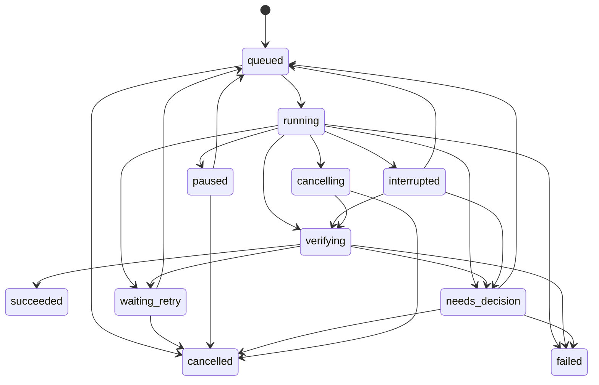

# 长时间运行操作盘点与 Task Engine 适配建议

> 调研日期：2026-10-10  
> 调研对象：`next/capability-layer` 当前工作树，HEAD 为 `0513ab07`。  
> 方法：只读静态代码检查，未修改文件，未运行下载、恢复、同步或跨设备实验。文中的 `file:line` 指向本次工作树；后续代码变更可能使行号漂移。  
> 标记：“现状”表示代码核实的行为；“建议／草案”表示拟议设计；“推测”表示仍需实验验证的风险。

## 1. 调研结论

现有代码已经具备多种长任务执行器，但任务生命周期分别保存在 Rust 会话、Service 内存、Widget 状态、SharedPreferences 和缓存文件中。**持久化了配置、结果或文件，不等于持久化了任务。** 例如，扫描保存目录与文件差异缓存，增量同步保存仓库索引，BT 则直接启用 rqbit 的 JSON 会话持久化。证据：`lib/services/scan_service.dart:287`、`lib/services/scan_service.dart:373`、`lib/services/auto_sync_service.dart:1033`、`rust/src/api/torrent.rs:143`。

需要优先处理以下边界：

1. **BT 执行与完成后入库分属不同生命周期。** Native 下载启动后由 Rust 会话执行；下载页负责五秒轮询和自动入库调度，入库路径多处检查 `mounted`。关闭或不打开下载页会影响这条自动入库路径。证据：`rust/src/api/torrent.rs:140`、`lib/pages/torrent_download_page.dart:122`、`lib/pages/torrent_download_page.dart:491`。
2. **取消存在不同语义。** BT 预览有 Rust `Abortable`；BT 下载有暂停、恢复、忘记、删除；WebDAV 搜索在边界检查停止；扫描处理器没有取消参数；关闭自动同步只停止调度。不能统一展示成“立即取消”。证据：`rust/src/api/torrent.rs:355`、`lib/services/torrent_download_service.dart:362`、`lib/services/webdav_service.dart:1903`、`lib/services/concurrent_video_processor.dart:46`、`lib/services/auto_sync_service.dart:129`。
3. **“执行结束”与“全部成功”混用。** Bangumi 批量同步即使存在失败项也返回 `success: true`；远程刮削返回汇总计数，但目录枚举异常可能被吞掉；插件市场没有检查导入返回值。证据：`lib/services/bangumi_sync_service.dart:641`、`lib/services/local_media_management_api.dart:237`、`lib/services/local_media_management_api.dart:476`、`lib/themes/nipaplay/widgets/plugin_market_dialog.dart:334`。
4. **已有可复用的验证逻辑。** BT 入库前检查文件存在且长度一致；VobSub 字幕对检查大小、格式和摘要后发布；插件外部脚本支持 SHA-256 校验。证据：`lib/services/torrent_download_service.dart:418`、`lib/services/remote_subtitle_service.dart:397`、`lib/plugins/danmaku/plugin_external_script_cache.dart:105`。
5. **部分业务仍由页面直接实现。** WebDAV／SMB 刮削在媒体库 Widget 和 HTTP API 内各有一套实现；备份、插件市场、批量匹配也由页面组织执行。证据：`lib/themes/nipaplay/widgets/library_management_tab.dart:5825`、`lib/services/local_media_management_api.dart:519`、`lib/themes/nipaplay/pages/settings/backup_restore_page.dart:242`、`lib/themes/nipaplay/widgets/plugin_market_dialog.dart:306`。
6. **实时服务应与持久任务区分。** 播放会话、资源监控、LAN 响应器和代理服务器没有自然的“业务完成”终点。它们需要受管理的生命周期；其中需要可靠交付的写操作，可以另建持久任务。证据：`lib/services/jellyfin_playback_sync_service.dart:70`、`lib/utils/system_resource_monitor.dart:221`、`lib/services/web_server_service.dart:429`、`lib/services/smb_proxy_service.dart:77`。

这与 Next 设计中的“共享 Harness、UI 作为调用者、Action 返回结构化判断、只在需要判断时唤醒 Agent”一致。Task Engine 是下一阶段，Mesh 是后续演进，不能把本文草案当作已经实现的接口。证据：`docs/next/DESIGN.md:8`、`docs/next/DESIGN.md:21`、`docs/next/DESIGN.md:33`、`docs/next/DESIGN.md:371`。

## 2. 阅读口径

本文区分以下概念：

- **状态观察**：轮询、ChangeNotifier、回调或 Stream，使调用者看到当前状态。
- **任务持久化**：保存输入、状态、检查点、重试计划和执行归属。
- **恢复**：重新启动后继续或对账同一个逻辑任务；仅重新扫描、重新下载或复用缓存，不自动视为恢复。
- **取消**：区分停止调度、停止提交新工作、取消正在执行的请求，以及仅忽略迟到结果。
- **回执**：能够追溯完成对象、执行结果和验证依据的持久记录；Snackbar、日志、Future 返回和 HTTP 200 本身不等于完整回执。

“没有取消／恢复”限定于本文引用的执行接口和路径，不表示所有依赖库都不具备相关能力。移动平台被系统终止后是否能常驻、各平台强杀恢复是否可靠，本次未做运行验证。

## 3. 主要操作盘点

### A01. BT 下载、磁链预览与完成后自动入库

#### 入口与执行链

`TorrentDownloadService.initialize()`、`listTasks()`、添加磁链、添加种子和预览均可触发会话初始化。会话是惰性初始化，并用共享 Future 合并并发初始化；不能准确描述为“只能打开下载页才初始化”。现有下载页在 `initState` 调用初始化，是明确的 GUI 触发方。证据：`lib/services/torrent_download_service.dart:200`、`lib/services/torrent_download_service.dart:279`、`lib/services/torrent_download_service.dart:304`、`lib/services/torrent_download_service.dart:382`、`lib/pages/torrent_download_page.dart:95`。

| 维度 | 代码核实的现状 |
|---|---|
| 状态与进度 | `TorrentTask` 包含 native ID、infoHash、输出目录、状态、下载／上传字节、总大小、速度、错误和 `finished`；Controller 是 ChangeNotifier。下载页只在活跃时五秒轮询，退出页面停止观察。证据：`lib/models/torrent_task.dart:62`、`lib/downloads/torrent_task_controller.dart:6`、`lib/pages/torrent_download_page.dart:112`。 |
| 取消 | 下载支持 pause、resume、forget、delete；它们的副作用不同。磁链预览另有取消接口，Rust 使用 timeout 和 `Abortable`，可以终止预览 Future。证据：`lib/services/torrent_download_service.dart:362`、`lib/services/torrent_download_service.dart:630`、`rust/src/api/torrent.rs:355`、`rust/src/api/torrent.rs:398`。 |
| 持久化与恢复 | Rust rqbit 配置启用 `fastresume` 和 JSON persistence。Android／OHOS 由 Dart 指定 application support 下的 `torrent_session`，并导入历史会话；其他平台使用 Rust 默认目录。恢复依赖再次初始化 native 会话，本次未验证强杀恢复。证据：`rust/src/api/torrent.rs:143`、`lib/services/torrent_download_service.dart:400`、`rust/src/api/torrent.rs:876`。 |
| 历史迁移 | 会话迁移按 infoHash 去重，复制 torrent／bitv 文件，并使用历史导入标记，避免已删除任务再次被导入。证据：`lib/services/torrent_session_storage.dart:9`。 |
| 错误处理 | 添加操作捕获后记录并重新抛出；Rust API 返回错误字符串；页面捕获后更新状态、显示消息。自动入库失败设置一分钟后的内存重试时间。证据：`lib/services/torrent_download_service.dart:304`、`rust/src/api/torrent.rs:398`、`lib/pages/torrent_download_page.dart:141`、`lib/pages/torrent_download_page.dart:508`。 |
| UI 耦合 | Native 下载执行不由页面轮询驱动；观察、摘要和自动入库由下载页组织。自动入库检查页面存活、设置 Provider、当前任务快照和 ScanService 忙状态。证据：`rust/src/api/torrent.rs:140`、`lib/pages/torrent_download_page.dart:462`、`lib/pages/torrent_download_page.dart:497`。 |
| 完成与回执 | `finished` 只说明下载完成，不说明已入库，也不说明停止做种。入库前检查路径位于下载根内、文件存在、长度等于 torrent 文件长度；扫描成功后才保存自动入库键。证据：`lib/models/torrent_task.dart:62`、`lib/services/torrent_download_service.dart:418`、`lib/pages/torrent_download_page.dart:504`、`lib/pages/torrent_download_page.dart:515`。 |

自动入库键为 `infoHash|outputFolder`，持久化在 SettingsStorage；正在入库、串行执行链和下次重试时间仍在页面内存。证据：`lib/models/torrent_task.dart:119`、`lib/services/torrent_download_service.dart:551`、`lib/pages/torrent_download_page.dart:462`。

**适配建议：** 拆成 `torrent.download` 和依赖它的 `library.import`。下载完成回执保存选中文件及验证结果；入库回执保存每个文件对应的媒体记录。做种作为后续会话状态单独管理，不延迟下载 Job 的完成。

### A02. 本地媒体库扫描

#### ScanService：扫描编排

| 维度 | 代码核实的现状 |
|---|---|
| 入口 | 主界面和 Cupertino 主界面首帧触发启动刷新；启动扫描等待播放准备、目录加载并延迟执行。用户添加目录、刷新媒体库和 HTTP API 也能触发扫描。证据：`lib/main.dart:1602`、`lib/themes/cupertino/pages/cupertino_main_page.dart:147`、`lib/services/scan_service.dart:229`、`lib/themes/nipaplay/widgets/library_management_tab.dart:717`、`lib/services/local_media_management_api.dart:630`。 |
| 状态与进度 | ChangeNotifier 暴露 `isScanning`、比例、消息、发现数量、失败列表和完成旗标；通知以 100ms 节流。全目录刷新分配差异分析与文件处理阶段进度。证据：`lib/services/scan_service.dart:140`、`lib/services/scan_service.dart:202`、`lib/services/scan_service.dart:664`。 |
| 取消 | 执行循环会检查 `_isScanning`，但服务没有公开取消扫描入口或传递给处理器的取消 token；dispose 取消通知定时器。不能据此认定用户可以取消正在执行的扫描。证据：`lib/services/scan_service.dart:202`、`lib/services/scan_service.dart:695`、`lib/services/scan_service.dart:911`、`lib/services/concurrent_video_processor.dart:46`。 |
| 持久化与恢复 | 扫描目录、文件差异缓存保存到 SharedPreferences；成功写入的观看历史保留。扫描队列、游标、失败重试计划没有在该路径持久化，启动刷新属于重新计算差异。证据：`lib/services/scan_service.dart:287`、`lib/services/scan_service.dart:373`、`lib/services/scan_service.dart:919`。 |
| 错误处理 | Rust 差异分析失败可回退完整扫描；逐文件失败进入失败列表；部分异常仍设置 `completed`，所以“扫描结束”不是“全部识别成功”。证据：`lib/services/scan_service.dart:664`、`lib/services/scan_service.dart:819`、`lib/services/scan_service.dart:919`。 |
| UI 耦合 | 服务本身不依赖页面 BuildContext，但启动时机由主界面挂接；UI 消费并清除“刚完成”旗标。HTTP API 返回启动结果并提供状态查询。证据：`lib/services/scan_service.dart:155`、`lib/themes/nipaplay/widgets/dashboard_home_page.dart:947`、`lib/services/local_media_management_api.dart:997`。 |
| 完成与回执 | 普通扫描依赖状态／失败列表；下载文件扫描以处理结果中没有失败项作为成功，空输入直接成功。没有逐文件持久验证回执。证据：`lib/services/scan_service.dart:975`。 |

**风险推测：** 扫描处理后更新文件差异缓存；若识别失败但文件未变，后续仅按差异选取时可能不再自动重试该文件，需要针对失败项验证。证据：`lib/services/scan_service.dart:961`。

#### ConcurrentVideoProcessor：识别与入库

- **入口、状态：** ScanService 调用批处理器；默认并发四个，通过 `(processed, total, displayName)` 回调报告进度，使用 Semaphore 和 `Future.wait`。证据：`lib/services/concurrent_video_processor.dart:28`、`lib/services/concurrent_video_processor.dart:46`、`lib/services/concurrent_video_processor.dart:98`。
- **取消：** 接口没有取消参数；识别设置二十秒超时。Dart Future 超时只结束等待，不能据此推断底层网络请求或 native 工作已经终止。证据：`lib/services/concurrent_video_processor.dart:119`。
- **持久化、恢复：** 成功项写入观看历史；没有持久执行队列或批次游标。部分已有匹配项直接跳过。证据：`lib/services/concurrent_video_processor.dart:46`、`lib/services/concurrent_video_processor.dart:224`。
- **错误：** 未匹配、缺少 ID、超时和异常转成逐项失败结果。证据：`lib/services/concurrent_video_processor.dart:232`。
- **UI、完成：** 不依赖 BuildContext；当前完成依据是匹配成功并调用历史写入，批处理返回成功／失败／跳过汇总，未提供独立数据库回读回执。证据：`lib/services/concurrent_video_processor.dart:114`、`lib/services/concurrent_video_processor.dart:224`。
- **判断规则：** 当前路径使用首个匹配结果，并处理已有观看进度及记录迁移。证据：`lib/services/concurrent_video_processor.dart:129`。

#### RustFileScanService：递归枚举与差异

- **入口、状态：** Dart 通过 FFI 等待完整 diff；接口没有逐项进度或取消参数，Web 不支持。证据：`lib/services/rust_file_scan_service.dart:28`。
- **持久化、恢复：** Rust 返回当前文件、增删改和 hash，由上层保存；Rust 调用没有独立任务检查点。证据：`lib/services/rust_file_scan_service.dart:48`。
- **错误：** 递归处理跳过符号链接，部分条目错误跳过；根级错误走错误返回。证据：`rust/src/api/file_scan.rs:145`。
- **完成与验证：** hash 使用文件大小和 mtime 的 SHA-256 截断值，属于变化指纹，**不是文件内容 hash**。证据：`rust/src/api/file_scan.rs:190`。
- **UI：** 这一层不依赖 Widget；可作为扫描 Job 的确定性枚举执行器。接口证据：`lib/services/rust_file_scan_service.dart:28`。

**适配建议：** 分离 `enumerate → identify → persist → verify`，为每个文件建立 Job item。枚举完成前允许总量未知；识别失败单独重试，不能由文件变化指纹决定失败项是否需要再次处理。

### A03. WebDAV／SMB 扫描与刮削

| 维度 | 代码核实的现状 |
|---|---|
| 入口 | 媒体库管理页经确认对话框启动；远程模式通过 Provider 请求服务端。HTTP API 另有 WebDAV／SMB 枚举与刮削路径。证据：`lib/themes/nipaplay/widgets/library_management_tab.dart:5936`、`lib/themes/nipaplay/widgets/library_management_tab.dart:5984`、`lib/themes/nipaplay/widgets/library_management_tab.dart:6172`、`lib/services/local_media_management_api.dart:237`、`lib/services/local_media_management_api.dart:441`。 |
| 状态与进度 | Widget 使用 `_isRemoteScraping`、setState 和逐文件回调；HTTP API 等待整个请求后返回总数、匹配数和失败数，没有这条刮削路径的 Job ID 或进度事件。证据：`lib/themes/nipaplay/widgets/library_management_tab.dart:5948`、`lib/themes/nipaplay/widgets/library_management_tab.dart:6045`、`lib/services/local_media_management_api.dart:519`。 |
| 取消 | 递归枚举与刮削接口没有统一取消 token；HTTP 长请求断开没有对应的业务取消处理。证据：`lib/themes/nipaplay/widgets/library_management_tab.dart:5825`、`lib/themes/nipaplay/widgets/library_management_tab.dart:6080`、`lib/services/local_media_management_api.dart:476`。 |
| 持久化与恢复 | 已识别媒体写入历史库；目录队列、已处理游标和失败项在这些路径没有持久检查点，重启需重新发起。证据：`lib/themes/nipaplay/widgets/library_management_tab.dart:5910`、`lib/services/local_media_management_api.dart:590`。 |
| 错误处理 | 单文件错误计入失败；目录递归异常被记录后返回部分列表，可能无法区分“完整枚举”与“枚举中断”。证据：`lib/themes/nipaplay/widgets/library_management_tab.dart:5920`、`lib/themes/nipaplay/widgets/library_management_tab.dart:6080`、`lib/themes/nipaplay/widgets/library_management_tab.dart:6313`、`lib/services/local_media_management_api.dart:476`。 |
| UI 耦合 | Widget 直接持有确认、Provider、状态、历史刷新和结果提示；API 又实现同类业务。WebDAV 页面路径用 probe URL 识别，API 显式传稳定路径与 probe；SMB 识别依赖 SMBProxy 初始化。证据：`lib/themes/nipaplay/widgets/library_management_tab.dart:6026`、`lib/themes/nipaplay/widgets/library_management_tab.dart:6259`、`lib/services/local_media_management_api.dart:519`。 |
| 完成与回执 | 以枚举列表处理结束和 matched／failed 汇总判定结束；没有逐条持久回执。HTTP 外层成功不能替代逐项成功，目录漏枚举也不一定进入失败计数。证据：`lib/services/local_media_management_api.dart:237`、`lib/services/local_media_management_api.dart:476`、`lib/services/local_media_management_api.dart:519`。 |

**适配建议：** 抽取一套无 UI 的 `remote.library.scan` 执行器，统一 GUI 与 HTTP 入口。稳定资源 URI、用于探测的临时 URL、连接配置引用分别保存；枚举错误必须进入回执，不能只记录日志。

### A04. 增量同步：AutoSyncService 与 incremental_sync_*

| 维度 | 代码核实的现状 |
|---|---|
| 入口 | 启动延后初始化；启用后立即同步；支持手动、配置间隔定时、本地修改后 45 秒 debounce、播放结束同步。播放结束两分钟内已有同步则跳过。证据：`lib/main.dart:542`、`lib/services/auto_sync_service.dart:107`、`lib/services/auto_sync_service.dart:120`、`lib/services/auto_sync_service.dart:140`、`lib/services/auto_sync_service.dart:149`、`lib/services/auto_sync_service.dart:194`。 |
| 状态与进度 | ChangeNotifier，阶段为 idle／pulling／merging／pushing／complete／failed；结果包含下载 patch、上传 operation、恢复 operation 等计数。并发调用合并到活动 Future，不是多个任务队列。证据：`lib/services/auto_sync_service.dart:27`、`lib/services/auto_sync_service.dart:95`、`lib/services/auto_sync_service.dart:204`。 |
| 取消 | `disable()` 停止定时调度，没有取消当前 `_performSync`；transport 接口没有 progress／cancel 参数。证据：`lib/services/auto_sync_service.dart:129`、`lib/services/incremental_sync_transport.dart:8`。 |
| 持久化与恢复 | 设置保存最近成功／错误；本地 support 目录的 index JSON 保存仓库、快照、已应用 patch 与状态，临时文件写入后 rename。重启重新运行并利用索引对账，没有逐阶段运行游标。证据：`lib/utils/auto_sync_settings.dart:179`、`lib/services/auto_sync_service.dart:1015`、`lib/services/auto_sync_service.dart:1033`。 |
| 错误处理 | 手动路径可抛出；自动路径忽略返回但保存错误状态。网络配置有连接／发送／接收超时，最多三次重试；部分提供商限流进入内存冷却，非所有错误都会重试。证据：`lib/services/auto_sync_service.dart:224`、`lib/services/incremental_sync_transport.dart:40`、`lib/services/incremental_sync_transport.dart:88`、`lib/services/incremental_sync_transport.dart:374`。 |
| UI 耦合 | 主要业务在服务中，不依赖页面 BuildContext；依赖备份服务进行本地状态导出／恢复，记录修改与播放器结束触发调度。证据：`lib/services/auto_sync_service.dart:273`、`lib/services/auto_sync_service.dart:1006`、`lib/providers/watch_history_provider.dart:470`、`lib/utils/video_player_state.dart:1896`。 |
| 完成与回执 | 同步结果有数量和仓库信息；patch 有 SHA-256、size、deviceId。本地先 apply 再 push；PUT 成功依据 HTTP 状态，未在 `_writeDirect` 回读验证。证据：`lib/services/incremental_sync_repository.dart:22`、`lib/services/auto_sync_service.dart:398`、`lib/services/auto_sync_service.dart:424`、`lib/services/incremental_sync_transport.dart:338`。 |

协议还有以下重要边界：

- 发布 manifest 前重新读取并合并；基准仓库／快照变化时抛错。transport 的所谓 atomic 写入实际为直接 PUT，不是服务器 CAS。证据：`lib/services/auto_sync_service.dart:439`、`lib/services/incremental_sync_transport.dart:165`。
- 达到阈值后压缩 patch，清理旧文件；清理失败留待后续处理。证据：`lib/services/auto_sync_service.dart:476`、`lib/services/auto_sync_service.dart:625`。
- JSON 规范化、恢复计划等可使用 Rust，也有 compute fallback；恢复计划按批次处理。证据：`lib/services/incremental_sync_native_codec.dart:83`、`lib/services/incremental_sync_native_codec.dart:139`、`rust/src/api/incremental_sync.rs:74`。
- 已有同步 deviceId 是本地持久标识，尚不能据此认定存在 Mesh 配对、执行租约或设备信任。证据：`lib/utils/auto_sync_settings.dart:166`；Mesh 仍在设计路线中：`docs/next/DESIGN.md:376`。

**适配建议：** 首先持久化调度和本次同步意图，保留现有 patch 协议。再保存稳定 patch ID、上传阶段和发布阶段检查点；发生不确定网络结果时先查远端对象，再决定重试。

### A05. 备份与恢复

| 维度 | 代码核实的现状 |
|---|---|
| 入口 | 备份设置页选择分类、路径或备份文件，经预览／确认后调用；完整备份恢复也被增量同步复用。证据：`lib/themes/nipaplay/pages/settings/backup_restore_page.dart:242`、`lib/themes/nipaplay/pages/settings/backup_restore_page.dart:336`、`lib/services/auto_sync_service.dart:1006`。 |
| 状态与进度 | 页面 `_isProcessing` 表示忙；FullBackupService 返回文件或分类结果，没有统一逐字节进度。完整备份顺序收集偏好、媒体库、历史、匹配和账号，可能包含缩略图。证据：`lib/services/full_backup_service.dart:65`、`lib/services/full_backup_service.dart:109`、`lib/themes/nipaplay/pages/settings/backup_restore_page.dart:242`。 |
| 取消 | 文件选择器可取消；编码、导出写入和恢复执行接口没有统一取消 token。证据：`lib/services/full_backup_service.dart:65`、`lib/services/full_backup_service.dart:495`、`lib/services/backup_service.dart:66`。 |
| 持久化与恢复 | `.npb`／`.nph` 文件及已恢复数据持久化；没有运行游标。完整恢复按分类／批次写入，不是整个恢复过程的一次全局事务；重启后需重新发起并处理已有结果。证据：`lib/services/full_backup_service.dart:495`、`lib/services/full_backup_service.dart:536`、`lib/services/backup_service.dart:66`。 |
| 错误处理 | 导出异常返回 null；完整恢复返回 success／errorMessage 和分类结果；旧恢复逐项 catch 后继续。证据：`lib/services/full_backup_service.dart:65`、`lib/services/full_backup_service.dart:632`、`lib/services/backup_service.dart:66`。 |
| UI 耦合 | 选择、确认、分享、进度提示由页面组织；核心编解码与分类恢复在服务中。iOS 导出后调用系统分享。证据：`lib/themes/nipaplay/pages/settings/backup_restore_page.dart:307`、`lib/themes/nipaplay/pages/settings/backup_restore_page.dart:336`。 |
| 完成与回执 | 完整恢复依据分类结果的 success，没有在最终完成方法中回读全部恢复对象。旧 `.nph` 恢复没有检查数据库 update 的影响行数，却增加 restoredCount。证据：`lib/services/full_backup_service.dart:641`、`lib/services/backup_service.dart:102`、`lib/services/backup_service.dart:118`。 |

**适配建议：** 导出回执记录格式、schema、文件大小／摘要和重新解析结果；恢复回执记录实际插入、更新、跳过、失败对象。恢复以备份摘要、分类和选定合并策略为幂等范围，按批次检查点继续。

### A06. 弹幕识别、匹配、缓存与导出

#### 自动识别与匹配

| 维度 | 代码核实的现状 |
|---|---|
| 入口 | 播放器加载和媒体扫描经 DanmakuMatchingService 调用 Dandanplay；支持本地、HTTP 和 SAF 文件，远程文件探测头部。证据：`lib/services/danmaku_matching_service.dart:14`、`lib/services/dandanplay_service_io.dart:1123`、`lib/utils/video_player_state/video_player_state_danmaku.dart:370`。 |
| 状态与进度 | 主要接口返回 Future／Map，没有统一匹配进度流；播放器解析弹幕使用 compute。证据：`lib/services/danmaku_matching_service.dart:14`、`lib/services/dandanplay_service_io.dart:1179`、`lib/utils/video_player_state/video_player_state_danmaku.dart:454`。 |
| 取消 | 这些识别／获取接口没有统一取消 token；网络超时不等于主动终止所有底层工作。证据：`lib/services/dandanplay_service_io.dart:1552`、`rust/src/api/media_probe.rs:26`。 |
| 持久化与恢复 | 匹配结果缓存于 SharedPreferences，弹幕另存缓存文件；没有“识别到哪一步”的持久任务记录。证据：`lib/services/dandanplay_service_io.dart:403`、`lib/services/dandanplay_service_io.dart:445`、`lib/services/danmaku_cache_manager.dart:99`。 |
| 错误处理 | 文件／远程探测、匹配和弹幕请求各自处理错误；匹配成功后弹幕获取失败可以只记录日志，匹配结果仍成功。证据：`lib/services/dandanplay_service_io.dart:1123`、`lib/services/dandanplay_service_io.dart:1179`。 |
| UI 耦合 | MatchingService 本身不依赖 BuildContext；人工匹配工具直接使用 BuildContext 与对话框，播放器加载流程持有媒体会话状态。证据：`lib/services/danmaku_matching_service.dart:14`、`lib/services/manual_danmaku_matcher.dart:45`、`lib/utils/video_player_state/video_player_state_danmaku.dart:854`。 |
| 完成与回执 | 本地识别使用前 16MiB MD5；存在首结果和文件名 fallback。返回匹配成功不能证明弹幕已下载或已持久化，也不能证明媒体身份正确。证据：`lib/services/dandanplay_service_io.dart:1535`、`lib/services/dandanplay_service_io.dart:1179`、`lib/services/dandanplay_service_io.dart:1235`。 |

#### 弹幕缓存

- **入口、状态：** 获取弹幕时读／写缓存；启动时可清空缓存，延后执行过期清理。读写使用串行链，清理另有合并 Future，不能认定所有缓存操作都在同一个串行队列。证据：`lib/services/danmaku_cache_manager.dart:28`、`lib/main.dart:527`、`lib/main.dart:542`、`lib/main.dart:714`。
- **持久化：** JSON 与 metadata 保存到缓存目录；不同作品年龄对应七天或两小时 TTL。证据：`lib/services/danmaku_cache_manager.dart:20`、`lib/services/danmaku_cache_manager.dart:56`、`lib/services/danmaku_cache_manager.dart:99`。
- **取消、错误：** 写入和清理没有统一进度／取消接口；写入异常被内部吞掉，过期／损坏文件可被删除。证据：`lib/services/danmaku_cache_manager.dart:209`、`lib/services/danmaku_cache_manager.dart:312`、`lib/services/danmaku_cache_manager.dart:374`。
- **完成、UI：** 弹幕获取路径异步保存后即可返回 comments；内存命中或返回成功不证明磁盘写入成功。缓存服务不依赖页面。证据：`lib/services/dandanplay_service_io.dart:1757`、`lib/services/danmaku_cache_manager.dart:209`。

#### 人工批量匹配与导出

批量匹配对话框负责搜索／剧集选择，返回映射后页面逐条写入、迁移和刷新；失败主要记录日志。自定义媒体信息也有目录扫描和批量保存。两条路径均由 UI 组织，没有持久执行游标或取消协议。证据：`lib/themes/nipaplay/widgets/batch_danmaku_dialog.dart:236`、`lib/themes/nipaplay/widgets/library_management_tab.dart:4310`、`lib/themes/nipaplay/widgets/library_management_tab.dart:4351`、`lib/themes/nipaplay/widgets/custom_media_info_dialog.dart:975`、`lib/themes/nipaplay/widgets/custom_media_info_dialog.dart:1520`。

弹幕过滤导出及 ASS 生成从 navigator／播放器 context 获取依赖，尚不是可独立运行的任务接口。证据：`lib/services/danmaku/danmaku_service.dart:29`、`lib/services/danmaku/danmaku_service.dart:67`、`lib/services/danmaku/danmaku_service.dart:90`。

**适配建议：** 将 `media.identify`、`danmaku.fetch`、`cache.persist` 分开记录结果。人工选择输出结构化映射，再由无 UI 的 `media.applyMappings` 执行；回执保存匹配方式、候选、所选 ID、弹幕数量与实际落盘结果。

### A07. 已有模型任务：AI 剧透过滤

仓库已经存在调用模型的后台判断任务，不只是未来 Task Engine 的设想。

| 维度 | 代码核实的现状 |
|---|---|
| 入口、状态 | 播放器状态通过 650ms debounce、pending 标记和运行标记调度分析；限制采样，并对媒体、配置与内容计算分析 hash。证据：`lib/utils/video_player_state/video_player_state_danmaku.dart:1103`、`lib/utils/video_player_state/video_player_state_danmaku.dart:1118`、`lib/utils/video_player_state/video_player_state_danmaku.dart:1163`、`lib/utils/video_player_state/video_player_state_danmaku.dart:1201`。 |
| 取消 | 返回后检查 dispose、开关、hash 和当前媒体路径，丢弃失效结果；这属于逻辑失效，没有该路径的模型 HTTP 取消协议。证据：`lib/utils/video_player_state/video_player_state_danmaku.dart:1235`。 |
| 持久化、恢复 | 分析状态／结果在播放器内存；没有持久 Job 检查点。证据：`lib/utils/video_player_state/video_player_state_danmaku.dart:1118`、`lib/utils/video_player_state/video_player_state_danmaku.dart:1235`。 |
| 错误 | 服务调用配置的 OpenAI／Gemini 接口，HTTP 等待上限六十秒；错误抛出，播放器捕获后记录并清除运行标记。证据：`lib/services/danmaku_spoiler_filter_service.dart:17`、`lib/utils/video_player_state/video_player_state_danmaku.dart:1235`。 |
| UI、完成 | 强依赖当前播放媒体和会话；完成依据模型结果被当前会话接受，不是磁盘产物。证据：`lib/utils/video_player_state/video_player_state_danmaku.dart:1201`、`lib/utils/video_player_state/video_player_state_danmaku.dart:1235`。 |

**适配建议：** 若纳入 Job，使用内容 hash、配置版本与模型版本形成分析键；播放器仅订阅适用于当前媒体版本的结果。应区分“直接调用分析模型”与“唤醒负责规划的 Agent”，避免每次弹幕变化都触发规划循环。

### A08. Bangumi 观看状态同步

| 维度 | 代码核实的现状 |
|---|---|
| 入口 | 账号页 Controller 的手动同步入口调用 BangumiSyncService。证据：`lib/pages/account/account_controller.dart:437`。 |
| 状态与进度 | 文本及 current／total 回调；逐作品执行，中间等待 500ms。证据：`lib/services/bangumi_sync_service.dart:502`、`lib/services/bangumi_sync_service.dart:560`、`lib/services/bangumi_sync_service.dart:618`。 |
| 取消 | 批量同步接口没有取消 token。证据：`lib/services/bangumi_sync_service.dart:502`。 |
| 持久化与恢复 | 保存最近时间、汇总状态、已同步作品 ID；成功 ID 在整批结束时保存。“增量”模式跳过已有 `anime_$animeId`，不是按本次观看状态变化决定重传。证据：`lib/services/bangumi_sync_service.dart:55`、`lib/services/bangumi_sync_service.dart:560`、`lib/services/bangumi_sync_service.dart:625`。 |
| 错误 | 逐作品累计失败；整批返回可同时包含 `success: true` 和非零 errorCount。顶层异常返回失败。证据：`lib/services/bangumi_sync_service.dart:615`、`lib/services/bangumi_sync_service.dart:641`、`lib/services/bangumi_sync_service.dart:652`。 |
| UI 耦合 | 服务通过回调汇报，不直接弹框；Controller 用 mounted／setState 展示。证据：`lib/services/bangumi_sync_service.dart:502`、`lib/pages/account/account_controller.dart:437`。 |
| 完成与回执 | 返回逐作品结果和汇总，但不提供批次持久验证回执；标题搜索取首个 subject，观看阈值决定 wish／done 等状态。证据：`lib/services/bangumi_sync_service.dart:167`、`lib/services/bangumi_sync_service.dart:182`、`lib/services/bangumi_sync_service.dart:641`。 |

**适配建议：** 用“账号＋作品／剧集＋目标状态版本”替代永久“已同步作品”作为幂等范围；成功项及时保存。标题到 subject 的低置信度映射应先形成 Decision，批准后再执行写入。

### A09. Jellyfin／Emby 与共享主机进度同步

#### 播放期间上行

| 维度 | 代码核实的现状 |
|---|---|
| 入口 | 播放设置启动远端会话，停止播放时发送结束；历史保存路径按位置条件发送进度。证据：`lib/utils/video_player_state/video_player_state_player_setup.dart:1533`、`lib/utils/video_player_state/video_player_state_playback_controls.dart:131`、`lib/utils/video_player_state/video_player_state_danmaku.dart:1477`。 |
| 状态与进度 | Jellyfin／Emby 服务持有当前 session；请求为 Future，没有任务进度流。名称为“开始定时同步”的方法只记录日志，已经没有定时器。实际条件是 `_position.inMilliseconds % 1000 < 100`，不能保证严格每秒一次。证据：`lib/services/jellyfin_playback_sync_service.dart:70`、`lib/services/jellyfin_playback_sync_service.dart:253`、`lib/services/emby_playback_sync_service.dart:263`、`lib/utils/video_player_state/video_player_state_danmaku.dart:1481`。 |
| 取消 | stop 是业务结束上报，并在 finally 清会话；dispose 清理状态。没有待发送写操作的持久取消／队列接口。证据：`lib/services/jellyfin_playback_sync_service.dart:131`、`lib/services/emby_playback_sync_service.dart:133`、`lib/utils/video_player_state.dart:1918`。 |
| 持久化与恢复 | 当前远端播放 session 是内存状态；这些服务没有 durable outbox，重启不能继续同一个本地 session。证据：`lib/services/jellyfin_playback_sync_service.dart:70`、`lib/services/emby_playback_sync_service.dart:70`。 |
| 错误 | HTTP 请求有十秒超时，调用失败主要记录；结束路径清理本地会话。证据：`lib/services/jellyfin_playback_sync_service.dart:294`、`lib/services/emby_playback_sync_service.dart:305`、`lib/services/jellyfin_playback_sync_service.dart:131`。 |
| UI 耦合 | 服务不需要 BuildContext，但调用和当前 session 强依赖 VideoPlayerState 生命周期。证据：`lib/utils/video_player_state/video_player_state_player_setup.dart:1533`、`lib/utils/video_player_state.dart:1918`。 |
| 完成与回执 | Playing／Progress／Stopped 以 HTTP 接受为完成；结束后可标记已观看，没有通用远端状态回读回执。播放开始读取服务端进度并与本地时间比较。证据：`lib/services/jellyfin_playback_sync_service.dart:27`、`lib/services/jellyfin_playback_sync_service.dart:70`、`lib/services/jellyfin_playback_sync_service.dart:326`、`lib/services/emby_playback_sync_service.dart:337`。 |

共享主机和 Web 远端进度同步另有独立服务：按资源内存记录最近发送时间，五秒节流，HTTP 成功仅日志确认，异常吞掉。共享主机还支持缩略图上传。证据：`lib/services/shared_remote_playback_sync_service.dart:17`、`lib/services/shared_remote_playback_sync_service.dart:67`、`lib/services/shared_remote_playback_sync_service.dart:87`、`lib/services/web_remote_history_sync_service.dart:9`、`lib/services/web_remote_history_sync_service.dart:61`。

#### 服务端历史下行

ServerHistorySyncService 在后台初始化，监听 Jellyfin／Emby ready，使用 microtask 调度；每次请求 resume 列表限制五条，通过忙标记合并工作，写本地历史并调用刷新回调，也可下载缩略图。dispose 移除监听，不等于取消正在进行的请求。证据：`lib/providers/service_provider.dart:43`、`lib/services/server_history_sync_service.dart:31`、`lib/services/server_history_sync_service.dart:35`、`lib/services/server_history_sync_service.dart:56`、`lib/services/server_history_sync_service.dart:136`、`lib/services/server_history_sync_service.dart:296`、`lib/services/server_history_sync_service.dart:391`。

这条路径没有持久批次／游标、统一取消或逐项回执，错误主要记录。服务中的启动注释写“仅支持 Jellyfin”，但实现实际也处理 Emby，应以执行代码为准。证据：`lib/providers/service_provider.dart:46`、`lib/services/server_history_sync_service.dart:97`。

**适配建议：** 实时 session 继续受播放器管理；最终进度、已观看状态和缩略图上传进入可合并 outbox。下行历史导入单独成为 Job。恢复时补交最终事实，不重放过期的 Playing 心跳。

### A10. 缩略图与时间轴预览生成

| 维度 | 代码核实的现状 |
|---|---|
| 入口 | 时间轴预览仅支持 MDK 路径，在媒体准备、设置和播放状态满足条件时预取／后台填充；历史截图与手动截图调用当前播放器。证据：`lib/utils/video_player_state/video_player_state_timeline_preview.dart:9`、`lib/utils/video_player_state/video_player_state_timeline_preview.dart:62`、`lib/utils/video_player_state/video_player_state_capture.dart:117`、`lib/utils/video_player_state/video_player_state_capture.dart:181`。 |
| 状态与进度 | 预览使用串行链和内部计数；后台填充最多八十个点，中间等待 220ms，没有持久批次进度。JPEG 编码可使用 compute。证据：`lib/utils/video_player_state/video_player_state_timeline_preview.dart:263`、`lib/utils/video_player_state/video_player_state_timeline_preview.dart:467`、`lib/utils/video_player_state/video_player_state_capture.dart:32`。 |
| 取消 | session 序号检查与预览播放器 dispose 使旧工作失效，属于播放会话取消边界。证据：`lib/utils/video_player_state/video_player_state_timeline_preview.dart:51`、`lib/utils/video_player_state/video_player_state_timeline_preview.dart:254`。 |
| 持久化与恢复 | bucket JPEG 写入 `timeline_thumbnails`，重新打开媒体时从磁盘 hydrate；没有持久生成意图，应用重启不会仅凭未完成批次自动续做。证据：`lib/utils/video_player_state/video_player_state_timeline_preview.dart:103`、`lib/utils/video_player_state/video_player_state_timeline_preview.dart:158`。 |
| 错误 | snapshot／编码／写入失败返回 null；后台填充循环计数不能证明每个点成功生成。证据：`lib/utils/video_player_state/video_player_state_timeline_preview.dart:158`、`lib/utils/video_player_state/video_player_state_timeline_preview.dart:467`。 |
| UI 耦合 | 执行依赖 VideoPlayerState、当前媒体、内核与独立预览播放器，不是独立媒体处理 worker。证据：`lib/utils/video_player_state/video_player_state_timeline_preview.dart:210`、`lib/utils/video_player_state/video_player_state_capture.dart:117`。 |
| 完成与回执 | 单张截图检查 snapshot、非空 JPEG 并 flush 写入；时间轴批次没有“所有目标 bucket 可解码”的最终验证。证据：`lib/utils/video_player_state/video_player_state_capture.dart:117`、`lib/utils/video_player_state/video_player_state_timeline_preview.dart:158`、`lib/utils/video_player_state/video_player_state_timeline_preview.dart:467`。 |

`_startScreenshotTimer()` 虽保留“每五秒”注释，方法体已移除定时截图，不能把它列为实际五秒任务。证据：`lib/utils/video_player_state/video_player_state_capture.dart:105`。

**适配建议：** 即时悬停预览保持会话级；用户要求预生成／批量生成时建立低优先级 Job。回执列出目标 bucket、成功／失败数量和可解码验证。

### A11. 插件下载、市场与更新检查

#### 插件市场和安装

| 维度 | 代码核实的现状 |
|---|---|
| 入口 | 市场对话框初始化读取版本／索引，用户点击安装或更新下载脚本；插件设置页也触发更新检查。证据：`lib/themes/nipaplay/widgets/plugin_market_dialog.dart:111`、`lib/themes/nipaplay/widgets/plugin_market_dialog.dart:306`、`lib/settings/pages/plugin_settings_content.dart:46`、`lib/settings/pages/plugin_settings_content.dart:220`。 |
| 状态与进度 | 页面 setState、每项 isInstalling；PluginService 是 ChangeNotifier。主体下载没有逐字节进度。证据：`lib/themes/nipaplay/widgets/plugin_market_dialog.dart:319`、`lib/plugins/plugin_service.dart:267`。 |
| 取消 | 对话框 dispose 没有取消下载 HTTP；下载返回后若页面已卸载，直接返回并不导入。证据：`lib/themes/nipaplay/widgets/plugin_market_dialog.dart:128`、`lib/themes/nipaplay/widgets/plugin_market_dialog.dart:328`。 |
| 持久化与恢复 | 脚本、索引和启用设置保存，但没有安装运行队列。IO 存储直接写脚本／索引，索引保存异常被吞掉。证据：`lib/plugins/plugin_storage_impl_io.dart:59`、`lib/plugins/plugin_storage_impl_io.dart:110`、`lib/plugins/plugin_service.dart:1783`。 |
| 错误 | 市场页面捕获 HTTP／导入异常并提示；Service 远端索引支持超时和镜像 fallback。证据：`lib/themes/nipaplay/widgets/plugin_market_dialog.dart:339`、`lib/plugins/plugin_service.dart:325`。 |
| UI 耦合 | 下载 URL／代理配置来自 context Provider；关闭市场影响下载之后是否安装。证据：`lib/themes/nipaplay/widgets/plugin_market_dialog.dart:323`、`lib/themes/nipaplay/widgets/plugin_market_dialog.dart:329`。 |
| 完成与回执 | Service 校验 metadata、宿主版本和版本关系，保存后 reload，返回插件 ID 或 null；市场未检查返回值即显示成功。证据：`lib/plugins/plugin_service.dart:1437`、`lib/themes/nipaplay/widgets/plugin_market_dialog.dart:334`。 |

#### 插件外部脚本缓存

外部脚本按 URL＋预期 hash 合并 in-flight Future，先验证已有文件，再下载；限制非空与最大大小，可验证 SHA-256，临时写入后 rename。没有持久下载 Job 或取消参数，但可从已有文件验证后复用。没有预期 SHA-256 时，验证仅为非空和大小范围。证据：`lib/plugins/danmaku/plugin_external_script_cache.dart:15`、`lib/plugins/danmaku/plugin_external_script_cache.dart:83`、`lib/plugins/danmaku/plugin_external_script_cache.dart:105`、`lib/plugins/danmaku/plugin_external_script_cache.dart:126`、`lib/plugins/danmaku/plugin_external_script_cache.dart:132`。

**适配建议：** 安装拆成下载、校验、发布、reload、验证插件 ID／版本。把配置与下载意图提交给 Service 后，页面只订阅。主体脚本与索引应提供可恢复的发布边界。

#### 应用更新检查

关于页初始化按设置自动检查，按钮可手动检查；UpdateService 请求 GitHub latest release，十秒超时，比较版本并返回 UpdateInfo／error。该服务是检查更新，不是更新包下载执行器。设置持久化，检查结果由页面状态持有，没有任务恢复或取消入口。证据：`lib/settings/pages/about_settings_content.dart:42`、`lib/settings/pages/about_settings_content.dart:458`、`lib/settings/pages/about_settings_content.dart:476`、`lib/services/update_service.dart:14`、`lib/services/update_service.dart:36`。

**适配建议：** `app.update.check` 可作为短 Job 或可缓存 Action；回执保存检查时间、release ID、版本、来源和错误，不以弹出更新提示作为业务完成。

## 4. 其他后台、批处理与定时操作

本节继续按入口、状态／进度、取消、持久化／恢复、错误、UI 和回执盘点。对没有自然完成终点的操作，建议采用受管理服务，不强制改成持久 Job。

### B01. 远程字幕、音轨与字体下载缓存

- **入口：** 字幕选择／自动加载、外挂音轨检测和字体加载触发。证据：`lib/utils/subtitle_manager.dart:1458`、`lib/utils/subtitle_manager.dart:2221`、`lib/utils/audio_track_manager.dart:114`、`lib/themes/nipaplay/widgets/subtitle_tracks_menu.dart:402`。
- **状态、取消：** 字幕下载按源合并 Future；没有统一 Job 进度或 cancel。SMB 底层读取是 Stream，取消流可杀对应流 isolate，但上层缓存接口未暴露统一取消。证据：`lib/services/remote_subtitle_service.dart:312`、`lib/services/smb2_native_service_ffi.dart:645`。
- **持久化、恢复：** 已发布缓存文件复用；音轨／字体先写 `.downloading` 后 rename，没有持久下载游标。证据：`lib/services/remote_subtitle_service.dart:692`、`lib/services/remote_subtitle_service.dart:741`。
- **错误、完成：** VobSub 对下载到 staging，检查大小、格式、内容摘要，发布不可变目录再更新 `current`；失败可回退完整旧缓存。音轨复用只检查非零长度，共享音轨下载没有同等的预期大小校验。证据：`lib/services/remote_subtitle_service.dart:397`、`lib/services/remote_subtitle_service.dart:420`、`lib/services/remote_subtitle_service.dart:453`、`lib/services/remote_subtitle_service.dart:714`、`lib/services/remote_subtitle_service.dart:1374`。
- **UI：** 下载服务本身不依赖 BuildContext，但请求与加载结果属于播放器／菜单流程。上述调用入口为证据。

**适配建议：** 统一 `asset.fetch`，保持字幕对的原子发布协议；持久任务恢复时验证已发布目标，清理或重做 staging。音轨／字体回执应明确验证强度，不能把非空等同于完整。

### B02. WebDAV 递归搜索

浏览器页用户搜索，配置范围、深度、超时和最大结果；Service 回调 searched／found 和结果。页面通过停止标记或达到上限请求停止，Service 在目录、网络返回和条目边界检查，不能据此认定正在执行的 list 请求已被中止。结果在页面内存，超时可返回部分结果，异常由页面提示，没有持久搜索游标。证据：`lib/pages/webdav_browser_page.dart:1949`、`lib/pages/webdav_browser_page.dart:1981`、`lib/pages/webdav_browser_page.dart:2019`、`lib/services/webdav_service.dart:1810`、`lib/services/webdav_service.dart:1903`。

**适配建议：** 通常采用会话级 search；若支持无人值守完整索引，才持久化目录 frontier，并将结束原因记录为 completed／timeout／limit／cancelled。

### B03. LAN 主机发现

发现对话框首帧启动；先 UDP，后并发 HTTP 探测，页面维护阶段、总量和已扫描量。dispose 取消 token、关闭 HTTP client 和 UDP socket；没有持久发现任务。返回主机需验证协议／应用标识，异常主要记录。回执是发现候选集合，不能把发现主机等同于 Mesh 身份配对。证据：`lib/themes/nipaplay/widgets/shared_remote_lan_scan_dialog.dart:125`、`lib/themes/nipaplay/widgets/shared_remote_lan_scan_dialog.dart:149`、`lib/themes/nipaplay/widgets/shared_remote_lan_scan_dialog.dart:203`、`lib/themes/nipaplay/widgets/shared_remote_lan_scan_dialog.dart:263`、`lib/themes/nipaplay/widgets/shared_remote_lan_scan_dialog.dart:332`。

**适配建议：** 保持短期 DiscoverySession；配对、授权与执行归属另建 Action／Job。

### B04. 网络媒体库分页加载、刷新与重连

分页 helper 处理 limit／offset、去重，请求前后检查 `isCurrent`；旧请求结果可以失效，但这不是 HTTP 主动取消。共享库 Provider 用 ChangeNotifier 和递增退避重试，结果／运行状态主要在内存；页面活跃时可每六十分钟刷新。错误产生重试或失败状态，没有逐页持久回执。证据：`lib/services/media_server_pagination.dart:31`、`lib/providers/shared_remote_library_provider.dart:402`、`lib/providers/shared_remote_library_provider.dart:446`、`lib/themes/nipaplay/widgets/network_media_library_view.dart:2153`。

启动连接检查并行探测服务，并通过 ValueNotifier 报告状态；该路径是启动检查，没有周期任务游标。证据：`lib/services/server_connectivity_service.dart:28`、`lib/main.dart:537`。

**适配建议：** 页面浏览保留可取消查询；完整后台索引才用 Job。连接健康检查属于受管理探测，失败按确定性退避，不必唤醒 Agent。

### B05. Bangumi API 请求队列、日历／详情缓存与季度回顾

- BangumiService 有优先级请求队列、并发限制、Completer、超时和重试；结果可落盘缓存并在请求失败时 fallback。没有持久队列或统一取消接口。证据：`lib/services/bangumi_service.dart:137`、`lib/services/bangumi_service.dart:291`、`lib/services/bangumi_service.dart:309`。
- 首页季度回顾先读缓存，再异步预热／收集；循环受 mounted、开关和当前账号限制，失败退避。缓存、预留／配额信息可保存，但不是正在运行的游标。证据：`lib/themes/nipaplay/widgets/dashboard_home_page_quarterly_review_logic.dart:97`、`lib/themes/nipaplay/widgets/dashboard_home_page_quarterly_review_logic.dart:150`、`lib/themes/nipaplay/widgets/dashboard_home_page_quarterly_review_logic.dart:182`。
- QuarterlyReviewCache 有 revision ValueNotifier、持久缓存和午夜到期 Timer；加载／保存错误部分静默。证据：`lib/services/quarterly_review_cache.dart:21`、`lib/services/quarterly_review_cache.dart:183`、`lib/services/quarterly_review_cache.dart:209`。
- 本地分享服务还会预取作品详情，失败清除 Future 以便重试。证据：`lib/services/local_media_share_service.dart:344`。

**适配建议：** 缓存预热低优先级、可随需求撤销；若要离开首页后继续季度回顾，应先提取页面循环，再以账号／季度／缓存版本为幂等范围，验证卡片数据而非页面刷新。

### B06. Bangumi Web 登录状态轮询

Web 初始化后启动五秒定时器，请求登录状态，单请求三秒超时；失败／404 返回 false，继续后续轮询。这是认证状态观察，与观看状态批量同步不同；没有任务回执或运行游标。证据：`lib/services/bangumi_api_service.dart:53`、`lib/services/bangumi_api_service.dart:110`、`lib/services/bangumi_api_service.dart:130`。

**适配建议：** 由认证服务管理轮询生命周期；等待用户登录可作为其他 Job 的阻塞原因，不将每次轮询保存成独立任务。

### B07. 图片缓存清理与后台维护

ImageCacheManager 合并加载、串行化同 URL 写盘；每两分钟触发内存维护，按磁盘清理间隔执行文件清理。不同缓存目录采用不同 TTL；递归检查 mtime 并删除，错误多被吞掉，没有逐文件进度、持久运行游标或清理计数回执。证据：`lib/utils/image_cache_manager.dart:29`、`lib/utils/image_cache_manager.dart:88`、`lib/utils/image_cache_manager.dart:453`、`lib/utils/image_cache_manager.dart:482`。

弹幕过期清理见 A06，远程音轨／字体下载也异步触发缓存清理。证据：`lib/services/remote_subtitle_service.dart:704`、`lib/services/remote_subtitle_service.dart:759`。

**适配建议：** 小规模维护保持受管理调度；大目录清理成为低优先级 maintenance Job，输出删除数量、字节和失败对象，停止时检查条目边界。

### B08. 文件日志批量刷盘

日志服务订阅日志流，用一秒 flush 调度、队列上限和文件轮转；停止时取消订阅／Timer 并等待 flush。失败重新入队，但未刷盘队列没有持久化；日志文件持久化。没有 UI 依赖，完成依据文件追加／flush，而非 Job 回执。证据：`lib/services/file_log_service_io.dart:26`、`lib/services/file_log_service_io.dart:67`、`lib/services/file_log_service_io.dart:104`、`lib/services/file_log_service_io.dart:173`。

**适配建议：** 保持基础设施服务；Job 事件应先进入自己的持久存储，不能以异步日志作为唯一恢复依据。

### B09. Linux／macOS 存储迁移

StorageService 在解析平台存储目录时调用迁移。迁移递归复制应用文件，累计成功／失败和错误，没有实时 progress／cancel 或逐项检查点；结果包含数量，但 copy 路径没有内容摘要校验。部分文件失败时仍写“迁移完成”标记；macOS 只有无失败时清理旧应用数据。证据：`lib/utils/storage_service.dart:170`、`lib/utils/storage_service.dart:255`、`lib/utils/linux_storage_migration.dart:163`、`lib/utils/linux_storage_migration.dart:222`、`lib/utils/linux_storage_migration.dart:264`、`lib/utils/macos_storage_migration.dart:104`、`lib/utils/macos_storage_migration.dart:167`、`lib/utils/macos_storage_migration.dart:215`。

**风险推测：** 标记完成但有失败项，后续自动迁移可能不再覆盖这些失败对象；需要用故障注入验证标记与重试策略。

**适配建议：** 保持启动前置依赖，但增加持久迁移清单和逐文件验证；复制、验证、删除旧数据分别记录。删除阶段需要独立的破坏性授权。

### B10. 常驻服务器、代理、SMB worker 与单实例通信

| 操作 | 核实的生命周期、状态与回执边界 |
|---|---|
| Web／遥控接收服务器、LAN responder | 启动流程加载设置并按开关启动；start bind 成功后保存状态并启动 LAN responder，失败保存错误；stop 强制关闭 server／responder。设置持久化，socket 不持久化。启动成功可验证绑定端口，但没有业务“自然完成”。证据：`lib/providers/service_provider.dart:51`、`lib/services/web_server_service.dart:350`、`lib/services/web_server_service.dart:419`、`lib/services/web_server_service.dart:442`、`lib/services/nipaplay_lan_discovery.dart:79`。 |
| SMB proxy | initialize／serve 建立本地代理，stop 关闭；属于访问媒体所需基础设施，没有持久执行游标。证据：`lib/services/smb_proxy_service.dart:33`、`lib/services/smb_proxy_service.dart:77`、`lib/services/smb_proxy_service.dart:98`。 |
| 插件媒体代理 | 惰性启动 isolate 和本地 HTTP 代理；属于插件运行基础设施。证据：`lib/services/plugin_media_proxy.dart:14`、`lib/services/plugin_media_proxy.dart:54`、`lib/services/plugin_media_proxy.dart:98`。 |
| Native SMB worker／流读取 | worker 在 isolate 执行；流式读取另有 StreamController，取消流杀对应 isolate。它提供底层执行与取消机制，不提供持久业务任务。证据：`lib/services/smb2_native_service_ffi.dart:151`、`lib/services/smb2_native_service_ffi.dart:645`。 |
| 单实例 IPC | socket 接受请求、分发并响应 OK；dispose 清理。这个 ACK 是接收／分发确认，不能当作播放、打开文件等业务已完成。证据：`lib/services/single_instance_service.dart:107`、`lib/services/single_instance_service.dart:311`。 |

**适配建议：** 建立 ManagedService 的 desiredState、running、health、lastError；启动／停止可以是 Action。服务器收到长操作请求后，应返回 Job ID；通信 ACK 与 Job receipt 分离。

### B11. 播放绑定操作、计算任务和 UI 定时器

| 操作 | 核实的现状及 Task Engine 边界 |
|---|---|
| 自动下一集 | 持有 BuildContext，Snackbar 倒计时，每秒更新，支持取消；状态不持久，播放动作完成没有独立回执。证据：`lib/services/auto_next_episode_service.dart:35`、`lib/services/auto_next_episode_service.dart:101`、`lib/services/auto_next_episode_service.dart:165`。建议保持会话级，避免重启重放旧倒计时。 |
| OP／ED 检测、AniSkip | 本地小输入直接检测、大输入 compute，以 generation 检查失效；AniSkip 按 MAL／集数合并请求和内存缓存，错误降级为空。没有持久检测游标。证据：`lib/utils/video_player_state/video_player_state_intro_skip.dart:97`、`lib/services/intro_skip/aniskip_service.dart:79`。批量离线分析可成为 Job，播放内判断仍受媒体 session 限制。 |
| 字幕解析、编码检测／转换 | 原生解析通过 compute；编码 fallback 调用 `uchardet`、`iconv` Process.run，失败尝试下一方案。没有该接口的进程取消或持久游标，结果是字幕／文本，不是 FFmpeg 转码任务。证据：`lib/utils/subtitle_parser.dart:802`、`lib/utils/subtitle_parser.dart:912`、`lib/utils/subtitle_parser.dart:1079`。 |
| 外部播放器启动与监视 | 服务解析播放源并准备弹幕；PotPlayer、mpv 等 session 使用进程／窗口轮询与清理。设置可保存，session 仍是运行时状态；启动成功不等于媒体解码成功。证据：`lib/services/external_player_service.dart:28`、`lib/services/external_player_service.dart:35`、`lib/models/external_player_session/potplayer_session.dart:248`、`lib/models/external_player_session/mpv_session.dart:515`。 |
| 系统资源与 FPS 监控 | 每秒采样，提供消费者注册和停止监控；没有自然完成终点。证据：`lib/utils/system_resource_monitor.dart:147`、`lib/utils/system_resource_monitor.dart:151`、`lib/utils/system_resource_monitor.dart:221`。 |
| 播放 UI、音量保存、Provider 通知 | Ticker 驱动播放 UI，音量保存 debounce，Jellyfin／Emby Provider 节流通知。这些是交互与状态更新，不需要持久 Job。证据：`lib/utils/video_player_state/video_player_state_navigation.dart:872`、`lib/utils/video_player_state.dart:1041`、`lib/providers/jellyfin_provider.dart:119`、`lib/providers/emby_provider.dart:82`。 |

JellyfinTranscodeManager 在所查路径负责设置读写，不能据类名推断存在本地后台转码 worker。证据：`lib/services/jellyfin_transcode_manager.dart:23`、`lib/services/jellyfin_transcode_manager.dart:47`。

## 5. 统一 Job 模型草案

本节全部为建议，不代表现有实现。

### 5.1 Job、Action 与执行器的关系

建议让 Action 负责校验、授权边界和提交任务，Task Engine 负责调度、持久化、恢复与事件，领域执行器负责确定性执行和验证。

`Outcome.Completed({jobId})` 应明确表示“任务已受理”，不能让调用者误认为下载、恢复已经完成。业务完成通过 `jobs.get`、事件订阅和最终 receipt 确认。需要选择时生成持久 Decision，选项仍携带可直接调用的 ActionCall，与现有设计契约一致。设计依据：`docs/next/DESIGN.md:21`、`docs/next/DESIGN.md:33`。

### 5.2 建议字段

| 字段组 | 草案字段与语义 |
|---|---|
| 身份、版本 | `jobId`、`type`、`schemaVersion`、`executorVersion`。Job ID 稳定，重试不换逻辑任务身份。 |
| 调用来源 | `actionId`、`invocationId`、`origin`、`createdBy`、`authorizationRef`。记录 GUI／Agent／远端调用关系；授权不能只靠恢复时的页面状态。 |
| 输入 | 不可变 `input`、`inputHash`、`resourceRefs`、`credentialRefs`。路径、连接与账号使用引用；不把密码、token 或短期带鉴权 URL写入事件。 |
| 编排 | `parentJobId`、`dependsOn`、`priority`、`resourceLocks`、`concurrencyClass`。支持下载后入库、字幕对、批量子项。 |
| 幂等 | `idempotencyKey`、`idempotencyScope`、`dedupePolicy`。区分重复请求去重、目标状态覆盖和仅运行期间合并。 |
| 生命周期 | `state`、`stateVersion`、`createdAt`、`updatedAt`、`startedAt`、`finishedAt`。用版本条件更新阻止迟到执行器覆盖新状态。 |
| 进度 | `phase`、`completed`、`total?`、`unit`、`bytesDone?`、`bytesTotal?`、`messageCode`。总量未知可为空；不同阶段／单位不能混算。 |
| 重试、错误 | `attempt`、`retryAt`、`retryPolicy`、`errorCode`、`retryable`、`errorDetailRef`。将限流、身份失效、缺资源与执行器错误区分。 |
| 取消、恢复 | `cancelRequestedAt`、`cancelMode`、`checkpointVersion`、`checkpoint`、`nativeHandle?`。native ID 是关联句柄，不能作为全局 Job ID。 |
| 设备归属 | `requestedDeviceId?`、`ownerDeviceId`、`executionDeviceId`、`ownerEpoch`、`leaseExpiresAt?`。预留 Mesh，首期只有本机也填写明确身份。 |
| 判断 | `decisionId?`、`blockedReason?`、`decisionContextRef?`。保存候选、约束、允许的选项与有效期。 |
| 结果 | `receiptId?`、`resultSummary`、`verificationStatus`。统计与验证记录分开保存。 |

进度消息建议为稳定代码与参数，中文显示由 UI 渲染。执行器不传 BuildContext，也不直接调用 Snackbar。

### 5.3 状态机



状态语义建议：

- `interrupted` 表示执行进程消失或归属不明确；恢复器先查副作用，不能直接重新执行。
- `paused` 只用于执行器能够暂停并继续的任务；不具备暂停能力的扫描应使用取消或中断恢复。
- `cancelRequested` 是请求事实；只有执行器确认安全停止才进入 `cancelled`。
- 取消到达时，若外部副作用已经提交，应继续验证并在回执记载取消时序，不能伪造“未执行”。
- 批处理允许项级成功／失败。默认必需项失败则整体失败；只有显式 `allowPartial` 策略才允许带 `partial: true` 的成功回执。
- `succeeded` 表示完成约定的验证，不能仅由 Future 返回、循环结束或页面提示设置。

### 5.4 事件与回执

建议保存有序事件：

`JobCreated`、`JobQueued`、`JobStarted`、`PhaseChanged`、`ProgressChanged`、`ItemCompleted`、`ItemFailed`、`RetryScheduled`、`DecisionRequested`、`DecisionResolved`、`CancelRequested`、`CancellationAcknowledged`、`CheckpointSaved`、`VerificationCompleted`、`JobSucceeded`、`JobFailed`、`OwnerChanged`。

每条事件包含 `jobId`、单调递增 `seq`、时间、attempt、deviceId、ownerEpoch 和结构化 payload。状态更新与事件写入同一数据库事务；UI／HTTP／Agent 从持久 cursor 订阅或回放。ChangeNotifier 可作为 GUI 投影，不再承担恢复事实。

回执建议包含：

- 输入摘要、执行器版本、设备、attempt 和完成时间；
- 产物、对象 ID、路径／稳定 URI、实际数量；
- 每项 succeeded／skipped／failed／cancelled 及原因；
- 验证方法、期望值、观察值和验证时间；
- 副作用提交标识与外部协议响应；
- `verified`、`acknowledged`、`unverified` 等验证等级。

例如，服务器只返回 HTTP 204 时可记录 `acknowledged`，不能包装成“已回读确认服务端状态”。文件回执可以记录存在／大小／摘要／可解析性，但它只是验证时刻的事实，后续文件变化需要重新验证。

### 5.5 幂等键草案

| 操作 | 建议范围 |
|---|---|
| BT 下载 | infoHash＋选中文件集合＋输出资源绑定＋下载选项版本；不同目标目录不应无条件合并。 |
| 下载后入库 | 下载 Job ID／产物版本＋文件身份＋匹配策略版本。 |
| 本地／远程扫描 | root resource＋扫描策略版本；运行期间合并重复刷新。项键使用稳定路径和版本指纹，失败项另行重试。 |
| 弹幕识别 | 文件识别指纹＋匹配算法版本；使用头部 hash 时明确其非完整内容摘要。 |
| 弹幕获取 | episodeId＋来源＋过滤／格式参数＋缓存版本。 |
| 增量同步 | 账号／远端仓库＋持久同步意图；同一上传阶段复用稳定 patch ID。 |
| Bangumi／媒体服务器写入 | 账号＋目标对象＋目标状态版本。进度 outbox 可合并为最新值，结束状态保留顺序约束。 |
| 备份恢复 | 备份摘要＋分类＋合并策略＋目标库身份。 |
| 插件安装 | 插件 ID＋目标版本／脚本摘要＋宿主兼容性版本。 |
| 缩略图 | 媒体版本＋内核／编码参数＋时间 bucket。 |
| 缓存维护 | 缓存域＋策略版本＋调度窗口。 |

这些键需要结合执行器验证。外部副作用跨数据库事务，单靠唯一键不能保证 exactly-once。

## 6. 存储位置与恢复策略建议

### 6.1 现有 SQLite 使用方式

现有观看历史数据库：

- `watch_history.db`，版本 2；
- 放在 StorageService 返回的应用存储目录；
- `_opening` Future 合并数据库打开；
- 桌面启用 sqflite FFI；
- Web 使用内存 map 与 SharedPreferences 延后保存。

证据：`lib/models/watch_history_database.dart:48`、`lib/models/watch_history_database.dart:66`、`lib/models/watch_history_database.dart:78`、`lib/models/watch_history_database.dart:101`、`lib/models/watch_history_database.dart:409`。

另有统一媒体数据库服务，采用 FFI、SQL 资源、版本升级与事务，并拒绝把旧观看历史库误当作统一库修改；本次在 `lib/` 搜索未发现 `DatabaseService.initialize` 的调用点，因此不把它当作已在启动流程接入的 Task 存储。实现证据：`lib/services/database/database_service.dart:22`、`lib/services/database/database_service.dart:106`。

### 6.2 推荐位置与表

建议首期独立保存于：

```text
<ApplicationSupport>/next/task_engine/jobs.db
<ApplicationSupport>/next/task_engine/artifacts/
```

理由是任务协调状态应与用户可迁移媒体目录分开；现有 BT 移动平台会话、增量同步索引也使用 application support。证据：`lib/services/torrent_download_service.dart:402`、`lib/services/auto_sync_service.dart:1053`。这只是位置建议，并非现有目录。

建议表：

| 表 | 用途 |
|---|---|
| `jobs` | 当前状态、输入、归属、重试计划、检查点。 |
| `job_items` | 批量文件／对象的状态、输入版本和项级结果。 |
| `job_events` | 持久事件序列。 |
| `job_receipts` | 终态回执和验证依据。 |
| `job_decisions` | 等待判断的上下文、选项和解决结果。 |
| `job_schedules` | 周期、debounce、下次触发和合并策略。 |
| `delivery_outbox` | 进度／状态等外部写入的可靠交付。 |

沿用现有打开合并、平台数据库初始化、schema migration 和事务实践；不要直接给旧 `watch_history.db` 升级成任务库。大文件及大批数据放 artifacts 或领域存储，数据库保存引用与摘要。

Web 需要明确选择 IndexedDB／其他持久实现，或让 Job 归属已连接的主机；不能默认桌面 SQLite FFI 在 Web 可用。

### 6.3 恢复原则

1. 启动先打开任务库，识别旧 `running`／`cancelling`，标记 interrupted 并执行对账。
2. 先检查外部副作用，再重试：torrent 是否已存在、文件是否已发布、patch 是否已上传、数据库映射是否已写入。
3. 批处理按 item 恢复，不按整个 Future 重放。
4. 恢复游标与业务数据跨库时不能假设一个原子事务；采用稳定项键、回读验证和可重入写入。
5. 定时器仅负责唤醒调度器；`retryAt` 和 `nextRunAt` 才是持久事实。
6. 进度写入节流，关键转换和副作用提交及时落盘。
7. 成功任务不自动重放；验证发现产物被删除后，创建修复任务或请求判断。

## 7. 逐项最小适配与 UI 解耦

以下为迁移建议；现状证据见对应 A／B 编号。

| 现有操作 | 最小 Job／服务适配 | 先解开的耦合 | 最低回执与恢复方式 |
|---|---|---|---|
| A01 BT 下载 | 包装 native 会话，Job 与 infoHash／native ID 关联；组合根初始化与对账。 | 页面五秒 Timer 不再决定全局观察是否运行。 | 恢复 native 会话后核对选中文件、大小和状态；不重复添加同一下载。 |
| A01 自动入库 | 持久 `library.import` 子 Job、依赖、重试时间。 | 移走页面 chain、mounted、Provider 设置读取和完成判定。 | 每文件媒体记录验证；恢复只处理未验证项。 |
| A02 本地扫描 | 持久枚举结果、项状态与失败列表，传递 cancel token。 | 启动由 runtime 调度；完成旗标改为事件。 | 枚举覆盖范围、识别结果、写入记录和失败原因。 |
| A02 Rust 枚举 | 首期包装一次 Future；中断重枚举，再复用项结果。 | 无页面耦合，后续扩展 native 进度／取消边界。 | 保存 diff 与指纹算法版本，不声称内容完整性验证。 |
| A03 WebDAV／SMB | 抽取共享枚举／刮削执行器，持久目录队列和 item。 | 删除 Widget／API 双实现，确认流程改 Decision。 | 枚举错误显式记录；稳定 URI 回执，重建 probe／proxy。 |
| A04 增量同步 | 持久调度、稳定 patch ID、阶段检查点和对账。 | 服务状态映射 Job；停用调度与取消本次同步分开。 | 仓库／快照／patch、操作数、发布验证等级；保留现有协议。 |
| A05 导出／恢复 | 包装 codec，分批记录恢复结果。 | 文件选择／分享留宿主，执行从页面分离。 | 导出可重新解析；恢复实际行数及目标状态验证。 |
| A06 识别／弹幕获取 | 拆 identify／fetch／persist，持久候选与结果。 | 对话框输出选项；执行不再读取 context。 | 身份选择依据、episodeId、弹幕数量与落盘验证。 |
| A06 批量匹配／自定义媒体 | `media.applyMappings` 项级 Job。 | 从对话框与管理页提取写入／迁移循环。 | 保存所选映射和实际写入对象。 |
| A06 弹幕导出 | 将输入弹幕、过滤规则、输出格式显式化。 | 移除 navigator／播放器 context 读取。 | 文件大小、摘要、格式解析结果。 |
| A07 AI 剧透过滤 | 按分析键去重，可缓存模型结果。 | 订阅绑定媒体版本，逻辑失效与 HTTP 取消分开。 | 输入／配置／模型版本及结果；禁止旧结果覆盖新会话。 |
| A08 Bangumi | 项级同步，目标状态版本化。 | 回调投影为事件；标题映射转 Decision。 | subject／episode、目标状态、响应与验证等级。 |
| A09 远端进度上行 | 合并 outbox；最终状态持久交付。 | 播放器提交事实，不等待 UI 才有重试。 | 不恢复旧 Playing session；只补交仍有效状态。 |
| A09 历史下行 | `server.history.pull` 批次 Job。 | 刷新回调变数据更新事件。 | 实际查询范围、导入对象、失败列表。 |
| A10 缩略图 | 批量生成 Job，按 bucket 检查点。 | 独立 worker 的来源／内核／参数显式化。 | 非空、可解码、目标 bucket 覆盖情况。 |
| A11 插件安装 | 下载→校验→发布→reload→验证。 | 页面退出不改变已提交安装意图。 | 插件 ID／版本、脚本摘要、索引和运行时加载结果。 |
| A11 更新检查 | 缓存 Action 或短 Job。 | 页面只展示结果。 | release ID、版本、来源、检查时间。 |
| B01 字幕／音轨／字体 | 通用 asset.fetch，保留配对发布。 | 播放加载与资源下载分离。 | 发布文件验证，部分下载重做；字幕对共同完成。 |
| B02 递归搜索 | 会话 search；完整索引需求才持久化。 | 页面状态改订阅。 | 保存停止原因与覆盖范围，部分结果不冒充完整。 |
| B03 LAN 发现 | DiscoverySession，配对独立。 | UI 不直接承担长期设备管理。 | 协议验证的候选，不当作 Mesh 身份。 |
| B04 网络库加载 | 浏览查询保持临时；后台索引单独 Job。 | 页面刷新与索引执行分离。 | 完整索引验证页数／范围；过期查询不恢复。 |
| B05 预热／季度回顾 | 低优先级缓存 Job；请求队列仍为基础设施。 | 移走首页 mounted 循环。 | 账号／季度／缓存版本与可解析数据。 |
| B06 登录轮询 | 认证 ManagedService。 | 登录等待成为任务 blockedReason。 | 认证状态；不持久化每次轮询。 |
| B07 缓存维护 | 调度服务，必要时大批清理 Job。 | 不以设置页存活决定执行。 | 删除计数、释放字节和失败项。 |
| B08 日志 | 保持日志服务。 | Job 不依赖日志刷盘确认。 | Task 数据库保存恢复事件。 |
| B09 存储迁移 | 持久迁移清单、验证后清理。 | 目录初始化与迁移状态显式关联。 | 逐文件复制／验证／删除记录。 |
| B10 常驻服务 | ManagedService，启动／停止 Action。 | 请求入口统一提交 Job。 | 绑定端口／健康状态与业务回执分离。 |
| B11 播放实时任务 | 保持会话、generation 和可停止监听。 | 确保依赖显式，避免旧异步结果污染。 | 不重启重放倒计时／窗口监视；批量需求另建 Job。 |

## 8. 稀疏智能：何时唤醒 Agent

本节是建议。普通进度、成功、可确定重试、缓存命中和固定冲突规则都由执行器处理。

| 判断节点 | 当前代码依据 | 建议提交给 Agent 的判断材料 |
|---|---|---|
| 下载持续失败，需要换源 | BT 提供任务错误；自动入库当前只有固定延迟重试。证据：`lib/models/torrent_task.dart:62`、`lib/pages/torrent_download_page.dart:508`。 | 错误类别、已尝试策略、资源身份、候选源与代价。固定重试耗尽后才询问替代源；不能把换目录／删数据作为普通重试。 |
| 文件无法识别或匹配有歧义 | 处理器返回失败，匹配路径有首结果和文件名 fallback。证据：`lib/services/concurrent_video_processor.dart:232`、`lib/services/dandanplay_service_io.dart:1235`。 | 文件名、大小、识别指纹、候选作品／剧集、已有进度与匹配来源。高置信规则可直接执行；歧义形成 Decision。 |
| Bangumi subject 映射不可靠 | 当前标题搜索取首个 subject。证据：`lib/services/bangumi_sync_service.dart:182`。 | 候选、日期、剧集范围、已有绑定；确认映射后缓存，不在每次同步重新推理。 |
| 同步遇到策略外冲突 | 同步包含合并、tombstone 与基准变化检测。证据：`lib/services/incremental_sync_repository.dart:144`、`lib/services/auto_sync_service.dart:439`。 | 冲突对象、双方版本、可执行选项。已有确定性合并规则先执行，Agent 不逐 patch 审阅。 |
| 恢复需要选择覆盖／保留范围 | 完整恢复按分类写入，旧恢复计数较弱。证据：`lib/services/full_backup_service.dart:495`、`lib/services/backup_service.dart:102`。 | 备份来源、预览差异、目标库和影响范围；判断先完成，再运行可重入恢复。 |
| 权限失效、目标路径不可用 | BT 校验路径／文件，扫描有目录管理及失败结果。证据：`lib/services/torrent_download_service.dart:424`、`lib/services/scan_service.dart:287`。 | 原设备、原资源、是否存在替代目录。系统权限授予仍由宿主／用户完成，不由模型模拟授权。 |
| 插件不兼容或需要选代理／版本 | 导入校验宿主版本，市场读取代理配置。证据：`lib/plugins/plugin_service.dart:1437`、`lib/themes/nipaplay/widgets/plugin_market_dialog.dart:323`。 | 兼容性要求、候选版本与现有设置；固定镜像 fallback 可确定性执行，策略外选择再请求判断。 |
| AI 剧透识别 | 已有模型分析服务。证据：`lib/services/danmaku_spoiler_filter_service.dart:17`。 | 直接执行受限分析任务；只有分析结果引出新的策略选择时，才唤醒规划 Agent。 |
| Mesh 设备选择／迁移 | Mesh 为后续路线。证据：`docs/next/DESIGN.md:376`。 | 此项为未来设计：设备能力、资源可达性、存储、授权与传输成本；优先规则选设备，无法决定才询问。 |

Decision 必须持久化，带版本和可执行 ActionCall。用户点击已给定选项应直接恢复执行；状态无变化时不重复唤醒 Agent。同一判断可通过 `jobId＋blockedReason＋contextVersion` 去重。

## 9. Mesh 预留建议

以下为草案，当前 LAN 发现和共享主机调用不能替代完整 Mesh 调度协议。

1. **分别记录调用来源与任务归属。** `origin = mesh:<device>` 只表示调用来自哪里；`ownerDeviceId` 表示谁负责，`executionDeviceId` 表示实际在哪执行。
2. **资源绑定设备。** 本地路径、SAF URI、torrent 会话目录和播放器内核不能仅修改 deviceId 后继续使用。转移前必须验证目标设备能访问资源，必要时另建传输任务。
3. **首期默认不可迁移。** BT、存储迁移、当前播放 session 固定原设备；无设备资源绑定的计算任务再逐步开放转移。
4. **租约与 ownerEpoch。** 转移使用归属版本和 fencing，阻止旧执行器继续提交。外部 API 若不支持 fencing，还需要单一协调者、稳定幂等键和对账。
5. **设备离线不是任务失败。** 记录 unknown／interrupted，等待原设备状态或经过明确策略迁移；避免另一设备重复下载、恢复或同步。
6. **执行器句柄不是全局身份。** rqbit native ID、HTTP host、播放器 session ID 只作为本地关联信息。
7. **不通过现有备份／增量同步复制活动租约。** 可同步任务展示与回执，但不能把“另一台设备正在 running”反序列化成可抢占的本地工作。

## 10. 建议迁移顺序

### 阶段一：任务基础设施与验证契约

实现独立存储、JobRepository、事件、receipt、调度、取消请求和恢复器。先建立一个无 UI 的执行器契约，再让 ChangeNotifier／HTTP 成为投影。

验证重点：状态与事件事务一致、重复提交、旧执行器迟到回写、数据库升级、事件回放。现有 SQLite 实践可参考第六节，不默认统一媒体库已经启动接入。

### 阶段二：BT 会话接管与自动入库

复用 native 持久化，对账会话，移走下载页自动入库逻辑。BT 已有可验证文件检查，适合作为第一条完整链路。现状依据：`rust/src/api/torrent.rs:143`、`lib/services/torrent_download_service.dart:418`、`lib/pages/torrent_download_page.dart:491`。

关键验收：重启后不打开下载页，任务仍可被对账，完成下载可以创建并执行入库 Job。

### 阶段三：本地与远程扫描

提取枚举、识别、入库；持久化 item 与失败项；统一 WebDAV／SMB 的 Widget 和 API 实现。现状依据：`lib/services/concurrent_video_processor.dart:46`、`lib/themes/nipaplay/widgets/library_management_tab.dart:5825`、`lib/services/local_media_management_api.dart:519`。

关键验收：中断后成功项不重复迁移，失败且未变文件仍可重试；枚举异常能显示真实覆盖范围。

### 阶段四：同步与可靠交付

先包住 AutoSyncService 的调度／状态，不同时改远端协议；随后加入稳定上传身份和阶段对账。并行迁移 Bangumi 项级结果、最终观看进度 outbox。现状依据：`lib/services/auto_sync_service.dart:194`、`lib/services/auto_sync_service.dart:410`、`lib/services/bangumi_sync_service.dart:625`。

关键验收：服务端已接受但本地没记账时不会无判断重复副作用；停止调度与取消执行各有明确效果。

### 阶段五：备份恢复、插件与资源下载

补全弱回执，再迁移大文件／批处理。保留 VobSub 已有发布协议，完善插件主体与索引一致性。现状依据：`lib/services/backup_service.dart:102`、`lib/themes/nipaplay/widgets/plugin_market_dialog.dart:334`、`lib/services/remote_subtitle_service.dart:453`。

### 阶段六：缩略图、缓存维护与低优先级预热

在交互任务稳定后迁移批量缩略图、缓存清理和无人值守预热，加入资源预算，避免抢占播放。现状依据：`lib/utils/video_player_state/video_player_state_timeline_preview.dart:467`、`lib/utils/image_cache_manager.dart:482`。

### 阶段七：Mesh 归属与转移

先实现设备身份、资源绑定、租约和归属事件，再开放少数明确可迁移 Job。播放实时循环、认证轮询、日志和服务器仍走受管理服务。

## 11. 风险与验证清单

### 11.1 主要风险

| 风险 | 事实依据与影响 |
|---|---|
| 把 UI 生命周期当任务生命周期 | 自动入库与插件下载完成后的导入检查 mounted。证据：`lib/pages/torrent_download_page.dart:497`、`lib/themes/nipaplay/widgets/plugin_market_dialog.dart:329`。迁移必须先移动执行归属，再改页面展示。 |
| 伪取消 | 扫描没有公开取消 token，同步停用只停调度，播放器丢弃旧结果。证据：`lib/services/concurrent_video_processor.dart:46`、`lib/services/auto_sync_service.dart:129`、`lib/utils/video_player_state/video_player_state_danmaku.dart:1235`。应暴露取消能力和实际确认。 |
| 弱成功被固化成终态 | Bangumi 部分失败返回 success，插件市场忽略 null，旧恢复不核实 update 行数。证据：`lib/services/bangumi_sync_service.dart:641`、`lib/themes/nipaplay/widgets/plugin_market_dialog.dart:334`、`lib/services/backup_service.dart:102`。必须先定义验证语义。 |
| 中断后的重复副作用 | 同步先本地 apply 后 push，Bangumi 成功 ID 整批保存，恢复分批写入。证据：`lib/services/auto_sync_service.dart:398`、`lib/services/bangumi_sync_service.dart:625`、`lib/services/full_backup_service.dart:536`。风险推测：在副作用与记账之间被终止可能导致重放，需要对账。 |
| 漏枚举被看作完整成功 | 远程递归枚举吞异常返回部分列表。证据：`lib/services/local_media_management_api.dart:476`。回执必须保存目录错误和覆盖范围。 |
| 变化指纹被当作内容校验 | Rust 扫描 hash 基于 size／mtime。证据：`rust/src/api/file_scan.rs:190`。不能用于证明文件内容一致。 |
| 插件脚本／索引部分发布 | IO 写入分别进行，索引错误被吞掉。证据：`lib/plugins/plugin_storage_impl_io.dart:59`、`lib/plugins/plugin_storage_impl_io.dart:110`。风险推测：中断或写入失败可能留下脚本和索引不一致。 |
| 远端并发发布冲突 | manifest 重新读后直接 PUT，非 CAS。证据：`lib/services/auto_sync_service.dart:439`、`lib/services/incremental_sync_transport.dart:165`。不能宣称全局 exactly-once；迁移须保留并发对账。 |
| 移动平台生命周期限制 | rqbit 开启持久化，但本次无平台恢复实验。证据：`rust/src/api/torrent.rs:143`。不得把“可在重启后恢复”解释为“系统杀进程后仍后台执行”。 |
| 任务数据库依赖可变存储路径 | 观看历史库随 StorageService；平台还有目录迁移。证据：`lib/models/watch_history_database.dart:82`、`lib/utils/storage_service.dart:170`。独立 support 位置仍需验证卸载、备份和升级行为。 |

### 11.2 建议测试，尚未执行

1. **重启窗口**：在副作用提交后、检查点保存前终止进程；覆盖 torrent 添加、媒体入库、patch 上传、Bangumi 写入、恢复批次和插件发布。
2. **没有页面**：不打开下载页／媒体管理页／市场，任务仍能恢复、执行、产生回执；打开页面后可回放状态。
3. **取消边界**：queued、枚举中、等待网络、正在写入、已提交待验证分别取消，核实实际副作用。
4. **文件异常**：缺失、大小不符、损坏、部分 staging、只存在一半字幕对、缩略图不可解码。
5. **重复请求**：相同幂等键重复提交；不同输出目录、不同媒体版本不应错误合并。
6. **部分成功**：扫描失败项可重试，远程枚举错误可见，Bangumi／恢复汇总与实际对象一致。
7. **不确定网络结果**：服务器接受请求但客户端超时，恢复先对账再决定重发。
8. **调度恢复**：debounce、retryAt、限流冷却和周期任务重启后不会密集补跑。
9. **迟到结果**：旧播放 session、旧分析 hash、旧 ownerEpoch 的结果不能覆盖新状态。
10. **Mesh 故障**：设备离线、网络分区、租约过期、归属转移和旧执行器继续运行；不能让两个设备同时执行破坏性阶段。

Task Engine 的首期完成标准建议采用：**任务身份稳定、执行不依赖页面、取消语义真实、重启可对账、终态有验证回执、判断节点可持久等待**。以此为基础，再逐步开放跨设备归属与迁移。